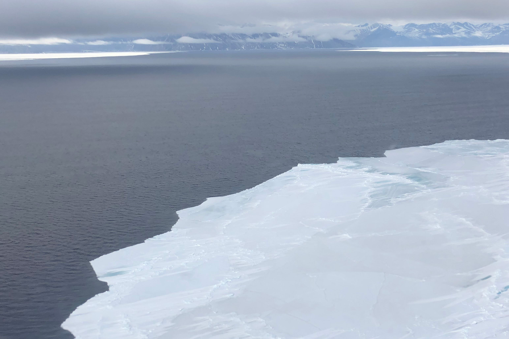
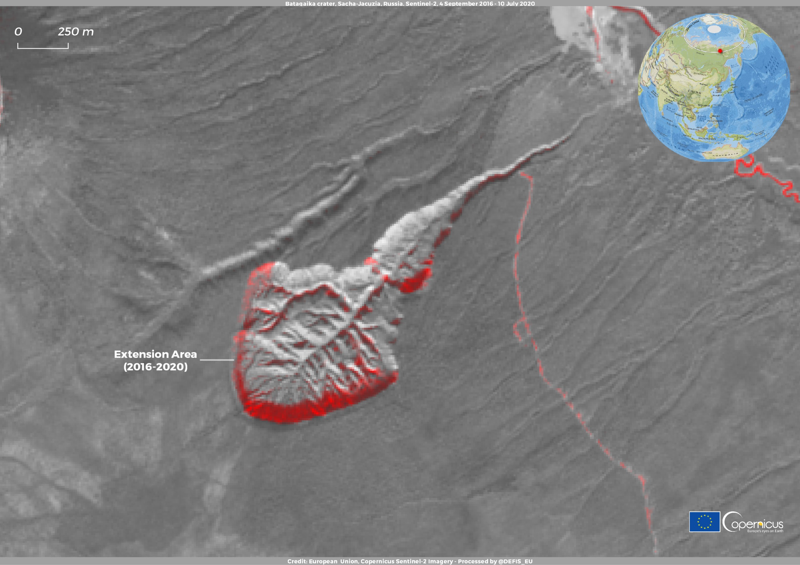
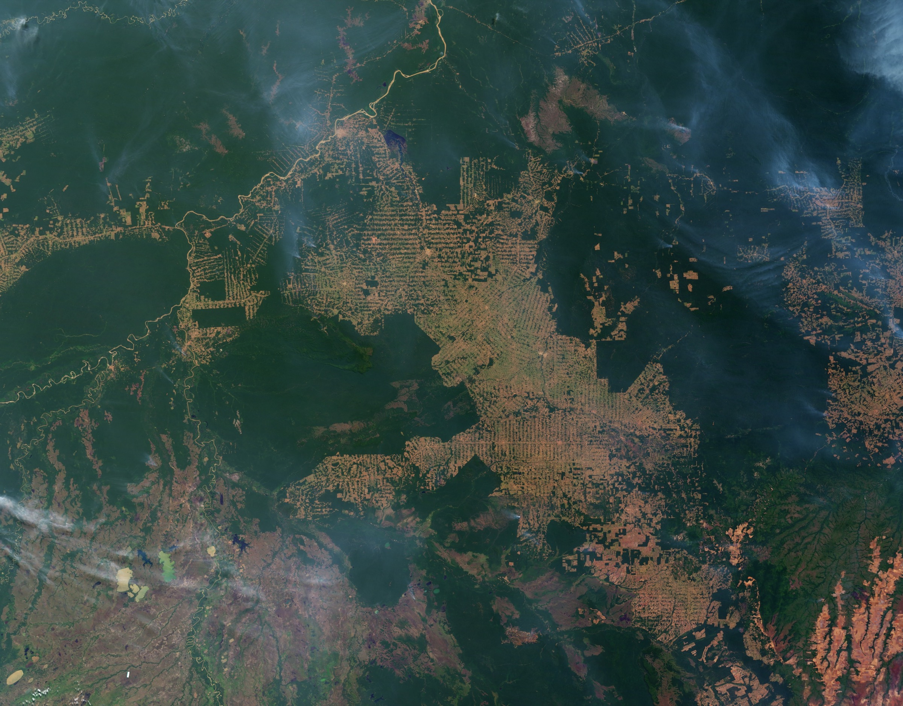
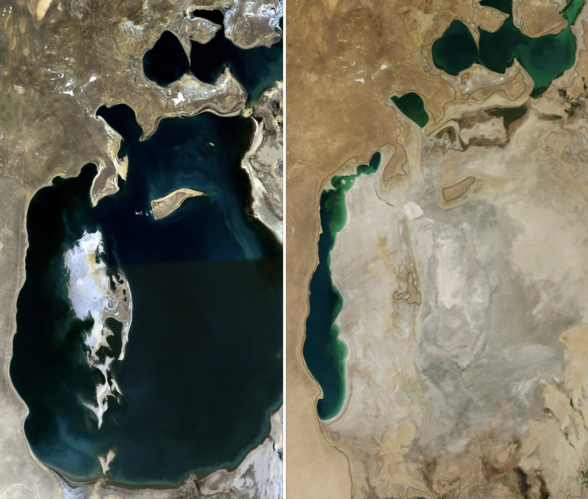

## Last Week, in One Slide

::: {style="font-size: 1.3em; line-height: 1.6;"}
- **Responsibility asymmetry:** the people who suffer most from climate change did the least to cause it — the Carteret Islanders, the families arriving in Dhaka's slums.
- **The sponge model fails.** Absorbing people without integrating them is warehousing, not rescue.
- **System boundaries decide the answer.** Draw the line around the refugee and it's a shelter problem. Draw it around the system and it's a responsibility problem.
- **The Tai Po question:** are the people displaced by the fire climate refugees? Where you drew that line said a lot about your frame.
:::

::: {style="font-size: 1.3em; margin-top: 30px; font-weight: bold; color: #8e44ad;"}
Asymmetry means the system is entangled. Pull one thread, **everything moves.** Today: how it moves.
:::

::: {style="font-size: 0.95em; color: #7f8c8d; margin-top: 24px;"}
Last week's challenge: the Invisible Bandwagon — a local, specific "everyone here already does this." Who tried it?
:::

::: {.notes}
One minute. The bridge is the last bold line: Week 9 showed who gets hurt; Week 10 shows the mechanism that carries the damage from one place, or one decision, to the next.
:::

## {background-color="#000000"}

::: {.w10-big}
£144
:::

::: {.w10-kicker}
One farmer. A thousand acres. A full year of work, and every machine he could buy.

**This is what was left.**
:::

::: {.w10-hero-cap style="color: #9a9a9a; font-size: 1em; margin-top: 40px;"}
Hold that number. We'll come back to it.
:::

::: {.notes}
Don't explain yet. This is the cliffhanger for today's strategy (#9, the Cliffhanger Return): open with an image or number, leave it unresolved, return to it transformed at the end. Students will see the technique used on them before they learn its name.
:::

## Quick Exercise: Find the Wolf

::: {style="font-size: 2em; text-align: center; padding: 50px; background: #145a32; color: white; border-radius: 15px;"}
What's **one thing** in Hong Kong that,

if you removed it, would change **everything else**?
:::

::: {style="font-size: 1.3em; margin-top: 30px; text-align: center;"}
*Shout them out. We'll test your answers against today's three shapes.*
:::

::: {.notes}
Likely answers: the MTR, Dongjiang water from Guangdong, food imports, the harbour, air-conditioning, the airport. Keep the list on the board and come back to it after "Three Shapes of a Cascade".
:::

## {background-color="#0a3d62"}

::: {style="font-size: 2.3em; color: white; text-align: center; line-height: 1.35;"}
Change one thing,

and **everything else changes with it.**
:::

::: {.fragment style="font-size: 1.45em; color: #ffb3a7; text-align: center; line-height: 1.45; margin-top: 30px;"}
Some of those changes you can undo. Some you can't. Today is about telling them apart.
:::

::: {style="font-size: 0.8em; color: #a9cce3; text-align: center; margin-top: 50px;"}
1 What is a cascade · 2 One farm · 3 Loops · 4 Tipping points · 5 Fixes that cascade · 6 Debate
:::

# Part 1 · What Is a Cascade? {background-color="#0a3d62"}

[One change knocks over the next — and the next.]{.w10-sub}

## See It: How Wolves Change Rivers



::: {.w10-src style="text-align: center;"}
Sustainable Human (~4.5 min), narrated by George Monbiot. The most famous cascade story there is — and, as we'll see, a slightly too-good one.
:::

## One Image. One Chain.

```{=html}
<div class="w10-chain">
  <div class="step"><b>Wolves return</b>Reintroduced to Yellowstone in 1995–96, after 70 years away</div>
  <div class="to fragment" data-fragment-index="1">→</div>
  <div class="step fragment" data-fragment-index="1"><b>Elk change</b>Fewer elk, and they avoid open valleys and riverbanks</div>
  <div class="to fragment" data-fragment-index="2">→</div>
  <div class="step fragment" data-fragment-index="2"><b>Trees return</b>Willow and aspen get a chance to grow back</div>
  <div class="to fragment" data-fragment-index="3">→</div>
  <div class="step fragment" data-fragment-index="3"><b>Banks hold</b>Roots stabilise the soil; beavers and birds come back</div>
  <div class="to fragment" data-fragment-index="4">→</div>
  <div class="step fragment" data-fragment-index="4"><b>Rivers shift</b>Less erosion, narrower channels, more pools</div>
</div>
```

::: {.fragment fragment-index="5" .w10-punch style="text-align: center;"}
Ecologists call this a **trophic cascade**: a change at the top of the food chain ripples all the way down to the landscape.
:::

## How Sure Are We? [Debated]{.w10-tag .debated}

::: {style="font-size: 1.25em; line-height: 1.6;"}
- **Settled:** wolves came back, elk numbers fell, and some willow and aspen recovered. A cascade happened.
- **Debated:** how much was the wolves. Elk were also hunted by people, bears and cougars, and hit by drought.
- **The rivers:** on many streams the willows stayed short. With the beavers gone, channels had cut down so far that the water table dropped out of the roots' reach. Wolves alone couldn't undo that.
:::

::: {.w10-punch}
The cascade is real. "Wolves moved the rivers" is the spectacle version. Both are useful — just know which one you're telling.
:::

::: {.w10-src}
Ripple & Beschta (2012), *Biological Conservation* · Marshall, Hobbs & Cooper (2013), "Stream hydrology limits recovery of riparian ecosystems after wolf reintroduction", *Proc. R. Soc. B* · Hobbs et al. (2024), *Ecological Monographs*
:::

::: {.notes}
This is the Week 7 and Week 8 thread again: an accurate story can still be over-told. The video isn't lying, it is choosing the strongest link and skipping the arguments. Students should be able to tell the spectacle version and the honest version, and choose deliberately.
:::

## Three Shapes of a Cascade

```{=html}
<div class="w10-cards" style="grid-template-columns: repeat(3, 1fr);">
  <div class="w10-card" style="background:#145a32; color:#fff;"><div class="k">Shape 1</div><div class="h">The Chain</div>One change knocks over the next, like dominoes.<br><br><b>Wolves → elk → willows → riverbanks.</b><br><br>Today: <i>one farm in Oxfordshire.</i></div>
  <div class="w10-card" style="background:#78281f; color:#fff;"><div class="k">Shape 2</div><div class="h">The Loop</div>The effect feeds back into the cause, so each turn is bigger than the last.<br><br><b>Melt → dark water → heat → more melt.</b><br><br>Today: <i>sea ice and permafrost.</i></div>
  <div class="w10-card" style="background:#1a1a2e; color:#fff;"><div class="k">Shape 3</div><div class="h">The Cliff</div>Past a threshold, the system flips to a new state — and won't flip back.<br><br><b>Rainforest → savanna.</b><br><br>Today: <i>the Amazon, the ice sheets, the reefs.</i></div>
</div>
```

::: {.fragment .w10-punch style="text-align: center;"}
The scariest cascades use all three: a chain that feeds a loop that pushes a system off a cliff.
:::

::: {.notes}
Go back to the "find the wolf" list. Is the MTR a chain risk (one failure spreads)? Is air-conditioning a loop (Week 5: a hotter city runs more AC, which heats it more)? Is anything in HK a cliff?
:::

# Part 2 · A Cascade on One Farm {background-color="#145a32"}

[Clarkson's Farm, Season 1: the £144 year.]{.w10-sub style="color: #d5f5e3;"}

## Meet the Fix-It Farmer

:::: {.columns}
::: {.column width="52%"}
::: {style="font-size: 1.15em; line-height: 1.55;"}
- **Jeremy Clarkson** — two decades as the face of *Top Gear*, and for most of it a loud mocker of climate concern
- In 2019 he decides to farm his own **~1,000 acres** in Oxfordshire himself — Diddly Squat Farm — with the cameras rolling
- His instinct is the PRO-DEVELOPMENT instinct: **find the problem, buy the fix.** Bigger machines. More effort. More money.
- First fix: a **Lamborghini tractor** — too big for some of his own gates
:::
:::

::: {.column width="48%"}
```{=html}
<div class="w10-tiles" style="grid-template-columns: 1fr 1fr; gap: 22px;">
  <div class="w10-tile" style="background:#145a32;"><b style="color:#abebc6;">~1,000</b><span>acres of Cotswold farmland</span></div>
  <div class="w10-tile" style="background:#145a32;"><b style="color:#abebc6;">1</b><span>Lamborghini tractor</span></div>
  <div class="w10-tile" style="background:#145a32;"><b style="color:#abebc6;">1</b><span>farming year, autumn 2019 to autumn 2020</span></div>
  <div class="w10-tile" style="background:#c0392b;"><b style="color:#fff;">£144</b><span>profit at the end of it</span></div>
</div>
```
:::
::::

::: {.w10-src}
*Clarkson's Farm*, Season 1 (Amazon Prime Video, 2021); the year's accounts are read out in the final episode
:::

::: {.notes}
Some students won't know the show; one sentence is enough: a famous petrolhead tries to farm, badly, on camera. It works here because his intent is unmistakable. He spends, he works, he cares about the outcome. The point is not that he's incompetent (he is, at first). The point is how many links in the chain he never controlled.
:::

## How the Bill Shrank to £144

```{=html}
<div class="w10-steps">
  <div class="n">1</div><div class="txt"><b>A very wet autumn.</b> Fields too waterlogged to plant winter crops on time. Some land goes unplanted until spring.</div><div class="when">Autumn 2019</div>
  <div class="n fragment" data-fragment-index="1">2</div><div class="txt fragment" data-fragment-index="1"><b>The wettest February on record</b> for the UK. More delay; switch to spring crops, which yield less.</div><div class="when fragment" data-fragment-index="1">Feb 2020 <span class="w10-tag settled">Met Office</span></div>
  <div class="n fragment" data-fragment-index="2">3</div><div class="txt fragment" data-fragment-index="2"><b>Then the opposite.</b> The UK's sunniest spring on record, and England's driest May. The late-sown crops go thirsty.</div><div class="when fragment" data-fragment-index="2">Spring 2020 <span class="w10-tag settled">Met Office</span></div>
  <div class="n fragment" data-fragment-index="3">4</div><div class="txt fragment" data-fragment-index="3"><b>Poor yields — everywhere.</b> It wasn't just him: England's wheat harvest fell by about 40%, the smallest since the 1980s.</div><div class="when fragment" data-fragment-index="3">Harvest 2020 <span class="w10-tag settled">Defra</span></div>
  <div class="n fragment" data-fragment-index="4">5</div><div class="txt fragment" data-fragment-index="4"><b>Meanwhile, the costs never stopped:</b> machinery, seed, fuel, sprays, wages, a pandemic lockdown mid-season.</div><div class="when fragment" data-fragment-index="4">All year</div>
  <div class="n hot fragment" data-fragment-index="5">=</div><div class="txt hot fragment" data-fragment-index="5"><b>£144.</b> Every link was survivable on its own. Together, they ate the year.</div><div class="when fragment" data-fragment-index="5"></div>
</div>
```

::: {.w10-src}
Met Office UK climate summaries: February 2020, Spring 2020, May 2020 · Defra, *Cereal and oilseed production in the UK*, final 2020 results (England wheat ≈ 8.9 million tonnes, down ≈ 40% on 2019)
:::

::: {.notes}
The UK figure: wheat production fell from about 16.2 million tonnes in 2019 to about 9.7 million in 2020, the lowest since 1981. Ask: which link could money have fixed? Machinery fixes the wrong problem when the field is underwater.
:::

## What He Controlled vs. What Controlled Him

```{=html}
<div class="w10-ctrl">
  <div style="background:#eaf2f8; color:#2c3e50;"><div class="k">His inputs</div><div class="h" style="color:#1f618d;">What he could spend on</div>
    <ul><li>The tractor, the kit, the sprayer</li><li>Seed, fertiliser, fuel</li><li>Labour — and his own long days</li><li>Advice from his land agent</li><li>A farm shop to sell direct</li></ul></div>
  <div class="fragment" style="background:#145a32; color:#fff;"><div class="k">The system</div><div class="h" style="color:#abebc6;">What he couldn't</div>
    <ul><li>When it rained — and when it stopped</li><li>What the soil could take that week</li><li>World grain prices</li><li>Subsidy rules and planning law</li><li>A pandemic</li></ul></div>
</div>
```

::: {.fragment .w10-punch style="text-align: center;"}
He could spend on every part of the farm except the system it sat in.
:::

::: {.notes}
This is this week's debate in one slide. PRO-DEVELOPMENT says: fix what's broken, one thing at a time. That works when the broken thing is the left-hand column. Cascades live in the right-hand column.
:::

## How Sure Are We?

::: {style="font-size: 1.25em; line-height: 1.6;"}
- [Settled]{.w10-tag .settled} The 2019–20 weather was extreme: record wet, then record dry and sunny — in the same farming year.
- [Emerging]{.w10-tag .emerging} Wetter winters and hotter, drier summers are what UK climate projections expect more of. Each extreme season is **consistent with** climate change; attributing one year needs a dedicated study.
- [Debated]{.w10-tag .debated} How much of the £144 was weather, and how much was a first-time farmer with a Lamborghini? **Plenty of it was Jeremy.**
:::

::: {.w10-punch}
Honest version: a cascade doesn't need climate change to start. Climate change loads the dice at every link.
:::

::: {.w10-src}
Met Office, *UK Climate Projections* (UKCP18) · Kendon et al., *State of the UK Climate* (annual, *International Journal of Climatology*)
:::

::: {.notes}
Don't let either side cheat here. Pro-climate students will want "climate change cost him his harvest". Pro-development students will want "he was just bad at farming". Both are partly true; the honest claim is about loaded dice.
:::

## Then the Policy Cascade

```{=html}
<div class="w10-cards" style="grid-template-columns: repeat(3, 1fr);">
  <div class="w10-card" style="background:#1f618d; color:#fff;"><div class="k">Subsidies</div><div class="h">Paid per acre → paid for nature</div>England is phasing out its EU-era subsidy, paid simply for farming land, between 2021 and 2027. In its place: payments for soil, hedges, water and wildlife.</div>
  <div class="w10-card" style="background:#78281f; color:#fff;"><div class="k">Costs</div><div class="h">Gas → fertiliser → food</div>Nitrogen fertiliser is made from natural gas. When gas prices spiked in 2021–22, UK fertiliser prices roughly tripled.</div>
  <div class="w10-card" style="background:#2c3e50; color:#fff;"><div class="k">Politics</div><div class="h">From the field to Whitehall</div>November 2024: Clarkson speaks at a farmers' rally in London against new inheritance tax rules on farmland.</div>
</div>
```

::: {.fragment .w10-punch style="text-align: center;"}
A war in Ukraine shows up on a field in Oxfordshire. That's a cascade too.
:::

::: {.w10-src}
Defra, *Agricultural Transition Plan* (2020) · AHDB fertiliser price series, 2021–2022 · BBC News, 19 November 2024
:::

::: {.notes}
Later seasons of the show follow these threads: subsidy changes, a refused planning application for a restaurant, rising input costs. The man who mocked climate concern now lives inside every link of the chain. Students can make up their own minds whether his views changed; the cascade doesn't care.
:::

## Now Zoom Out to Hong Kong

```{=html}
<div class="w10-tiles" style="grid-template-columns: repeat(3, 1fr);">
  <div class="w10-tile" style="background:#145a32;"><b style="color:#abebc6;">90%+</b><span>of Hong Kong's food is imported</span></div>
  <div class="w10-tile" style="background:#145a32;"><b style="color:#abebc6;">~40%</b><span>fall in England's wheat harvest in one bad year</span></div>
  <div class="w10-tile" style="background:#c0392b;"><b style="color:#fff;">You</b><span>pay for someone else's £144 year — at the supermarket</span></div>
</div>
```

::: {.fragment .w10-punch style="text-align: center;"}
Hong Kong has almost no farms. It still lives downstream of every farm it buys from.
:::

::: {.w10-src}
HKSAR Government, Agriculture, Fisheries and Conservation Department; Legislative Council Secretariat research briefs on food supply
:::

::: {.notes}
Engagement prompt: "What's your £144? A project where you controlled every input and still lost to the system." Then: "Hong Kong's food comes from farms in Guangdong, Thailand, Brazil, Australia. Which of their weather systems are you exposed to?"
:::

# Part 3 · Loops That Feed Themselves {background-color="#78281f"}

[What happens when the effect becomes the cause?]{.w10-sub style="color: #f5d5d0;"}

## {background-color="#000000"}

{.r-stretch}

::: {.w10-hero-cap}
White reflects. Dark absorbs. Once the ice goes, the warming speeds up.
:::

::: {.w10-hero-credit}
Arctic sea ice and open water
:::

## The Ice–Albedo Loop [Settled]{.w10-tag .settled}

```{=html}
<div class="w10-loop">
  <div class="node"><b>The Arctic warms</b>about four times faster than the planet as a whole</div>
  <div class="arr fragment" data-fragment-index="1">→</div>
  <div class="node fragment" data-fragment-index="1"><b>Sea ice melts</b>bright ice reflects most of the sunlight that hits it</div>
  <div class="arr fragment" data-fragment-index="4">↑</div>
  <div class="hub fragment" data-fragment-index="4">Each turn of the loop<br>makes the next one worse</div>
  <div class="arr fragment" data-fragment-index="2">↓</div>
  <div class="node hot fragment" data-fragment-index="3"><b>More heat absorbed</b>the water warms, and so does the air</div>
  <div class="arr fragment" data-fragment-index="3">←</div>
  <div class="node hot fragment" data-fragment-index="2"><b>Dark ocean exposed</b>open water reflects only about 6%</div>
</div>
```

::: {.fragment fragment-index="5" style="font-size: 1.1em; text-align: center; margin-top: 24px;"}
Same shape as Week 8's ocean sink: a **positive feedback** — positive as in *self-reinforcing*, not good.
:::

::: {.w10-src}
Rantanen et al. (2022), *Communications Earth & Environment*: Arctic warming ≈ 4× the global rate since 1979 · Albedo: bare sea ice ≈ 0.5–0.7, fresh snow up to ≈ 0.9, open ocean ≈ 0.06 (NSIDC)
:::

## {background-color="#000000"}

{.r-stretch}

::: {.w10-hero-cap}
This is what happens when the ground itself starts to melt.
:::

::: {.w10-hero-credit}
The Batagaika megaslump, Sakha Republic, Siberia — the world's largest permafrost thaw slump, still growing
:::

## Permafrost: The Numbers

```{=html}
<div class="w10-tiles">
  <div class="w10-tile" style="background:#78281f;"><b style="color:#f5b7b1;">~1,500</b><span>billion tonnes of carbon in northern permafrost soils</span></div>
  <div class="w10-tile" style="background:#78281f;"><b style="color:#f5b7b1;">~2×</b><span>the carbon already in the atmosphere</span></div>
  <div class="w10-tile" style="background:#78281f;"><b style="color:#f5b7b1;">~80×</b><span>methane's warming power vs. CO₂ over 20 years (~30× over 100)</span></div>
  <div class="w10-tile" style="background:#78281f;"><b style="color:#f5b7b1;">24–69%</b><span>of near-surface permafrost could be lost by 2100, low vs. high emissions</span></div>
</div>
```

::: {.fragment .w10-punch style="text-align: center;"}
Thaw releases CO₂ and methane. More warming, more thaw. Another loop.
:::

::: {.w10-src}
Schuur et al. (2015), *Nature* 520, 171 · IPCC AR6 WG1 (2021), Table 7.15 (methane GWP) · IPCC *Special Report on the Ocean and Cryosphere* (2019)
:::

::: {.notes}
Corrections from the old deck: methane is about 80× CO₂ over 20 years and about 30× over 100 years (AR6), not "25×", which is the older AR4 number. The Arctic is warming about four times as fast as the globe, not twice.
:::

## Bomb or Leak?

```{=html}
<div class="w10-rows">
  <div class="eng" style="background:#78281f;">Thawing<small>is it happening?</small></div>
  <div>Yes. Permafrost is warming across the Arctic and releasing carbon as it thaws.</div>
  <div><span class="w10-tag settled">Settled</span></div>
  <div class="eng" style="background:#78281f;">Abrupt thaw<small>collapses and lakes</small></div>
  <div>Slumps like Batagaika and new thaw lakes release carbon faster than gradual thaw — and models mostly leave them out.</div>
  <div><span class="w10-tag emerging">Emerging</span></div>
  <div class="eng" style="background:#78281f;">"Methane bomb"<small>a sudden burst?</small></div>
  <div>The IPCC expects a gradual release — tens to hundreds of billions of tonnes of carbon this century — not a single explosion.</div>
  <div><span class="w10-tag debated">Debated</span></div>
</div>
```

::: {.w10-punch style="text-align: center;"}
A slow leak you can't turn off is still a one-way door.
:::

::: {.w10-src}
IPCC AR6 WG1 (2021), Ch. 5 · Turetsky et al. (2020), "Carbon release through abrupt permafrost thaw", *Nature Geoscience*
:::

## See It: The Methane Beneath the Ice



::: {.w10-src style="text-align: center;"}
BBC Earth (~5 min). Scientists set frozen methane bubbles alight on an Arctic lake.
:::

::: {.notes}
Engagement prompt: "Permafrost holds about twice the carbon in the atmosphere. If you can't switch a loop off, what does a 'climate target' even mean?"
:::

# Part 4 · Tipping Points: The Cliff {background-color="#1a1a2e"}

[The moment a system shifts — and can't shift back.]{.w10-sub style="color: #d6dbdf;"}

## {background-color="#000000"}

{.r-stretch}

::: {.w10-hero-cap}
No one decided to destroy the Amazon. Everyone just followed the incentives.
:::

::: {.w10-hero-credit}
Deforestation on the Amazon frontier, Rondônia, Brazil (NASA)
:::

## The Amazon Makes Its Own Rain

```{=html}
<div class="w10-chain">
  <div class="step"><b>Clear forest</b>For cattle, soy and roads</div>
  <div class="to fragment" data-fragment-index="1">→</div>
  <div class="step fragment" data-fragment-index="1"><b>Less rain recycled</b>Trees return up to half the region's rain to the air</div>
  <div class="to fragment" data-fragment-index="2">→</div>
  <div class="step fragment" data-fragment-index="2"><b>Longer dry seasons</b>The remaining forest dries out</div>
  <div class="to fragment" data-fragment-index="3">→</div>
  <div class="step fragment" data-fragment-index="3"><b>More fire</b>Drought and fire kill more trees</div>
  <div class="to fragment" data-fragment-index="4">→</div>
  <div class="step fragment" data-fragment-index="4" style="background:#1a1a2e; color:#fff;"><b style="color:#f5b041;">Savanna?</b>A drier, carbon-poor state that doesn't easily return</div>
</div>
```

::: {style="font-size: 1.15em; line-height: 1.55; margin-top: 30px;"}
- About **17%** of the Amazon has already been cleared [Settled]{.w10-tag .settled}
- A tipping threshold of **20–25%** clearance has been proposed [Debated]{.w10-tag .debated}
- By 2050, **10–47%** of the forest may face stresses that could tip it into a new state [Emerging]{.w10-tag .emerging}
:::

::: {.w10-src}
Lovejoy & Nobre (2018), *Science Advances* · Flores et al. (2024), "Critical transitions in the Amazon forest system", *Nature* 626, 555
:::

## Where Are the Cliffs?

```{=html}
<div class="w10-tp">
  <div class="row"><div class="lab">Greenland ice sheet<small>collapse · ~7 m sea-level rise</small></div><div class="track"><div class="rng" style="left:10%; width:27.5%; background:#1f618d;"></div><div class="dot" style="left:18.75%; background:#1f618d;"></div><div class="now" style="left:17.5%;"></div></div></div>
  <div class="row"><div class="lab">West Antarctic ice sheet<small>collapse · ~3 m of sea-level rise</small></div><div class="track"><div class="rng" style="left:12.5%; width:25%; background:#1f618d;"></div><div class="dot" style="left:18.75%; background:#1f618d;"></div><div class="now" style="left:17.5%;"></div></div></div>
  <div class="row"><div class="lab">Warm-water coral reefs<small>die-off</small></div><div class="track"><div class="rng" style="left:12.5%; width:12.5%; background:#c0392b;"></div><div class="dot" style="left:18.75%; background:#c0392b;"></div><div class="now" style="left:17.5%;"></div></div></div>
  <div class="row"><div class="lab">Boreal permafrost<small>abrupt thaw</small></div><div class="track"><div class="rng" style="left:12.5%; width:16.25%; background:#78281f;"></div><div class="dot" style="left:18.75%; background:#78281f;"></div><div class="now" style="left:17.5%;"></div></div></div>
  <div class="row"><div class="lab">Amazon rainforest<small>dieback (from warming alone)</small></div><div class="track"><div class="rng" style="left:25%; width:50%; background:#145a32;"></div><div class="dot" style="left:43.75%; background:#145a32;"></div><div class="now" style="left:17.5%;"></div></div></div>
  <div class="row"><div class="lab">Atlantic overturning (AMOC)<small>collapse</small></div><div class="track"><div class="rng" style="left:17.5%; width:82.5%; background:#7d3c98;"></div><div class="dot" style="left:50%; background:#7d3c98;"></div><div class="now" style="left:17.5%;"></div></div></div>
  <div class="row" style="margin-top:4px;"><div class="lab"></div><div class="axis"><span style="left:0%">0°C</span><span style="left:12.5%">1°C</span><span class="nowlab" style="left:17.5%; top:22px;">today ≈ 1.4°C</span><span style="left:25%">2°C</span><span style="left:37.5%">3°C</span><span style="left:50%">4°C</span><span style="left:62.5%">5°C</span><span style="left:75%">6°C</span><span style="left:87.5%">7°C</span><span style="left:100%">8°C</span></div></div>
</div>
```

::: {style="font-size: 0.85em; text-align: center; margin-top: 8px;"}
Dot = best estimate · bar = likely range of warming above pre-industrial · line = where we are now
:::

::: {.fragment .w10-punch style="text-align: center;"}
Four of these six have their best estimate at about 1.5°C. We're at the edge of their ranges already.
:::

::: {.w10-src}
Armstrong McKay et al. (2022), "Exceeding 1.5°C global warming could trigger multiple climate tipping points", *Science* 377 · WMO, *State of the Global Climate 2024*: long-term warming ≈ 1.3–1.4°C; 2024 alone ≈ 1.55°C
:::

::: {.notes}
Read the chart carefully with students: a threshold range that starts below today's line means we may already be inside it. The AMOC range is extremely wide (1.4–8°C), which is itself the honest message: we don't know. The Amazon's warming threshold is separate from the deforestation threshold on the previous slide; the two stresses add together.
:::

## The First Cliff We May Have Crossed [New evidence]{.w10-tag .newev}

::: {style="font-size: 1.3em; line-height: 1.6;"}
- Since 2023, the **fourth global coral bleaching event** has hit about **84%** of the world's reef area — the largest on record.
- In October 2025, the *Global Tipping Points Report* concluded that warm-water coral reefs have **likely passed their tipping point.**
- Some reefs will survive in cooler pockets. But for most, "recovery" now means a different, poorer reef.
:::

::: {.w10-punch}
We used to talk about tipping points as a future risk. One may already be behind us.
:::

::: {.w10-src}
NOAA Coral Reef Watch & International Coral Reef Initiative (April 2025) · Lenton et al., *Global Tipping Points Report 2025* (University of Exeter)
:::

## One Cliff Can Push the Next [Emerging]{.w10-tag .emerging}

```{=html}
<div class="w10-chain">
  <div class="step"><b>Greenland melts</b>Fresh water pours into the North Atlantic</div>
  <div class="to fragment" data-fragment-index="1">→</div>
  <div class="step fragment" data-fragment-index="1"><b>AMOC slows</b>Lighter fresh water sinks less, weakening the conveyor</div>
  <div class="to fragment" data-fragment-index="2">→</div>
  <div class="step fragment" data-fragment-index="2"><b>Rain belts shift</b>Tropical rainfall moves south</div>
  <div class="to fragment" data-fragment-index="3">→</div>
  <div class="step fragment" data-fragment-index="3"><b>Amazon dries</b>More stress on a forest already near its edge</div>
  <div class="to fragment" data-fragment-index="4">→</div>
  <div class="step fragment" data-fragment-index="4" style="background:#78281f; color:#fff;"><b style="color:#fff;">More warming</b>Carbon released, and the loop starts again</div>
</div>
```

::: {.fragment fragment-index="5" .w10-punch style="text-align: center;"}
Chain, loop, cliff — all three at once. Scientists call it a **tipping cascade**.
:::

::: {.w10-src}
Wunderling et al. (2021), "Interacting tipping elements increase risk of climate domino effects", *Earth System Dynamics* 12, 601
:::

## See It: Where We Stand on Tipping Points



::: {.w10-src style="text-align: center;"}
TED-Ed (~4 min). Is our climate headed for a mathematical tipping point?
:::

# Part 5 · The Fix That Cascades {background-color="#4a235a"}

[Every targeted fix is also the first domino of something else.]{.w10-sub style="color: #e8daef;"}

## {background-color="#000000"}

{.r-stretch}

::: {.w10-hero-cap}
They wanted cotton. They got a desert.
:::

::: {.w10-hero-credit}
The Aral Sea, 1989 vs. 2014 (NASA). Once the world's fourth-largest lake.
:::

## The Aral Sea: A Targeted Fix [Settled]{.w10-tag .settled}

```{=html}
<div class="w10-chain">
  <div class="step"><b>The fix</b>1960s: the USSR diverts the Amu Darya and Syr Darya rivers to irrigate cotton</div>
  <div class="to fragment" data-fragment-index="1">→</div>
  <div class="step fragment" data-fragment-index="1"><b>The sea shrinks</b>By the 2010s it has lost about 90% of its area</div>
  <div class="to fragment" data-fragment-index="2">→</div>
  <div class="step fragment" data-fragment-index="2"><b>Fishing dies</b>Port towns like Moʻynoq end up miles from the water</div>
  <div class="to fragment" data-fragment-index="3">→</div>
  <div class="step fragment" data-fragment-index="3"><b>Dust and climate</b>Salty, pesticide-laden dust storms; hotter summers, colder winters</div>
</div>
```

::: {.fragment fragment-index="4" style="font-size: 1.2em; line-height: 1.6; margin-top: 34px;"}
**PRO-DEVELOPMENT says:** "Hindsight is easy. They needed cotton." **PRO-CLIMATE says:** "They ignored the system. How many more Aral Seas?"
:::

::: {.w10-src}
Micklin (2007), "The Aral Sea disaster", *Annual Review of Earth and Planetary Sciences* 35 · NASA Earth Observatory
:::

## {background-color="#000000"}

:::: {.columns}
::: {.column width="36%"}
::: {style="text-align: center;"}
{width="90%"}
:::

::: {.w10-hero-credit}
Rachel Carson, c. 1940
:::
:::

::: {.column width="64%"}
::: {style="font-size: 1.25em; line-height: 1.65; color: white;"}
In 1962, Rachel Carson published **Silent Spring**: pesticides like DDT didn't stay on the crops. They cascaded up the food chain — into fish, into birds' eggs, into us.

The chemical industry ran **the Doubt Machine** against her. She was called hysterical and unscientific.

**She was right.** The US banned DDT for farm use in 1972.

[*A targeted fix for insects. A cascade through everything that ate them.*]{style="color: #f5b041;"}
:::
:::
::::

## Geoengineering: The Ultimate Targeted Fix

```{=html}
<div class="w10-cards" style="grid-template-columns: 1fr 1fr;">
  <div class="w10-card" style="background:#1f618d; color:#fff;"><div class="k">Treat the cause</div><div class="h">Carbon removal &amp; storage</div>Pull CO₂ out and bury it. Norway's Sleipner project has stored about a million tonnes a year since 1996. The catch: all novel removal today is a rounding error next to our emissions (Week 8).</div>
  <div class="w10-card" style="background:#4a235a; color:#fff;"><div class="k">Treat the symptom</div><div class="h">Solar radiation management</div>Reflect sunlight with particles high in the atmosphere. Fast and cheap. The catch: it doesn't stop acidification, and if it ever stops, the warming it masked comes back fast — "termination shock".</div>
</div>
```

::: {style="font-size: 1.15em; line-height: 1.55; margin-top: 30px;"}
- Could solar geoengineering shift monsoon rainfall? Models disagree. [Debated]{.w10-tag .debated}
- Does the promise of a fix slow down emissions cuts — the **moral hazard**? [Debated]{.w10-tag .debated}
:::

::: {.fragment .w10-punch style="text-align: center;"}
The Lamborghini tractor, at planetary scale: a powerful machine aimed at one link of the chain.
:::

::: {.w10-src}
Equinor, Sleipner CO₂ storage (since 1996) · National Academies (2021), *Reflecting Sunlight* · IPCC AR6 WG1 (2021), Ch. 4
:::

::: {.notes}
Geoengineering was last year's debate motion. It stays in the lecture as an example of a "fix that cascades", but the debate moves to farming, where students have just seen the cascade happen to one person.
:::

# Part 6 · The Debate {background-color="#0a3d62"}

[Pay farmers to grow food — or to protect the system that grows it?]{.w10-sub}

## Two Sides. Two Ways of Seeing.

::: {style="display: flex; justify-content: space-around; margin-top: 50px;"}
::: {style="text-align: center; width: 45%; background: #27ae60; color: white; padding: 50px; border-radius: 15px;"}
::: {style="font-size: 2.1em; font-weight: bold; white-space: nowrap;"}
PRO-CLIMATE
:::
::: {style="font-size: 1.3em; margin-top: 20px;"}
= Systems thinking

= "Protect the whole chain"
:::
::: {style="font-size: 0.95em; margin-top: 22px; opacity: 0.92;"}
Soil, water and hedges are the farm's defences against the next bad year
:::
:::

::: {style="text-align: center; width: 45%; background: #3498db; color: white; padding: 50px; border-radius: 15px;"}
::: {style="font-size: 2.1em; font-weight: bold; white-space: nowrap;"}
PRO-DEVELOPMENT
:::
::: {style="font-size: 1.3em; margin-top: 20px;"}
= Targeted solutions

= "Fix what's broken, one thing at a time"
:::
::: {style="font-size: 0.95em; margin-top: 22px; opacity: 0.92;"}
A farm's job is food. Grow less at home and you import it — and its emissions
:::
:::
:::

## The Core Tension

::: {style="font-size: 1.35em; line-height: 1.5;"}
| [PRO-CLIMATE]{style="color: #27ae60; font-weight: bold;"} | [PRO-DEVELOPMENT]{style="color: #3498db; font-weight: bold;"} |
|-------------|-----------------|
| [Pay]{style="color: #27ae60;"} for soil, water, hedges and wildlife | [Pay]{style="color: #3498db;"} for food — the thing we can't import our way out of |
| [Build]{style="color: #27ae60;"} resilience before the next £144 year | [Fix]{style="color: #3498db;"} the farmer's actual problem: prices, costs, cash flow |
| [Act]{style="color: #27ae60;"} on the precautionary principle | [Demand]{style="color: #3498db;"} proof that nature payments deliver |
| Everything affects everything | Solve one problem at a time |
:::

::: {style="font-size: 1.3em; text-align: center; margin-top: 30px; font-weight: bold;"}
Both are true. The debate is about **which comes first when they collide.**
:::

## Why This Motion?

::: {style="font-size: 1.3em; line-height: 1.8;"}
This debate connects three scales — and everything we covered today:
:::

::: {style="display: flex; justify-content: space-around; margin-top: 20px;"}
::: {style="text-align: left; width: 30%; background: #145a32; color: white; padding: 25px; border-radius: 10px;"}
::: {style="font-size: 1.2em; font-weight: bold;"}
One Farm
:::
::: {style="font-size: 1.05em; line-height: 1.5; margin-top: 10px;"}
Diddly Squat spent on every input and still made £144. **Would paying for soil and hedges have helped — or just paid him not to farm?**
:::
:::

::: {style="text-align: left; width: 30%; background: #2c3e50; color: white; padding: 25px; border-radius: 10px;"}
::: {style="font-size: 1.2em; font-weight: bold;"}
One Policy
:::
::: {style="font-size: 1.05em; line-height: 1.5; margin-top: 10px;"}
England is switching from paying farmers per acre to paying for nature, 2021–2027. Farmers protested across Europe in 2024. **It's a live experiment.**
:::
:::

::: {style="text-align: left; width: 30%; background: #78281f; color: white; padding: 25px; border-radius: 10px;"}
::: {style="font-size: 1.2em; font-weight: bold;"}
One City
:::
::: {style="font-size: 1.05em; line-height: 1.5; margin-top: 10px;"}
Hong Kong imports 90%+ of its food. **When rich countries grow less, who grows it instead — and whose forest is cleared to do it?**
:::
:::
:::

::: {.notes}
Why the motion changed: the old geoengineering motion asked students to argue about a technology nobody in the room will ever touch. This one turns the lecture's central case into a real policy choice that is being made right now, and it has a cascade on both sides: degraded soil and floods on one side, imported food and "leaked" deforestation on the other.
:::

## This Week's Debate Motion

::: {style="font-size: 1.8em; text-align: center; background: #2c3e50; color: white; padding: 50px; border-radius: 15px;"}
**"This house believes that governments should pay farmers to protect soil, water and climate rather than to maximise food production — even if it means growing less food at home."**
:::

::: {style="display: flex; justify-content: space-between; gap: 50px; margin-top: 36px; text-align: left;"}
::: {style="flex: 1; border-left: 10px solid #27ae60; padding: 4px 0 4px 26px; font-size: 1.1em; line-height: 1.5;"}
[PRO-CLIMATE]{style="color: #27ae60; font-weight: 800;"}\
The £144 year came from the system, not the tractor. Healthy soil holds water in a flood and in a drought. Pay for the chain, not just the harvest.
:::
::: {style="flex: 1; border-left: 10px solid #3498db; padding: 4px 0 4px 26px; font-size: 1.1em; line-height: 1.5;"}
[PRO-DEVELOPMENT]{style="color: #3498db; font-weight: 800;"}\
Grow less at home and someone else grows it — perhaps on cleared rainforest. Food security is a climate defence too. Fix farm incomes first.
:::
:::

::: {style="font-size: 1.05em; text-align: center; margin-top: 30px; color: #7f8c8d;"}
Trace the cascade on both sides. Label your evidence: [Settled]{.w10-tag .settled} [Emerging]{.w10-tag .emerging} [Debated]{.w10-tag .debated}
:::

# Role-Play: Who Gets Paid?

#

```{=html}
<style>
  #w10groupAssignment_container { text-align: center; margin-top: 20px; font-family: Arial, sans-serif; }
  #w10groupAssignment_startButton { font-size: 24px; padding: 15px 30px; cursor: pointer; background-color: #3498db; color: white; border: none; border-radius: 5px; transition: background-color 0.3s; }
  #w10groupAssignment_startButton:hover { background-color: #2980b9; }
  #w10groupAssignment_overlay { position: fixed; top: 0; left: 0; width: 100%; height: 100%; background-color: rgba(255,255,255,0.9); display: none; justify-content: center; align-items: center; z-index: 1000; }
  #w10groupAssignment_display { font-size: 36px; text-align: center; padding: 20px; max-width: 90%; max-height: 90%; overflow-y: auto; }
  #w10groupAssignment_display h2 { color: #2c3e50; font-size: 48px; margin-bottom: 30px; }
  #w10groupAssignment_display ul { list-style-type: none; padding: 0; }
  #w10groupAssignment_display li { margin: 20px 0; font-size: 36px; background-color: #ecf0f1; padding: 15px; border-radius: 10px; box-shadow: 0 2px 5px rgba(0,0,0,0.1); }
  #w10groupAssignment_closeButton { position: absolute; top: 20px; right: 20px; font-size: 24px; cursor: pointer; background-color: #e74c3c; color: white; border: none; border-radius: 5px; padding: 10px 20px; }
</style>
<div id="w10groupAssignment_container">
  <h1 style="font-size: 48px; color: #34495e;">Group Assignment Time!</h1>
  <button id="w10groupAssignment_startButton">Start the assignment</button>
</div>
<div id="w10groupAssignment_overlay">
  <div id="w10groupAssignment_display"></div>
  <button id="w10groupAssignment_closeButton">Close</button>
</div>
<script>
const W10GroupAssignment = {
  groups: ['Group One','Group Two','Group Three','Group Four','Group Five','Group Six'],
  vocations: ['Farmer (a Diddly Squat-sized farm)','Land Agent / Farm Banker','Agriculture Ministry Official','Soil and Wildlife Ecologist','Supermarket Buyer','Hong Kong Food Importer'],
  shuffleArray: function(a){for(let i=a.length-1;i>0;i--){const j=Math.floor(Math.random()*(i+1));[a[i],a[j]]=[a[j],a[i]];}return a;},
  createAssignment: function(){const s=this.shuffleArray([...this.vocations]);return this.groups.map((g,i)=>({group:g,vocation:s[i]}));},
  displayAssignment: function(){const a=this.createAssignment();let h='<h2>Random Group Assignments</h2><ul>';a.forEach(x=>{h+=`<li><strong>${x.group}:</strong> ${x.vocation}</li>`;});h+='</ul>';document.getElementById('w10groupAssignment_display').innerHTML=h;document.getElementById('w10groupAssignment_overlay').style.display='flex';},
  init: function(){document.getElementById('w10groupAssignment_startButton').addEventListener('click',()=>this.displayAssignment());document.getElementById('w10groupAssignment_closeButton').addEventListener('click',()=>{document.getElementById('w10groupAssignment_overlay').style.display='none';});}
};
W10GroupAssignment.init();
</script>
```

## Presentation Countdown

```{=html}
<style>
  #w10timer {
    font-size: 348px;
    font-weight: 700;
    font-variant-numeric: tabular-nums;
    line-height: 1.1;
    margin-bottom: 20px;
    transition: color 0.6s ease;
  }
  #w10timer.w10timer-flash { animation: w10timer-pop 0.6s ease; }
  @keyframes w10timer-pop {
    0%   { transform: scale(1); }
    40%  { transform: scale(1.06); }
    100% { transform: scale(1); }
  }
  #w10timer-label { font-size: 40px; color: #7f8c8d; margin-bottom: 30px; min-height: 1.4em; }
  .w10timer-btn { font-size: 24px; padding: 15px 30px; color: white; border: none; border-radius: 8px; cursor: pointer; margin: 0 5px; }
  .w10timer-btn:disabled { opacity: 0.6; cursor: default; }
  #w10start-button { background-color: #27ae60; }
  #w10pause-button { background-color: #f39c12; }
  #w10reset-button { background-color: #e74c3c; }
  #w10timer-legend { display: flex; justify-content: center; gap: 28px; margin-top: 36px; font-size: 26px; color: #2c3e50; }
  #w10timer-legend span { display: inline-flex; align-items: center; gap: 8px; }
  #w10timer-legend i { display: inline-block; width: 22px; height: 22px; border-radius: 50%; }
</style>

<div id="w10timer-container" style="text-align: center;">
  <div id="w10timer">05:00</div>
  <div id="w10timer-label"></div>
  <button id="w10start-button" class="w10timer-btn">Start 5:00</button>
  <button id="w10pause-button" class="w10timer-btn" disabled>Pause</button>
  <button id="w10reset-button" class="w10timer-btn">Reset</button>
  <div id="w10timer-legend"></div>
</div>

<script>
(function () {
  const TOTAL = 300; // 5 minutes
  // One colour per minute, as on countdown_colors.qmd:
  // 5:00–4:01 slate, 4:00–3:01 blue, 3:00–2:01 green, 2:00–1:01 orange, final minute red.
  const BAND_COLORS = ['#2c3e50', '#2980b9', '#27ae60', '#f39c12', '#e74c3c'];
  const DONE_COLOR = '#8e44ad'; // Time's up

  const timerEl = document.getElementById('w10timer');
  const labelEl = document.getElementById('w10timer-label');
  const startBtn = document.getElementById('w10start-button');
  const pauseBtn = document.getElementById('w10pause-button');
  const resetBtn = document.getElementById('w10reset-button');
  const legendEl = document.getElementById('w10timer-legend');

  let timeLeft = TOTAL;
  let deadline = 0;
  let interval = null;
  let currentBand = -1;

  BAND_COLORS.forEach((c, i) => {
    const s = document.createElement('span');
    s.innerHTML = '<i style="background:' + c + '"></i>' + (BAND_COLORS.length - i) + ' min';
    legendEl.appendChild(s);
  });

  // 300..241 -> 0, 240..181 -> 1, ..., 60..1 -> 4, 0 -> done
  function bandFor(sec) {
    return sec <= 0 ? BAND_COLORS.length : BAND_COLORS.length - Math.ceil(sec / 60);
  }

  function render(animate) {
    const m = Math.floor(timeLeft / 60);
    const s = timeLeft % 60;
    timerEl.textContent = String(m).padStart(2, '0') + ':' + String(s).padStart(2, '0');

    const band = bandFor(timeLeft);
    if (band === currentBand) return;
    currentBand = band;
    if (band >= BAND_COLORS.length) {
      timerEl.style.color = DONE_COLOR;
      labelEl.textContent = "Time's up!";
    } else {
      const minsLeft = BAND_COLORS.length - band;
      timerEl.style.color = BAND_COLORS[band];
      labelEl.textContent = minsLeft === 1 ? 'Final minute' : minsLeft + ' minutes left';
    }
    if (animate) {
      timerEl.classList.remove('w10timer-flash');
      void timerEl.offsetWidth; // restart the pop animation
      timerEl.classList.add('w10timer-flash');
    }
  }

  function stop() {
    clearInterval(interval);
    interval = null;
    pauseBtn.disabled = true;
  }

  function tick() {
    // Count down from a deadline so a slow or throttled tab cannot stretch the five minutes.
    timeLeft = Math.max(0, Math.ceil((deadline - Date.now()) / 1000));
    render(true);
    if (timeLeft <= 0) {
      stop();
      startBtn.disabled = true;
      startBtn.textContent = 'Done';
    }
  }

  startBtn.addEventListener('click', () => {
    if (interval || timeLeft <= 0) return;
    deadline = Date.now() + timeLeft * 1000;
    interval = setInterval(tick, 250);
    startBtn.disabled = true;
    startBtn.textContent = 'Running…';
    pauseBtn.disabled = false;
  });

  pauseBtn.addEventListener('click', () => {
    stop();
    startBtn.disabled = false;
    startBtn.textContent = 'Resume';
  });

  resetBtn.addEventListener('click', () => {
    stop();
    timeLeft = TOTAL;
    currentBand = -1;
    startBtn.disabled = false;
    startBtn.textContent = 'Start 5:00';
    render(false);
  });

  render(false);
})();
</script>
```

## The Debate

::: {style="font-size: 1.35em; line-height: 1.7;"}
You will take **stakeholder positions**: Farmer, Land Agent, Ministry Official, Ecologist, Supermarket Buyer, Hong Kong Food Importer — or whatever you see fit.

**Think in cascades:**

- **First order** — what does the policy do to one farm this year?
- **Second order** — what does that do to food prices, imports and the landscape?
- **Third order** — what cascades from *that*? Whose forest, whose river, whose plate?

The strongest teams won't just argue for or against. They'll **trace the chain** — and show where it breaks or where it holds.
:::

## Ground Rules

::: {style="font-size: 1.5em; line-height: 1.8;"}
- This is a [**safe space**]{style="color: #27ae60;"} for exploration and discussion. There are [**no wrong answers**]{style="color: #e74c3c;"}, only opportunities to learn.

- **Respect** and **open-mindedness** are our guiding principles. Every opinion shared contributes to collective learning.

- **Feedback** and **reflection** are encouraged. This is a chance to voice thoughts, ask questions, and grow from the experience.
:::

## Pro-Climate Talking Points

::: {style="font-size: 1.2em; line-height: 1.6;"}
**Pay for the chain, not just the harvest:**

- **The weather is getting wilder** — record wet then record dry in a single farming year, and UK projections expect more of both [Settled]{.w10-tag .settled}
- **Spending on inputs didn't save the £144 year** — the losses came from the links money couldn't buy
- **Healthy soil and hedges are flood and drought defences** — they hold water when it pours and keep it when it doesn't [Emerging]{.w10-tag .emerging}
- **Rachel Carson and the Aral Sea** — farming for maximum output, one link at a time, is how the worst cascades started
:::

## Pro-Development Talking Points

::: {style="font-size: 1.2em; line-height: 1.6;"}
**Feed people first — and fix farm incomes directly:**

- **Grow less here, grow more elsewhere** — lost output is replaced by imports, perhaps from cleared forest. Emissions "leak" abroad [Debated]{.w10-tag .debated}
- **Food security is climate security** — a city like Hong Kong, 90%+ imported, knows what a supply shock costs
- **Farmers' real problem is money** — fertiliser tripled, subsidies are shrinking, the bank wants paying. Fix that first
- **Proof first** — pay for nature schemes once they show measurable results, not before
:::

# This Week's Conceptual Takeaway

## Every Decision Is a Fork

::: {style="font-size: 1.3em; line-height: 1.6;"}
Before this week, "everything is connected" might have sounded like a bumper sticker. Now you know: you never just "fix" something — you switch the system onto a new path.
:::

::: {style="display: flex; justify-content: space-around; margin-top: 30px;"}
::: {style="text-align: left; width: 45%; background: #27ae60; color: white; padding: 30px; border-radius: 10px;"}
::: {style="font-size: 1.3em; font-weight: bold;"}
Reversible Forks
:::
::: {style="font-size: 1.05em; line-height: 1.6; margin-top: 10px;"}
- **A £144 year** — painful, but next year can be better
- **Wolves removed, then returned** — partial recovery. Not all of it.
- **Emissions cut deeply** — some systems stabilise. The path bends back, slowly.
:::
:::

::: {style="text-align: left; width: 45%; background: #c0392b; color: white; padding: 30px; border-radius: 10px;"}
::: {style="font-size: 1.3em; font-weight: bold;"}
One-Way Doors
:::
::: {style="font-size: 1.05em; line-height: 1.6; margin-top: 10px;"}
- **Topsoil washed away** — it takes centuries to rebuild
- **The Aral Sea** — that path doesn't exist anymore
- **Permafrost and reefs** — a leak you can't turn off; a cliff we may have passed
:::
:::
:::

## {background-color="#1a1a2e"}

::: {style="font-size: 2.2em; color: white; text-align: center; line-height: 1.6;"}
The tragedy of cascade effects:

we often don't know if a fork is reversible

[**until we've already walked through it.**]{style="color: #e74c3c;"}
:::

## Cascade Effects

::: {style="font-size: 1.2em; line-height: 1.55; background: #0a3d62; color: white; padding: 36px 40px; border-radius: 15px;"}
Now you have the three shapes — and the labels to keep them honest:

- **Chain:** wolves → elk → willows; wet autumn → late crops → dry spring → £144 [Settled]{.w10-tag .settled}
- **Loop:** ice → dark water → heat → less ice; thaw → carbon → warming → more thaw [Settled]{.w10-tag .settled}
- **Cliff:** coral reefs likely past their tipping point; the Amazon may be next [Emerging]{.w10-tag .emerging}
- **Fix that cascades:** cotton → a dead sea; DDT → silent springs; geoengineering → ? [Debated]{.w10-tag .debated}
:::

::: {style="font-size: 1.3em; margin-top: 26px; font-weight: bold; color: #8e44ad; text-align: center;"}
**Your portable takeaway:** Every climate decision is a fork. Some you can walk back. Some are one-way doors. The skill is knowing which is which — before you step through.
:::

## The Semester So Far

```{=html}
<div class="w10-map">
  <div class="wk"><small>WEEK 1</small>Spectacle Formula</div><div class="les">Fact + human story + stakes. Data alone doesn't persuade.</div>
  <div class="wk"><small>WEEK 2</small>Complexity</div><div class="les">Rarely one right answer — that's not a bug, it's the point.</div>
  <div class="wk"><small>WEEK 3</small>System Boundaries</div><div class="les">Where you draw the boundary changes the answer.</div>
  <div class="wk"><small>WEEK 4</small>Timing</div><div class="les">When energy flows matters as much as how much.</div>
  <div class="wk"><small>WEEK 5</small>Built Environment</div><div class="les">Buildings are climate decisions. Hot cities heat themselves.</div>
  <div class="wk"><small>WEEK 6</small>Structural Incentives</div><div class="les">Every player acts rationally — the outcome is catastrophic.</div>
  <div class="wk"><small>WEEK 7</small>The Doubt Machine</div><div class="les">Accurate, nuanced facts can still be arranged to mislead.</div>
  <div class="wk"><small>WEEK 8</small>Invisible Infrastructure</div><div class="les">The ocean sink is slowing — the climate can speed itself up.</div>
  <div class="wk last"><small>WEEK 9</small>Responsibility Asymmetry</div><div class="les last">The people who suffer most did the least to cause it.</div>
  <div class="wk now fragment" data-fragment-index="1"><small>WEEK 10</small>Cascade Effects</div><div class="les now fragment" data-fragment-index="1">Chains, loops and cliffs: some forks are one-way doors.</div>
</div>
<div class="w10-next">Still to come: Week 11 Perspective — the Overview Effect</div>
```

::: {.notes}
Two minutes. Ask: which of these lenses did you use in today's debate? Week 6 (structural incentives) and Week 9 (asymmetry) both show up in the Clarkson case: the incentive was to maximise output, and the cost of a bad year lands hardest on the smallest farms.
:::

## Two Threads That Run to Week 11

```{=html}
<div class="w10-thread p">
  <div class="t">1 · Accurate facts can still mislead</div>
  <div class="w10-chain">
    <div class="step"><b>Week 7</b>Correct, nuanced details arranged to manufacture doubt</div>
    <div class="to">→</div>
    <div class="step"><b>Week 8</b>Label every claim: settled, emerging or debated</div>
    <div class="to">→</div>
    <div class="step today"><b>Today</b>"Wolves moved the rivers" — true-ish, and over-told</div>
    <div class="to">→</div>
    <div class="step"><b>Week 11</b>No framing is neutral — not even yours</div>
  </div>
</div>
<div class="w10-thread r fragment" data-fragment-index="1">
  <div class="t">2 · The climate can speed itself up</div>
  <div class="w10-chain">
    <div class="step"><b>Week 5</b>A hotter city runs more air-con, which makes it hotter</div>
    <div class="to">→</div>
    <div class="step"><b>Week 8</b>A warmer ocean absorbs less CO₂, which warms it more</div>
    <div class="to">→</div>
    <div class="step today"><b>Today</b>Chains, loops, cliffs — and a cliff we may have passed</div>
    <div class="to">→</div>
    <div class="step"><b>Week 11</b>A cascade in orbit: space debris</div>
  </div>
</div>
```

::: {.notes}
Week 11 picks up both threads: the Kessler cascade of space debris (a chain and a loop in orbit), and Strategy #10, the reminder that your own framing is never neutral.
:::

# The Persuasion Playbook | Strategy #9

## The Cliffhanger Return

::: {style="font-size: 1.6em; background: #2c3e50; color: white; padding: 40px; border-radius: 10px;"}
Every TV episode ends mid-scene.

Not at resolution — at **maximum tension**.

*Breaking Bad* ended seasons on unresolved gunshots and half-spoken sentences.

**Because you will come back to close the loop.**
:::

## The Science

::: {style="font-size: 1.4em; line-height: 1.8;"}
The **Zeigarnik Effect** — we remember unfinished tasks better than finished ones — now applied to structure.

The twist: **anticipation is often more pleasurable than completion itself.** Dopamine rises in anticipation of a reward, not only when it arrives.

Open strong. Leave it open. Return at the end — **transformed**.
:::

## You Just Saw It

::: {style="font-size: 1.5em; line-height: 1.7;"}
We opened with a number and walked away from it: **£144.**

By the time we came back, it had changed meaning. It started as a joke about a celebrity farmer. Now it's a weather record, a harvest statistic, a fertiliser price, a policy fight — and your grocery bill.

**Same number. You see it differently.** That's the return.
:::

## {background-color="#000000"}

::: {.w10-big}
£144
:::

::: {.w10-kicker}
It was never a farming bill.

**It was the system's invoice.**
:::

::: {.notes}
The bookend. Pause on it. Then name the trick: you just experienced the Cliffhanger Return.
:::

## Next Week's Challenge

::: {style="font-size: 2em; background: #e74c3c; color: white; padding: 40px; border-radius: 10px; text-align: center;"}
**Your last line should echo your first — transformed.**

The bookend is the memory anchor.
:::

## Next Week: The Overview Effect

::: {style="font-size: 1.45em; line-height: 1.7; background: #2c3e50; color: white; padding: 40px; border-radius: 15px;"}
Next week is the last. We zoom out — all the way out.

Astronauts who see Earth from space report a cognitive shift. Borders disappear. The atmosphere looks impossibly thin. **The whole system is visible at once.**

You'll need everything you've learned to get there.
:::

## Further Reading and Sources

::: {style="font-size: 0.6em; line-height: 1.45; column-count: 2; column-gap: 70px; text-align: left;"}
*Clarkson's Farm*, Season 1 (Amazon Prime Video, 2021). Met Office UK climate summaries: February 2020; Spring 2020; May 2020. Defra (2020). *Cereal and oilseed production in the United Kingdom*, final results.

Defra (2020). *The Path to Sustainable Farming: An Agricultural Transition Plan 2021 to 2024*. AHDB fertiliser price series (2021–2022). Met Office (2018). *UK Climate Projections* (UKCP18).

Ripple, W. J. & Beschta, R. L. (2012). Trophic cascades in Yellowstone. *Biological Conservation* 145. Marshall, K. N., Hobbs, N. T. & Cooper, D. J. (2013). *Proceedings of the Royal Society B* 280.

Rantanen, M. et al. (2022). The Arctic has warmed nearly four times faster than the globe since 1979. *Communications Earth & Environment* 3, 168.

Schuur, E. A. G. et al. (2015). Climate change and the permafrost carbon feedback. *Nature* 520, 171. Turetsky, M. R. et al. (2020). Carbon release through abrupt permafrost thaw. *Nature Geoscience* 13, 138.

IPCC (2019). *Special Report on the Ocean and Cryosphere in a Changing Climate*. IPCC (2021). *Climate Change 2021: The Physical Science Basis*, Ch. 4, 5 and 7.

Lovejoy, T. E. & Nobre, C. (2018). Amazon tipping point. *Science Advances* 4. Flores, B. M. et al. (2024). Critical transitions in the Amazon forest system. *Nature* 626, 555.

Armstrong McKay, D. I. et al. (2022). Exceeding 1.5°C global warming could trigger multiple climate tipping points. *Science* 377. Wunderling, N. et al. (2021). *Earth System Dynamics* 12, 601.

Lenton, T. M. et al. (2025). *Global Tipping Points Report 2025*. University of Exeter. NOAA Coral Reef Watch & ICRI (2025). Fourth global coral bleaching event. WMO (2025). *State of the Global Climate 2024*.

Micklin, P. (2007). The Aral Sea disaster. *Annual Review of Earth and Planetary Sciences* 35. Carson, R. (1962). *Silent Spring*. National Academies (2021). *Reflecting Sunlight*.

Images: NASA (Aral Sea, Amazon frontier) · Batagaika megaslump · Rachel Carson, US Fish and Wildlife Service
:::

# Appendix: Collage Examples

## Collage Inspiration

::: {style="display: flex; justify-content: space-around; margin-top: 30px; font-size: 1.2em; line-height: 1.6;"}
::: {style="text-align: left; width: 45%; background: #eaf2f8; padding: 30px; border-radius: 15px;"}
Your collage should tell a **systems story** — not just collect images, but show how they **connect**.

One image leads to another. Cause → effect → cascade.

The best collages make the viewer **trace the chain** themselves.
:::
::: {style="text-align: left; width: 45%; background: #145a32; color: white; padding: 30px; border-radius: 15px;"}
**Remember:**

- Script matters more than production quality
- Voice-over on still images works
- Clips stitched with slogans works
- The quality of the **message** is valued above the quality of the video
:::
:::
