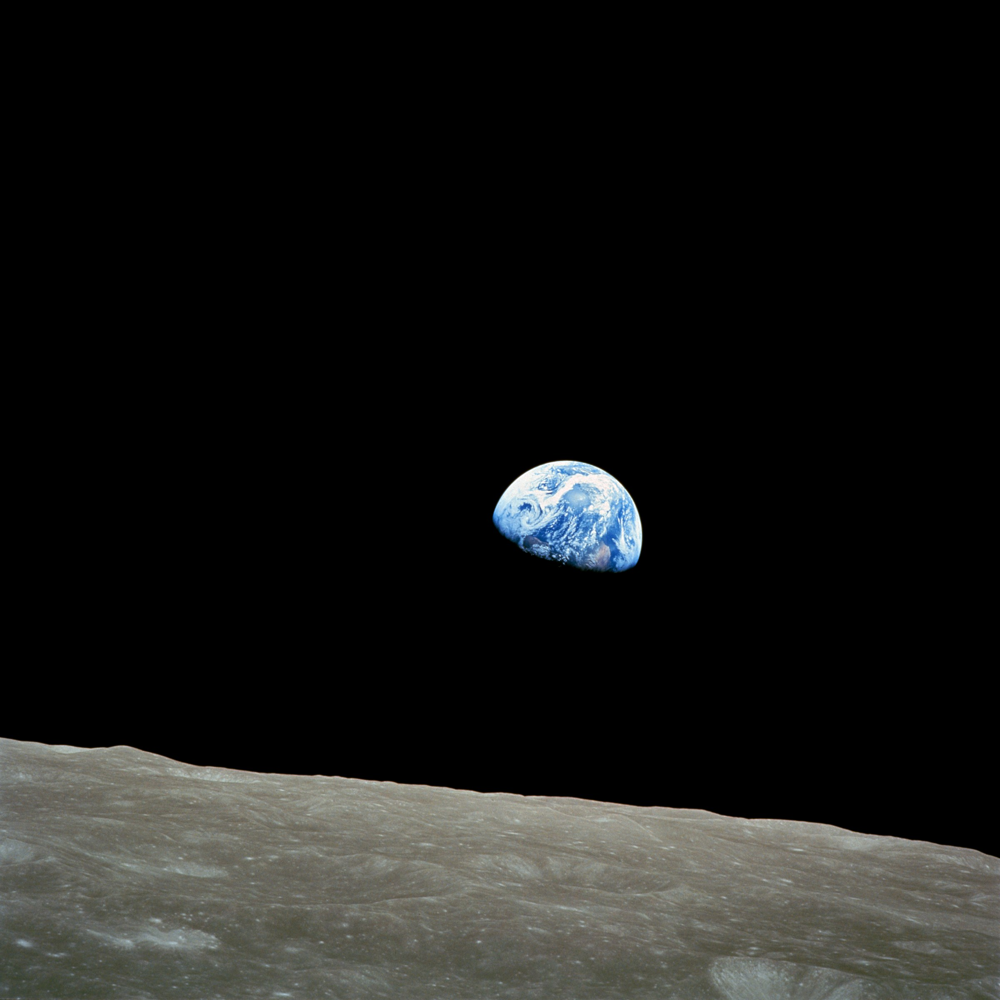
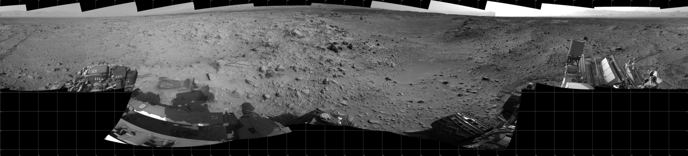
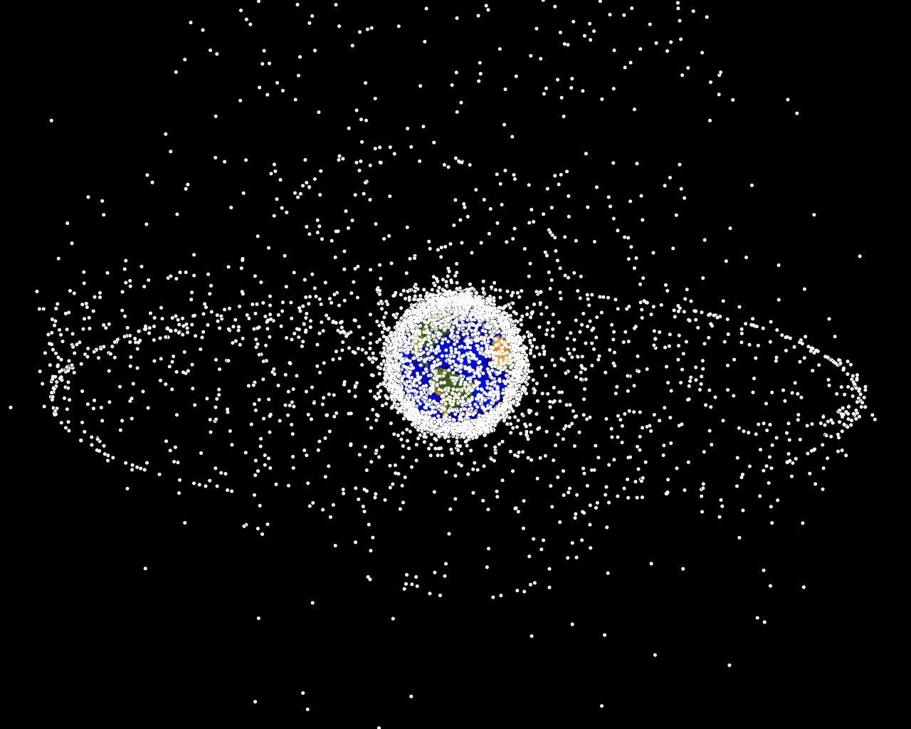

## They went to photograph the Moon. {background-color="#000000"}

{.w11-hero fig-alt="Earth rising above the lunar horizon, photographed from Apollo 8."}

::: {.w11-hero-cap}
Then Earth came into view.
:::
::: {.w11-hero-credit}
[NASA / Bill Anders · Apollo 8 · 24 December 1968](https://science.nasa.gov/resource/apollo-8s-iconic-earthrise/)
:::

::: {.notes}
Let the image sit for a few seconds. Apollo 8 was orbiting the Moon when Bill Anders photographed Earthrise. The crew hurried to find colour film. Do not call this the first photograph of Earth from lunar orbit: robotic images preceded it.

Optional opening media: NASA's reconstruction uses original onboard audio. Open https://science.nasa.gov/resource/the-story-behind-apollo-8s-famous-earthrise-photo/ or https://www.youtube.com/watch?v=dE-vOscpiNc. The still image is sufficient if there is no connection; no video is required to understand the lecture.
:::

## One image. Two responsibilities?

```{=html}
<div class="w11-cards two"><div class="w11-card green"><div class="k">Retain</div><div class="h">Keep this home habitable.</div><p>Protect the people and living systems that depend on Earth.</p></div><div class="w11-card blue"><div class="k">Expand</div><div class="h">Build a second home.</div><p>Develop a place where human civilisation could continue beyond Earth.</p></div></div>
```

::: {.w11-punch}
Can we pursue both—or does one make it easier to neglect the other?
:::

::: {.notes}
Introduce the week's organising tension: retaining responsibility for Earth while pursuing settlement elsewhere. Expansion is not inherently abandonment; whether the two goals reinforce or undermine each other is the question. Ask for one initial view, then return to it after the debate.
:::

## From a farm to a second home

```{=html}
<div class="w11-cards two"><div class="w11-card blue"><div class="k">Week 10</div><div class="h">Trace the consequences.</div><p>The £144 farming year: one pressure travelled through a system. A proposed fix could create another chain.</p></div><div class="w11-card purple"><div class="k">Week 11</div><div class="h">Choose who carries them.</div><p>Building elsewhere could change what we invest in here. Trace who gains protection—and who still carries the risk.</p></div></div>
```

::: {.w11-punch}
Carry forward two questions: what happens next—and to whom?
:::

::: {.notes}
Recall Clarkson’s Farm without introducing new numerical claims. Week 9 adds the distribution and long-term support question; Week 10 adds the causal mechanism. Different cases do not have identical physics.
:::

## Can we build a second home without giving up on the first?

```{=html}
<div class="w11-chain"><div class="step"><b>The promise</b>Why does Elon Musk argue for a settlement beyond Earth?</div><div class="to" aria-hidden="true">→</div><div class="step"><b>The test</b>What would make it a real home—and an independent backup?</div><div class="to" aria-hidden="true">→</div><div class="step"><b>The responsibility</b>What do we still owe the people who remain here?</div><div class="to" aria-hidden="true">→</div><div class="step"><b>The choice</b>Which priority deserves new public funding?</div></div>
```

::: {.w11-punch}
“Deserting Earth” is an interpretation to examine, not a motive to assume.
:::

# Part 1 · Mars… or the Moon first? {background-color="#6c3483"}

[Follow the changing route. Then ask what would make a home last.]{.w11-sub}

## 2016–17 · The destination is Mars.

::: {.w11-question}
“One path is we stay on Earth forever, and then there will be some eventual extinction event.”
:::

::: {.w11-lead}
**The ambition:** a self-sustaining civilisation on Mars could survive a catastrophe on Earth.
:::

::: {.w11-punch}
The goal is more than a visit: a second home that could survive without this one.
:::

::: {.w11-src}
Elon Musk, [Making Humans a Multi-Planetary Species, 2017, p. 46](https://doi.org/10.1089/space.2017.29009.emu), based on his 2016 IAC talk. A proponent’s argument, not a demonstrated survival benefit.
:::

::: {.notes}
This is an authored proposal/commentary. Musk argues for self-sustaining civilisation, not just a visiting crew. His quote does not establish that Earth is beyond repair or that climate change makes abandonment necessary. Do not attribute “stop protecting Earth” to him.

Current context, checked 16 November 2026: SpaceX's published mission materials include lunar bases and a long-term Mars civilisation; these are development goals. The case is not an assertion that Mars is currently its first operational destination. Source: https://www.spacex.com/mars . The debate therefore retains both the Moon and Mars.

Optional original media: SpaceX's official 27 September 2016 presentation, https://www.youtube.com/watch?v=H7Uyfqi_TE8 . Exact excerpt timestamps are not preselected; the dated quotation on this slide provides the complete classroom prompt without video.
:::

## January 2025 · “The Moon is a distraction.”

::: {.w11-question}
“No, we’re going straight to Mars. The Moon is a distraction.”
:::

::: {.w11-lead}
Musk publicly argues for a direct route to Mars.
:::

```{=html}
<div class="w11-cards two"><div class="w11-card purple"><div class="k">The stated priority</div><div class="h">Concentrate on Mars.</div><p>Treat a lunar detour as something that could slow the larger goal.</p></div><div class="w11-card grey"><div class="k">The programme context</div><div class="h">The Moon was already involved.</div><p>NASA had selected SpaceX for its lunar lander in April 2021. This statement did not itself cancel that work.</p></div></div>
```

::: {.w11-src}
Musk’s [3 January 2025 post](https://x.com/elonmusk/status/1875023335891026324), quoted in [Ars Technica’s contemporaneous report](https://arstechnica.com/space/2025/01/elon-musk-were-going-straight-to-mars-the-moon-is-a-distraction/) · [NASA’s 2021 selection](https://www.nasa.gov/news-release/as-artemis-moves-forward-nasa-picks-spacex-to-land-next-americans-on-moon/).
:::

::: {.notes}
Pause after the quotation, then advance to February 2026. This supplies the earlier position that makes the next turn intelligible. The quote is preserved in contemporary reporting; direct retrieval of X was unavailable. It concerns a publicly stated priority, not proof that all lunar projects were removed from SpaceX's programme. The original post is 3 January UTC, 2 January in parts of the US. Avoid conflating Musk's preference with NASA's separate Moon-to-Mars rationale.
:::

## February 2026 · Now the Moon comes first.

::: {.w11-lead}
Musk announced a shift towards a **lunar city**, while retaining the Mars ambition. His reason: a nearer destination could be developed faster.
:::

::: {.w11-question}
“the overriding priority is securing the future of civilization and the Moon is faster”
:::

::: {.w11-punch}
The survival argument remains. The immediate priority changes.
Why does being easier to reach now matter so much?
:::

::: {.w11-src}
Musk’s [8 February 2026 post](https://x.com/elonmusk/status/2020640004628742577) · [Archived original](https://archive.ph/9vQar). An announced priority and projection, not an achieved settlement.
:::

::: {.notes}
About one minute. The original post is timestamped 8 February 2026, 23:24 UTC (9 February in Hong Kong). Musk kept the survival rationale and the long-term Mars goal. Do not frame the change as proof of dishonesty: changing a route in response to constraints can be sensible. Ask students to separate easier access from demonstrated independence.

SpaceX's June 2026 prospectus describes initial lunar cargo/crew priorities (printed p. 82) and early-stage, unproven Moon/Mars initiatives (printed p. 31): https://content.spacex.com/cms-assets/FINAL_Documents%20and%20Updates/SpaceX%20-%20EU%20Prospectus%20%28Approved%20by%20Bafin%29%20-%20June%205%2C%202026.pdf . His forecast dates are not presented as confirmed delivery dates.
:::

## Easier to reach—for what?

::: {.w11-lead}
NASA describes lunar journeys in **days**, Mars journeys in **months**.
:::

```{=html}
<div class="w11-cards two"><div class="w11-card blue"><div class="k">Build and maintain a settlement</div><div class="h">A nearer supplier can help.</div><p>Deliver equipment, replace failures and learn from repeated missions.</p></div><div class="w11-card green"><div class="k">Provide an independent backup</div><div class="h">What if deliveries stop?</div><p>Essential supplies and systems must keep working through a prolonged loss of support from Earth.</p></div></div>
```

::: {.w11-punch}
A shorter supply line still needs a supplier. Can local resources change that?
:::

::: {.w11-src}
[NASA, Why Moon and Mars?, 2025, p. 2](https://www.nasa.gov/wp-content/uploads/2025/12/acr25-wp-why-moon-and-mars-v2.pdf) · These are two different tests of the second-home promise.
:::

::: {.notes}
This replaces the later visit/settle/backup framework and moves its analytical work into the chronological story. Relative proximity can help development without making lunar habitation cheap or easy. The independence criterion is the claim under examination, not a capability attributed to any existing settlement. Transition: local production can reduce deliveries, but existence of material alone is not a dependable supply.
:::

## What if the most accessible supplies run down?

::: {.w11-lead}
**On Earth or the Moon, material can exist without being easy to obtain.** Lunar polar ice, for example, is patchy; finding it is the start of building a supply.
:::

```{=html}
<div class="w11-chain"><div class="step"><b>Extract and process</b>Obtaining usable water needs power, equipment and maintenance.</div><div class="to" aria-hidden="true">→</div><div class="step"><b>Use and recover</b>If recovery is incomplete, water losses need replacing.</div><div class="to" aria-hidden="true">→</div><div class="step"><b>If accessible deposits diminish…</b>Choose among harder extraction, more recovery, lower demand or renewed imports.</div></div>
```

::: {.w11-punch}
Which resource problems would another frontier solve—and which would we carry with us?
:::

::: {.w11-src}
[NASA/JPL: patchy polar ice](https://www.jpl.nasa.gov/news/ice-confirmed-at-the-moons-poles/) · [USGS: lunar-resource assessment](https://pubs.usgs.gov/circ/1507/cir1507.pdf) · [USGS: resources and reserves](https://www.usgs.gov/publications/mineral-resources-reserves-peak-production-and-future). The chain is a conditional scenario, not a depletion forecast.
:::

::: {.notes}
This is the course's resource-management question, not Musk's stated explanation for the Moon priority. Distinguish three things: logistics moves supplies; accessibility concerns what can practically be obtained; depletion removes a stock. Using an accessible deposit can lead to harder sources, but technology, substitution, recycling and demand changes alter the outcome. Reserves are not all the material that exists. Do not infer that Earth is nearly empty, that lunar ice will soon run out, or that lunar mining is already economical.

Ask students to name one assumption before choosing a response: recovery rate, extraction energy, demand, or dependable imports. Then return to Mars as the worked example of what makes a home function. CHAPEA shows the maintenance and support; MOXIE shows one step in converting local material into a usable product.
:::

## Mars has a landscape. A home needs systems. {background-color="#000000"}

{.w11-hero .wide fig-alt="Curiosity rover panorama looking towards Hidden Valley on Mars."}

::: {.w11-hero-cap}
What must keep working for people to live here?
:::
::: {.w11-hero-credit}
Curiosity panorama, 31 July 2014 (Sol 705). NASA/JPL-Caltech · [PIA18409](https://www.jpl.nasa.gov/images/pia18409-curiositys-360-degree-view-before-entering-hidden-valley/)
:::

::: {.notes}
Ask students for oxygen, pressure, water, energy, food, protection and maintenance. The image is a stitched Navigation Camera panorama, not an unaided human view. Avoid the old “no water, no atmosphere” caption.
:::

## On simulated Mars: food, water—and dish soap.

::: {.w11-lead}
**378 days in a Houston habitat.** Four volunteers completed NASA’s Earth-based Mars simulation on **31 October 2026**.
:::

```{=html}
<div class="w11-cards two"><div class="w11-card blue"><div class="k">Inside the habitat</div><div class="h">Keep everyday life working.</div><p>Engineer James Spicer described tracking dish soap and respirator filters alongside food and water.</p></div><div class="w11-card green"><div class="k">Outside the habitat</div><div class="h">Keep the crew supported.</div><p>Medical officer Ellen Ellis highlighted the coordinated specialists supporting them from outside.</p></div></div>
```

::: {.w11-punch}
Who keeps a home working—and what happens when that support is interrupted?
:::

::: {.w11-src}
[NASA’s crew reflections and photographs, 9 November 2026](https://www.nasa.gov/missions/analog-field-testing/chapea/chapea-mission-2-crew-reflects-after-378-days-on-simulated-mars/) · CHAPEA Mission 2: an Earth-based simulation.
:::

::: {.notes}
About one minute. Begin with an ordinary object students would not put in a Mars poster: dish soap. The story connects exploration to maintenance, relationships and care. The crew generated useful health and performance evidence; this does not demonstrate survival under Mars's radiation and gravity, a closed ecosystem, or independence from Earth. Ask for one support role that disappears from the spectacular image of a rocket launch.
:::

## Turning local material into something usable

::: {.w11-number}
122 g
:::

::: {.w11-lead}
of oxygen produced across NASA’s **MOXIE experiment on Mars**.
:::

```{=html}
<div class="w11-cards two"><div class="w11-card green"><div class="k">Demonstrated</div><div class="h">Extract oxygen locally.</div><p>A working method using Mars’s carbon-dioxide-rich atmosphere.</p></div><div class="w11-card purple"><div class="k">Not demonstrated</div><div class="h">Sustain a settlement.</div><p>Continuous production, storage and an entire life-support system at the required scale.</p></div></div>
```

::: {.w11-src}
[NASA: MOXIE mission results, 2023](https://www.nasa.gov/solar-system/nasas-oxygen-generating-experiment-moxie-completes-mars-mission/)
:::

::: {.notes}
Connect to the resource sequence: this is a demonstration of conversion, not evidence of depletion or a complete supply system. Keep NASA’s MOXIE result distinct from SpaceX’s proposal. The number is total oxygen over the experimental mission, not an hourly rate. Mars also has water ice: https://science.nasa.gov/resource/swim-map-shows-subsurface-water-ice-on-mars/. Success at one task is evidence of progress, not proof that the full system has been built.
:::

## Insurance—or permission to give up?

```{=html}
<div class="w11-cards two"><div class="w11-card blue"><div class="k">The insurance argument</div><div class="h">Protect against a future catastrophe.</div><p>A second civilisation could preserve a future that a single-planet society might lose.</p></div><div class="w11-card red"><div class="k">The abandonment concern</div><div class="h">Make the first home seem expendable.</div><p>Could the promise of somewhere else weaken investment in protecting people here?</p></div></div>
```

::: {.w11-punch}
These are competing claims to test—not established consequences or proof of anyone’s motives.
:::

::: {.notes}
Link to Weeks 7–8: a frame highlights some questions and suppresses others. “Insurance” must specify the risk, beneficiaries and reliability; “abandonment” needs evidence of displaced resources or weakened obligations. Students can defend pursuing both goals if they explain the funding and safeguards. They should not treat enthusiasm for exploration as proof of disregard for Earth.
:::

## A backup for whom?

```{=html}
<div class="w11-cards two"><div class="w11-card blue"><div class="k">Continuity of civilisation</div><div class="h">Could humanity continue somewhere?</div><p>This claim does not require every person on Earth to relocate.</p></div><div class="w11-card green"><div class="k">Protection of people</div><div class="h">Who becomes safer—and when?</div><p>Ask who could go, who could afford it, and what protection reaches those who stay.</p></div></div>
```

::: {.w11-punch}
Saving a future for the species and meeting people’s present needs are different tests.
:::

::: {.notes}
This is an ethical distinction, not a claim about a published passenger-selection scheme. Connect to Week 9: the possibility of moving somewhere does not establish access, rights, livelihood or long-term support. Ask what obligations remain towards people who never leave Earth. A second-home proposal is not itself a resettlement programme for climate-displaced communities.
:::

## Before Mars: who governs Starbase?

::: {.w11-lead}
On **3 May 2025**, voters supported incorporating Starbase, Texas.
:::

```{=html}
<div class="w11-cards two"><div class="w11-card blue"><div class="k">The incorporation vote</div><div class="h">212 for · 6 against</div><p>The county’s posted report records strong support among those voting on the proposal.</p></div><div class="w11-card purple"><div class="k">The inaugural mayor</div><div class="h">Bobby Peden</div><p>The city’s biography also identifies him as SpaceX Vice President of Texas Test and Launch.</p></div></div>
```

::: {.w11-punch}
In a future settlement, if one company supplies jobs, transport and essential services, what independent voice should residents have?
:::

::: {.w11-src}
[Cameron County election report](https://www.cameroncountytx.gov/elections/wp-content/uploads/2025/05/City-of-Starbase-Summary.pdf), labelled “unofficial results”, updated 9 May 2025 · [Official city biography](https://www.starbase.texas.gov/city-commission-and-staff), checked 16 November 2026.
:::

::: {.notes}
About one minute. The future-settlement question is a hypothetical extension, not a claim that all these services are provided by one company in Starbase. A home needs institutions as well as oxygen. Consider both relevant technical expertise and safeguards for independent representation. Overlapping roles are not proof of coercion or corruption. Musk is not the mayor, and incorporation does not establish that SpaceX legally owns the city.
:::

# Part 2 · Protecting the first home {background-color="#0a3d62"}

[Going into space can also help people stay safely on Earth.]{.w11-sub}

## Some space technology helps us stay here.

::: {.w11-lead}
Before a typhoon reaches a coastline, satellite images help forecasters locate its centre and follow its movement.
:::

```{=html}
<div class="w11-chain"><div class="step"><b>Observation</b>See cloud patterns over an ocean with sparse surface observations.</div><div class="to" aria-hidden="true">→</div><div class="step"><b>Forecast</b>Combine satellite information with other observations and models.</div><div class="to" aria-hidden="true">→</div><div class="step"><b>Decision</b>Use forecasts and warnings to prepare people and services.</div></div>
```

::: {.w11-punch}
Who can act on the warning—and who still needs shelter, transport or recovery support?
:::

::: {.w11-src}
[Hong Kong Observatory: tracking tropical cyclones by satellite](https://www.hko.gov.hk/en/education/tropical-cyclone/tracking/00159-tracking-by-satellite-observations.html) · Observation ≠ a complete forecast.
:::

::: {.notes}
HKO’s explanation is from 2010. Use its enduring explanation of ocean observation, not its historical half-hour image frequency. Satellite images are one input; warning decisions also use other evidence and operational judgement. The access question carries forward Week 9: detecting risk does not by itself give everyone the capacity to act.
:::

## “Space spending” contains different activities.

```{=html}
<div class="w11-cards three"><div class="w11-card blue"><div class="k">Services</div><div class="h">Observe and connect</div><p>Weather and climate observations, communications and navigation.</p></div><div class="w11-card green"><div class="k">Knowledge</div><div class="h">Investigate and test</div><p>Robotic science, exploration and planetary-defence experiments.</p></div><div class="w11-card purple"><div class="k">Human futures</div><div class="h">Visit or settle</div><p>Crewed missions, tourism and projects for permanent residence.</p></div></div>
```

::: {.w11-lead}
Satellites have provided a continuous global record of **sea-level change since 1993**.
:::

::: {.w11-src}
[NASA: satellite sea-level record](https://www.nasa.gov/wp-content/uploads/2023/06/gmsl-satelliterecordclassroomdatasheet.pdf) · Categories here are a teaching framework, not a budget classification.
:::

## Protecting Earth can involve going into space.

::: {.w11-lead}
NASA’s **DART** mission changed an asteroid moon’s orbit by striking it with a spacecraft.
:::

```{=html}
<div class="w11-cards two"><div class="w11-card green"><div class="k">Test result</div><div class="h">An orbit was changed.</div><p>Dimorphos’s orbital period around Didymos shortened by about 33 minutes.</p></div><div class="w11-card blue"><div class="k">What it establishes</div><div class="h">A defence method was tested.</div><p>It was not an actual emergency, or a demonstration against every possible asteroid threat.</p></div></div>
```

::: {.w11-src}
[NASA: DART validates kinetic impact as a planetary-defence method, 2023](https://www.nasa.gov/science-research/planetary-science/nasas-dart-data-validates-kinetic-impact-as-planetary-defense-method/)
:::

::: {.notes}
This is a substantive counterexample to “all activity beyond Earth is escapism.” Keep planetary defence separate from permanent settlement when defining the debate.
:::

# Part 3 · Responsibilities travel with us {background-color="#78281f"}

[Would a new destination solve the problems of sharing a home?]{.w11-sub}

## Orbit can look empty from the ground. {background-color="#000000"}

{.w11-hero fig-alt="Historical visualization of tracked objects around Earth, including a ring in the geosynchronous region."}

::: {.w11-hero-credit}
Historical NASA visualization of tracked objects, including satellites and debris. Dots enlarged for visibility; this is not a photograph or a current count. [NASA ODPO](https://orbitaldebris.jsc.nasa.gov/photo-gallery/) · [Archived image record](https://commons.wikimedia.org/wiki/File:Debris-GEO1280.jpg)
:::

::: {.notes}
This exact image predates February 2005. The outer ring shows the geosynchronous region. Do not describe every dot as junk or associate this historical graphic with the current numerical estimate on the next slide.
:::

## The small pieces add up. [Model estimate]{.w11-tag .emerging}

::: {.w11-number}
≈1.5 million
:::

::: {.w11-lead}
debris objects **larger than 1 cm and up to 10 cm** in Earth orbit.
:::

::: {.w11-punch}
An estimated population—not 1.5 million individually tracked objects.
:::

::: {.w11-src}
[ESA Space Environment Statistics](https://sdup.esoc.esa.int/discosweb/statistics/) · MASTER-8 reference population: February 2026. Page updated 13 November 2026.
:::

::: {.notes}
Keep size range and model date attached to the number. The live page separately reports roughly 47,270 tracked space objects, including functioning satellites. Do not compare that catalogue count to the model as if both measured the same population.
:::

## A collision can create the next collision.

```{=html}
<div class="w11-loop">
  <div class="node"><b>A collision</b>Objects strike one another.</div>
  <div class="arr" aria-hidden="true">→</div>
  <div class="node hot"><b>More fragments</b>New debris remains in orbit.</div>
  <div class="arr" aria-hidden="true">↑</div>
  <div class="hub">A reinforcing<br>feedback loop</div>
  <div class="arr" aria-hidden="true">↓</div>
  <div class="node"><b>Further collisions</b>Some impacts create still more debris.</div>
  <div class="arr" aria-hidden="true">←</div>
  <div class="node hot"><b>More collision risk</b>Other objects encounter the fragments.</div>
</div>
```

::: {.w11-src}
[ESA Space Environment Report 2026](https://www.esa.int/articles/esa-space-environment-report-2026) · Kessler syndrome: cumulative risk in affected orbital regions, not an instant shutdown of all space.
:::

::: {.notes}
Bring back Week 10’s loop. Risk and persistence depend on orbit and object characteristics; avoid one universal “point of no return” date. ESA notes that debris growth can continue even without additional launches.
:::

## Who pays to keep orbit usable?

```{=html}
<div class="w11-cards two"><div class="w11-card green"><div class="k">Before failure</div><div class="h">Prevent and coordinate</div><p>Plan disposal, reduce fragmentation and coordinate traffic.</p></div><div class="w11-card blue"><div class="k">After accumulation</div><div class="h">Remove selected debris</div><p>Active removal can address selected debris; it does not replace prevention.</p></div></div>
```

::: {.w11-punch}
New territory still needs rules: who pays, and whose priorities count?

Civilian services, commercial operators, national-security agencies?
:::

::: {.w11-src}
[ESA 2026 report: disposal, coordination and active removal](https://www.esa.int/articles/esa-space-environment-report-2026)
:::

::: {.notes}
Policy options include operator obligations, shared funding and international coordination. Present these as options. Do not claim that nobody is working on debris removal, or that operational removal at the necessary scale is already solved.
:::

## More activity also brings environmental questions.

```{=html}
<div class="w11-cards two"><div class="w11-card red"><div class="k">Launch · modelled effects</div><div class="h">What is emitted—and where?</div><p>Rocket-soot studies model stratospheric heating, circulation and ozone responses under specified scenarios.</p></div><div class="w11-card purple"><div class="k">Re-entry · observed material</div><div class="h">What happens after it comes down?</div><p>Spacecraft-derived metals have been detected in stratospheric particles; their consequences remain under study.</p></div></div>
```

::: {.w11-punch}
How would a settlement programme account for the costs of building and supplying it?
:::

::: {.w11-src}
[Maloney et al., 2022 · modelling](https://repository.library.noaa.gov/view/noaa/53971/noaa_53971_DS1.pdf) · [NOAA / Murphy et al., 2023 · measurements](https://csl.noaa.gov/news/2023/388_1016.html)
:::

::: {.notes}
Supporting evidence for the second-home question, not a claim that current launch emissions outweigh the programme's possible benefits. Fuel, altitude and activity level matter. Do not convert modelled stratospheric temperature changes into the same global surface warming, or infer quantified ozone loss or health harm merely from detecting metals. The policy question is who measures, limits and pays for environmental costs.
:::

# Part 4 · The public choice {background-color="#145a32"}

[Which priority can you justify—and under what conditions?]{.w11-sub}

## A private ambition becomes a public choice.

::: {.w11-lead}
**Musk’s proposal is our case. Governments are the decision-makers in this debate.**
:::

```{=html}
<div class="w11-cards two"><div class="w11-card green"><div class="k">Decision in scope</div><div class="h">New public support for settlement</div><p>Should government commit money to permanent residence beyond Earth, or prioritise climate adaptation here?</p></div><div class="w11-card grey"><div class="k">Keep categories clear</div><div class="h">A service is not a settlement.</div><p>Buying weather observations or launch services for another purpose is a different funding decision.</p></div></div>
```

::: {.notes}
Do not equate a company valuation, personal wealth or an announced pledge with money governments could redirect. No dollar total is assumed. A private programme may have public customers, but whether a particular contract falls within the motion depends on the funded activity's primary objective. Students are evaluating a priority rule, not voting on whether they like Musk.
:::

## What must we retain if we build elsewhere?

```{=html}
<div class="w11-cards two"><div class="w11-card green"><div class="k">Responsibility here</div><div class="h">Protect those who remain.</div><p>Explain what people facing heat, flooding and displacement will receive—including sustained recovery support.</p></div><div class="w11-card blue"><div class="k">Ambition elsewhere</div><div class="h">Make the future benefit credible.</div><p>Explain what settlement research can deliver, who benefits and how its costs will be governed.</p></div></div>
```

::: {.w11-punch}
“We can do both” needs a plan. “We must choose” needs an opportunity-cost argument.
:::

::: {.notes}
Bring the deserting/retaining question back before the funding motion. Both sides must explain what their priority would leave undone. Retaining responsibility for Earth does not require opposing every mission; pursuing a settlement does not establish that present needs will be met. These are arguments to assess, not attributed motives.
:::

## This week’s debate motion

::: {.w11-motion}
This house would redirect new public funding for permanent human settlements on the Moon or Mars to climate adaptation on Earth for the next ten years.
:::

::: {.w11-lead}
**FOR:** redirect the funding.

**AGAINST:** oppose this blanket ten-year redirection; defend a public role for settlement research and development.
:::

::: {.notes}
A hypothetical policy rule for governments making future allocations. It is not a claim that one existing pooled world budget can simply be transferred. Students may propose safeguards and conditions, but should take a clear position on this rule.
:::

## What exactly is inside the motion?

::: {.w11-list}
- **New public funding:** future government commitments. Existing contracts and private expenditure are outside this redirection.
- **Permanent settlement:** projects whose primary objective is permanent human residence on the Moon or Mars.
- **Ten years:** the proposed funding rule lasts ten years; it does not claim adaptation will then be complete.
:::

::: {.notes}
For mixed-use projects, identify the funded activity’s primary objective and explain your classification. Do not win the debate simply by saying weather satellites help climate: those are explicitly outside the proposed redirection. Adaptation means reducing vulnerability to climate impacts, including sustained recovery capacity, rather than emissions mitigation alone.
:::

## Where does the boundary fall?

::: {.w11-list}
- **Adaptation:** reducing harm from climate impacts, including preparedness and sustained recovery. Emissions cuts alone do not qualify.
- **Activities outside the redirection:** Earth observation, weather/navigation services, planetary defence and robotic science.
- **Mixed-use projects:** classify the funded activity by its primary objective, then explain your choice.
:::

::: {.w11-punch}
Apply these definitions consistently to both sides.
:::

## The strongest case FOR

::: {.w11-list}
- **Urgency:** people face risks now; prioritise interventions with a credible route to protection.
- **Public responsibility:** assess whose vulnerability receives attention and who can access the benefits.
- **Uncertain returns:** settlement milestones do not yet demonstrate an independent backup.
:::

::: {.w11-punch}
Your hard question: how will redirected money become effective, sustained support?
:::

::: {.notes}
Argument scaffold, not a list of already proven policy conclusions. Require an example of adaptation delivery, a mechanism and a limitation. Tie the third point to MOXIE without using one experiment to dismiss all future work.
:::

## The strongest case AGAINST

::: {.w11-list}
- **Long lead times:** stopping new commitments may delay capabilities that take decades to develop.
- **Future options:** research can be valuable before the ultimate objective is achieved.
- **Public influence:** a continuing public role may help shape access, standards and accountability.
:::

::: {.w11-punch}
Your hard question: which benefit justifies this funding when adaptation needs remain?
:::

::: {.notes}
These are contestable arguments to substantiate, not predictions of inevitable spin-offs or claims that any space expenditure is justified. Opposing the motion does not require rejecting adaptation, or claiming a settlement will be independent soon.
:::

# Part 5 · The final debate {background-color="#2c3e50"}

[Six stakeholder groups · five minutes each · 50-minute activity]{.w11-sub}

## Your role supplies a concern—not an answer.

```{=html}
<div class="w11-role-grid"><div class="w11-role"><b>STEM Educator/Researcher</b>Which knowledge and capabilities would we create—or lose?</div><div class="w11-role"><b>Climate Policy Maker</b>How reliably would redirected money reduce vulnerability?</div><div class="w11-role"><b>Space Industry Entrepreneur</b>What would happen to investment and technical capability?</div><div class="w11-role"><b>Social Scientist/Ethicist</b>Who benefits, who pays, and whose priorities count?</div><div class="w11-role"><b>Energy Sector Executive</b>How should competing energy and infrastructure needs be assessed?</div><div class="w11-role"><b>General Public/Student</b>What benefit and accountability should the public expect?</div></div>
```

::: {.w11-punch}
Every role can argue FOR or AGAINST. Choose and justify your position.
:::

## Group assignments

```{=html}
<button id="w11-assign" class="w11-btn">Assign the six roles</button>
<button id="w11-clear" class="w11-btn" hidden>Clear assignments</button>
<p id="w11-assignment-status" class="w11-small" aria-live="polite">Assign once, then keep the result visible while groups work.</p>
<div id="w11-assignments" class="w11-role-grid"></div>
<script>
(function () {
  const roles = [["STEM Educator/Researcher", "Which knowledge and capabilities would we create\u2014or lose?"], ["Climate Policy Maker", "How reliably would redirected money reduce vulnerability?"], ["Space Industry Entrepreneur", "What would happen to investment and technical capability?"], ["Social Scientist/Ethicist", "Who benefits, who pays, and whose priorities count?"], ["Energy Sector Executive", "How should competing energy and infrastructure needs be assessed?"], ["General Public/Student", "What benefit and accountability should the public expect?"]];
  const list = document.getElementById('w11-assignments');
  const start = document.getElementById('w11-assign');
  const clear = document.getElementById('w11-clear');
  const status = document.getElementById('w11-assignment-status');
  const key = 'ccgl9065-w11-roles-v1';
  let assigned = [];
  function show() {
    list.replaceChildren();
    assigned.forEach((r, i) => {
      const box = document.createElement('div');
      box.className = 'w11-role';
      const num = document.createElement('div');
      num.className = 'num'; num.textContent = 'Group ' + (i + 1);
      const name = document.createElement('b'); name.textContent = r[0];
      const concern = document.createElement('div'); concern.textContent = r[1];
      box.append(num, name, concern); list.appendChild(box);
    });
    start.disabled = assigned.length > 0;
    clear.hidden = assigned.length === 0;
    status.textContent = assigned.length ? 'Keep your role. Decide FOR or AGAINST within your group.' : 'Assign once, then keep the result visible while groups work.';
  }
  try {
    const stored = JSON.parse(sessionStorage.getItem(key));
    if (Array.isArray(stored) && stored.length === roles.length && new Set(stored).size === roles.length && stored.every(i => Number.isInteger(i) && i >= 0 && i < roles.length)) assigned = stored.map(i => roles[i]);
  } catch (_) {}
  start.addEventListener('click', () => {
    if (assigned.length) return;
    const order = roles.map((_, i) => i);
    for (let i = order.length - 1; i > 0; i--) {
      const j = Math.floor(Math.random() * (i + 1));
      [order[i], order[j]] = [order[j], order[i]];
    }
    assigned = order.map(i => roles[i]);
    try { sessionStorage.setItem(key, JSON.stringify(order)); } catch (_) {}
    show();
  });
  clear.addEventListener('click', () => {
    assigned = [];
    try { sessionStorage.removeItem(key); } catch (_) {}
    show();
  });
  show();
})();
</script>
```

## Your presentation: five minutes maximum

::: {.w11-list}
- **Position:** FOR or AGAINST, and what your stakeholder cares about.
- **Mechanism:** one causal chain, supported by two claims from this lecture or earlier weeks.
- **Objection:** the strongest argument against your position—and your response.
- **Revision:** one finding that would make you change your recommendation.
:::

::: {.w11-src}
Use the supplied evidence. Label observations, model estimates and policy judgements clearly; no new research is required during the preparation window.
:::

## The 50-minute activity

::: {.w11-table}
| Time | What happens |
|:--|:--|
| **2 min** | Settle into six groups; assign roles. |
| **3 min** | Exchange positions; agree a stance and use the supplied evidence. |
| **35 min** | Six × five-minute presentations, plus five minutes for transitions. |
| **5 min** | Compare arguments and reflect individually. |
| **5 min** | Buffer for questions and overruns. |
:::

::: {.w11-punch}
Challenge a claim with a reason. Represent the other side fairly.
:::

## Presentation countdown

```{=html}
<style>
  #w11timer {
    font-size: 348px;
    font-weight: 700;
    font-variant-numeric: tabular-nums;
    line-height: 1.1;
    margin-bottom: 20px;
    transition: color 0.6s ease;
  }
  #w11timer.w11timer-flash { animation: w11timer-pop 0.6s ease; }
  @keyframes w11timer-pop {
    0%   { transform: scale(1); }
    40%  { transform: scale(1.06); }
    100% { transform: scale(1); }
  }
  #w11timer-label { font-size: 40px; color: #7f8c8d; margin-bottom: 30px; min-height: 1.4em; }
  .w11timer-btn { font-size: 24px; padding: 15px 30px; color: white; border: none; border-radius: 8px; cursor: pointer; margin: 0 5px; }
  .w11timer-btn:disabled { opacity: 0.6; cursor: default; }
  #w11start-button { background-color: #27ae60; }
  #w11pause-button { background-color: #f39c12; }
  #w11reset-button { background-color: #e74c3c; }
  #w11timer-legend { display: flex; justify-content: center; gap: 28px; margin-top: 36px; font-size: 26px; color: #2c3e50; }
  #w11timer-legend span { display: inline-flex; align-items: center; gap: 8px; }
  #w11timer-legend i { display: inline-block; width: 22px; height: 22px; border-radius: 50%; }
</style>

<div id="w11timer-container" style="text-align: center;">
  <div id="w11timer">05:00</div>
  <div id="w11timer-label"></div>
  <button id="w11start-button" class="w11timer-btn">Start 5:00</button>
  <button id="w11pause-button" class="w11timer-btn" disabled>Pause</button>
  <button id="w11reset-button" class="w11timer-btn">Reset</button>
  <div id="w11timer-legend"></div>
</div>

<script>
(function () {
  const TOTAL = 300; // 5 minutes
  // One colour per minute, as on countdown_colors.qmd:
  // 5:00–4:01 slate, 4:00–3:01 blue, 3:00–2:01 green, 2:00–1:01 orange, final minute red.
  const BAND_COLORS = ['#2c3e50', '#2980b9', '#27ae60', '#f39c12', '#e74c3c'];
  const DONE_COLOR = '#8e44ad'; // Time's up

  const timerEl = document.getElementById('w11timer');
  const labelEl = document.getElementById('w11timer-label');
  const startBtn = document.getElementById('w11start-button');
  const pauseBtn = document.getElementById('w11pause-button');
  const resetBtn = document.getElementById('w11reset-button');
  const legendEl = document.getElementById('w11timer-legend');

  let timeLeft = TOTAL;
  let deadline = 0;
  let interval = null;
  let currentBand = -1;

  BAND_COLORS.forEach((c, i) => {
    const s = document.createElement('span');
    s.innerHTML = '<i style="background:' + c + '"></i>' + (BAND_COLORS.length - i) + ' min';
    legendEl.appendChild(s);
  });

  // 300..241 -> 0, 240..181 -> 1, ..., 60..1 -> 4, 0 -> done
  function bandFor(sec) {
    return sec <= 0 ? BAND_COLORS.length : BAND_COLORS.length - Math.ceil(sec / 60);
  }

  function render(animate) {
    const m = Math.floor(timeLeft / 60);
    const s = timeLeft % 60;
    timerEl.textContent = String(m).padStart(2, '0') + ':' + String(s).padStart(2, '0');

    const band = bandFor(timeLeft);
    if (band === currentBand) return;
    currentBand = band;
    if (band >= BAND_COLORS.length) {
      timerEl.style.color = DONE_COLOR;
      labelEl.textContent = "Time's up!";
    } else {
      const minsLeft = BAND_COLORS.length - band;
      timerEl.style.color = BAND_COLORS[band];
      labelEl.textContent = minsLeft === 1 ? 'Final minute' : minsLeft + ' minutes left';
    }
    if (animate) {
      timerEl.classList.remove('w11timer-flash');
      void timerEl.offsetWidth; // restart the pop animation
      timerEl.classList.add('w11timer-flash');
    }
  }

  function stop() {
    clearInterval(interval);
    interval = null;
    pauseBtn.disabled = true;
  }

  function tick() {
    // Count down from a deadline so a slow or throttled tab cannot stretch the five minutes.
    timeLeft = Math.max(0, Math.ceil((deadline - Date.now()) / 1000));
    render(true);
    if (timeLeft <= 0) {
      stop();
      startBtn.disabled = true;
      startBtn.textContent = 'Done';
    }
  }

  startBtn.addEventListener('click', () => {
    if (interval || timeLeft <= 0) return;
    deadline = Date.now() + timeLeft * 1000;
    interval = setInterval(tick, 250);
    startBtn.disabled = true;
    startBtn.textContent = 'Running…';
    pauseBtn.disabled = false;
  });

  pauseBtn.addEventListener('click', () => {
    stop();
    startBtn.disabled = false;
    startBtn.textContent = 'Resume';
  });

  resetBtn.addEventListener('click', () => {
    stop();
    timeLeft = TOTAL;
    currentBand = -1;
    startBtn.disabled = false;
    startBtn.textContent = 'Start 5:00';
    render(false);
  });

  render(false);
})();
</script>
```

::: {.notes}
Reset before each group. The timer uses a deadline, so a throttled tab does not stretch five minutes. Colours change by remaining minute; the label also states the remaining band for accessibility.
:::

## Before the next group: what did you hear?

::: {.w11-list}
- **Claim:** what did the group ask us to support?
- **Evidence:** which fact or mechanism did the most work?
- **Uncertainty:** what remained unresolved?
:::

::: {.w11-lead}
In the wrap-up, name the strongest argument you heard **against your own position**.
:::

::: {.notes}
Use as a listener prompt, not as an extra timed presentation after every group. The final five-minute wrap-up includes the individual reflection in the next section.
:::

## Write your decision—and its limit.

::: {.w11-question}
“I would prioritise **___** because **___**.”

“The strongest objection is **___**.”

“I would reconsider if **___**.”
:::

::: {.w11-src}
Individual reflection · 90 seconds within the five-minute wrap-up. You may keep or revise your initial position.
:::

::: {.notes}
Ask for one changed view and one unchanged view with stronger reasoning. Do not reward agreement with the lecturer. The purpose is to make the reasoning visible.
:::

# Part 6 · Return to Earthrise {background-color="#0a3d62"}

[The image stays the same. Your reasons may have changed.]{.w11-sub}

## What would your decision protect? {background-color="#000000"}

{.w11-hero fig-alt="Earthrise, the opening photograph revisited after the funding debate."}

::: {.w11-hero-cap}
What could a second home protect—and what would we still owe this one?
:::
::: {.w11-hero-credit}
[NASA / Bill Anders · Apollo 8 · 24 December 1968](https://science.nasa.gov/resource/apollo-8s-iconic-earthrise/)
:::

::: {.notes}
Return to the opening question and Musk’s insurance argument: which part can you now defend, and what would you require before supporting it? Students now have distinctions and evidence that the image alone could not supply. Do not reveal a single “correct” emotional response or policy choice.
:::

## A different view can change what matters.

::: {.w11-lead}
Some astronauts describe awe, connection and a heightened sense of Earth’s fragility: experiences often called the **overview effect**.
:::

::: {.w11-punch}
A perspective can motivate a decision. It cannot settle the decision for us.
:::

::: {.w11-src}
[Yaden et al., 2016: astronaut accounts and the overview effect](https://doi.org/10.1037/cns0000086) · [Bill Anders: NASA oral history](https://www.nasa.gov/wp-content/uploads/2025/07/waa-10-8-97-amended.pdf)
:::

::: {.notes}
The evidence does not establish that every astronaut changes in the same way, that the change is permanent, or that Earthrise created the environmental movement. Anders’s oral history is a first-person account, not a representative experiment.
:::

## Strategy #10 · Self-persuasion

::: {.w11-lead}
Invite people to build a reason **in their own words**.
:::

```{=html}
<div class="w11-cards two"><div class="w11-card purple"><div class="k">Potential</div><div class="h">An argument you generate can persuade you.</div><p>Research finds this can work especially when generating reasons feels easy.</p></div><div class="w11-card grey"><div class="k">Limit</div><div class="h">Generating a reason does not make it true.</div><p>Check the evidence and leave room for disagreement or revision.</p></div></div>
```

::: {.w11-src}
[Xu & Wegener, 2024: ease and difficulty in self-persuasion](https://doi.org/10.1177/19485506221146612)
:::

::: {.notes}
Five samples, including two preregistered studies. The advantage diminished when generating arguments felt difficult. Avoid the old cult/brainwashing example and the claim that acting or speaking automatically produces belief. This is a conditional finding, not a manipulation guarantee.
:::

## The semester gave us four questions.

```{=html}
<div class="w11-cards two"><div class="w11-card purple"><div class="k">Weeks 7–8 · evidence and language</div><div class="h">What is the claim?</div><p>Separate what is observed from what a label asks us to believe.</p></div><div class="w11-card green"><div class="k">Week 9 · displacement and support</div><div class="h">Who bears the consequences?</div><p>Look beyond the first event to recovery, access and continued support.</p></div></div>
```

```{=html}
<div class="w11-cards two"><div class="w11-card blue"><div class="k">Week 10 · cascades</div><div class="h">What happens next?</div><p>Trace the mechanism, including the consequences of your proposed fix.</p></div><div class="w11-card red"><div class="k">Week 11 · second homes</div><div class="h">What would justify the priority?</div><p>Test the promise of a second home and the obligations that remain here.</p></div></div>
```

::: {.notes}
Different cases require different evidence. Do not say Tai Po and Tuvalu share identical physics, or that every environmental change is the same feedback loop.
:::

## Use the same discipline in your final spectacle.

```{=html}
<div class="w11-chain"><div class="step"><b>A person or scene</b>Help the audience see what is at stake.</div><div class="to" aria-hidden="true">→</div><div class="step"><b>A supported claim</b>Explain the mechanism without hiding its limits.</div><div class="to" aria-hidden="true">→</div><div class="step"><b>A feasible action</b>Show who can do what, and how it would help.</div></div>
```

::: {.w11-punch}
Write one question your audience can answer using your evidence—even if they disagree.
:::

## Your essay: a persuasive, fact-checkable proposal.

::: {.w11-list}
- **750 words maximum.** Connect insights from more than one week.
- **A concrete climate solution:** explain its relevance to Hong Kong and the wider context, how it works, and who can act.
- **At least four credible sources.** Address a serious limitation or counterargument.
- **Narrative does not mean fiction:** a vivid opening still needs verifiable facts.
:::

::: {.w11-src}
[Assessment criteria](evaluation.html#final-reflective-essay-20) · [Portfolio roadmap and format requirements](portfolio_roadmap.html#deliverable-1-final-reflective-essay-20)
:::

::: {.notes}
This is a reminder of the current course documents, not a new assignment or deadline. Roadmap: 12pt Times New Roman, double-spaced, APA citations; maximum 750 words. The visual creation should communicate the same proposal. Follow the linked course pages for full submission details.
:::

## Final portfolio · Two submission deadlines

```{=html}
<div class="w11-cards two">
  <div class="w11-card red">
    <div class="k">Presenting in the last class</div>
    <div class="h">Wednesday 25 November</div>
    <p>Submit your final portfolio by</p>
    <p style="font-size:1.6em;font-weight:800;margin-top:24px;">Tuesday 24 November</p>
    <p style="font-size:2.7em;font-weight:900;line-height:1.15;margin-top:12px;">11:59 PM</p>
  </div>
  <div class="w11-card blue">
    <div class="k">Not presenting</div>
    <div class="h">End-of-week submission</div>
    <p>Submit your final portfolio by</p>
    <p style="font-size:1.6em;font-weight:800;margin-top:24px;">Sunday 29 November</p>
    <p style="font-size:2.7em;font-weight:900;line-height:1.15;margin-top:12px;">11:59 PM</p>
  </div>
</div>
```

::: {.w11-punch}
To present on 25 November, submit by the earlier deadline: 24 November, 11:59 PM.
:::

::: {.w11-src style="text-align:center;font-size:0.85em;"}
**All dates are in 2026. All deadlines are Hong Kong time (UTC+8).**
:::

::: {.notes}
Course-lead instruction, 17 November 2026: there are two final-portfolio submission deadlines based on presentation intention. Students intending to present in the last class on 25 November must submit by 11:59 PM on 24 November. Students not intending to present must submit by 11:59 PM on 29 November. No presentation start time or submission-platform change is specified here.
:::

## Leave the audience with a reason to act. {background-color="#0a3d62"}

::: {.w11-question}
What should we do?

Who would it help?

Why should they trust the argument?
:::

::: {.w11-lead}
Your task is to make those answers clear enough to examine—and strong enough to matter.
:::

# Sources & teaching notes {background-color="#2c3e50"}

[Evidence checked 16 November 2026 · optional reference slides]{.w11-sub}

## Sources · The second-home proposal

::: {.w11-sources}
- [Elon Musk, 2017 · Making Humans a Multi-Planetary Species](https://doi.org/10.1089/space.2017.29009.emu) — his authored survival argument; quotation from p. 46. A proposal, not an independently demonstrated outcome.
- [SpaceX · Official 2016 presentation](https://www.youtube.com/watch?v=H7Uyfqi_TE8) — the original public argument; optional media, not required for the lecture.
- [SpaceX · Mission: Mars](https://www.spacex.com/mars) — current company development goals include lunar bases and Mars civilisation; checked 16 November 2026. Goals and announced targets are not achieved capabilities.
:::

::: {.w11-punch}
Use the proponent’s words to establish the proposal. Use independent evidence to assess it.
:::

## Sources · Three recent stories

::: {.w11-sources}
- **Changed priority:** Musk’s [February 2026 post](https://x.com/elonmusk/status/2020640004628742577), preserved in the [original-post archive](https://archive.ph/9vQar). [SpaceX’s June 2026 prospectus](https://content.spacex.com/cms-assets/FINAL_Documents%20and%20Updates/SpaceX%20-%20EU%20Prospectus%20%28Approved%20by%20Bafin%29%20-%20June%205%2C%202026.pdf), printed pp. 31 and 82, separates development risk and initial lunar priorities.
- **Everyday habitation:** [NASA, 9 November 2026](https://www.nasa.gov/missions/analog-field-testing/chapea/chapea-mission-2-crew-reflects-after-378-days-on-simulated-mars/) — CHAPEA crew accounts following the 31 October completion; simulation, not actual Mars residence.
- **Residents’ voice:** [Cameron County’s May 2025 result](https://www.cameroncountytx.gov/elections/wp-content/uploads/2025/05/City-of-Starbase-Summary.pdf) and [Starbase’s official biography](https://www.starbase.texas.gov/city-commission-and-staff). The governance question is our hypothetical extension of these public facts.
:::

## Sources · The route and the resource question

::: {.w11-sources}
- **January 2025 statement:** [Musk’s original post](https://x.com/elonmusk/status/1875023335891026324), quoted by [Ars Technica on 3 January 2025](https://arstechnica.com/space/2025/01/elon-musk-were-going-straight-to-mars-the-moon-is-a-distraction/). [NASA’s April 2021 lander selection](https://www.nasa.gov/news-release/as-artemis-moves-forward-nasa-picks-spacex-to-land-next-americans-on-moon/) supplies the programme context.
- **Distance and autonomy:** [NASA’s 2025 architecture paper](https://www.nasa.gov/wp-content/uploads/2025/12/acr25-wp-why-moon-and-mars-v2.pdf), p. 2 — nearer exploration and increasing independence are related but distinct.
- **Deposit versus supply:** [NASA/JPL’s 2018 polar-ice observations](https://www.jpl.nasa.gov/news/ice-confirmed-at-the-moons-poles/) and [USGS Circular 1507, 2022](https://pubs.usgs.gov/circ/1507/cir1507.pdf) — presence, recovery and usable supply require different evidence.
- **Depletion and alternatives:** [Meinert, Robinson & Nassar, 2016 / USGS](https://www.usgs.gov/publications/mineral-resources-reserves-peak-production-and-future) — reserves cannot simply be treated as all remaining material; recycling and production costs matter.
:::

## Sources · Earth and orbit

::: {.w11-sources}
- [Hong Kong Observatory · Tracking by satellite observations](https://www.hko.gov.hk/en/education/tropical-cyclone/tracking/00159-tracking-by-satellite-observations.html) — why observations over the ocean matter; historical operating frequency not used.
- [NASA · Satellite sea-level record](https://www.nasa.gov/wp-content/uploads/2023/06/gmsl-satelliterecordclassroomdatasheet.pdf) — combined global record from 1993.
- [ESA · Space Environment Statistics](https://sdup.esoc.esa.int/discosweb/statistics/) — updated 13 November 2026; small-debris estimate uses the February 2026 model population.
- [ESA · Space Environment Report 2026](https://www.esa.int/articles/esa-space-environment-report-2026) — collision feedback and complementary responses; orbital regions differ.
- [NASA ODPO · Image gallery](https://orbitaldebris.jsc.nasa.gov/photo-gallery/) — visualization conventions; [exact historical image record](https://commons.wikimedia.org/wiki/File:Debris-GEO1280.jpg).
:::

## Sources · Atmosphere and exploration

::: {.w11-sources}
- [Maloney et al., 2022 · JGR Atmospheres](https://repository.library.noaa.gov/view/noaa/53971/noaa_53971_DS1.pdf) — modelled atmospheric effects of specified rocket-soot scenarios.
- [NOAA / Murphy et al., 2023](https://csl.noaa.gov/news/2023/388_1016.html) — measured re-entry metals; atmospheric consequences remain under study.
- [NASA · MOXIE results, 2023](https://www.nasa.gov/solar-system/nasas-oxygen-generating-experiment-moxie-completes-mars-mission/) — 122 g of oxygen in total; [Mars subsurface ice](https://science.nasa.gov/resource/swim-map-shows-subsurface-water-ice-on-mars/); [human-mission challenges](https://www.nasa.gov/humans-in-space/humans-to-mars/).
- [NASA · DART analysis, 2023](https://www.nasa.gov/science-research/planetary-science/nasas-dart-data-validates-kinetic-impact-as-planetary-defense-method/) — changed Dimorphos’s orbit in a planned test.
- [NASA/JPL · PIA18409](https://www.jpl.nasa.gov/images/pia18409-curiositys-360-degree-view-before-entering-hidden-valley/) — Curiosity panorama, 31 July 2014.
:::

## Sources · Perspective and persuasion

::: {.w11-sources}
- [NASA · Earthrise image record](https://science.nasa.gov/resource/apollo-8s-iconic-earthrise/) — Bill Anders, Apollo 8, 24 December 1968.
- [NASA · How Earthrise was photographed](https://science.nasa.gov/resource/the-story-behind-apollo-8s-famous-earthrise-photo/) — optional reconstruction with original onboard audio; the lecture also works with the still image.
- [Yaden et al., 2016 · The overview effect](https://doi.org/10.1037/cns0000086) — astronaut accounts, not evidence of a universal permanent effect.
- [NASA · Bill Anders oral history, 1997](https://www.nasa.gov/wp-content/uploads/2025/07/waa-10-8-97-amended.pdf) — a first-person account of Earth’s apparent fragility.
- [Xu & Wegener, 2024 · Self-persuasion](https://doi.org/10.1177/19485506221146612) — generating arguments can persuade; effects depend on how difficult generation feels.
:::
