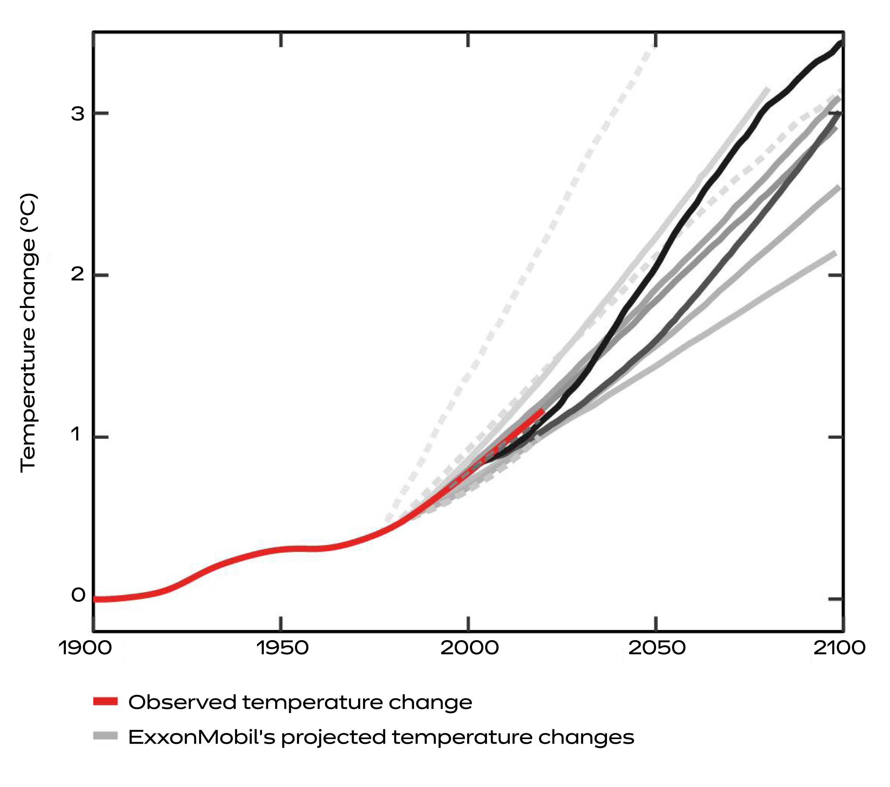
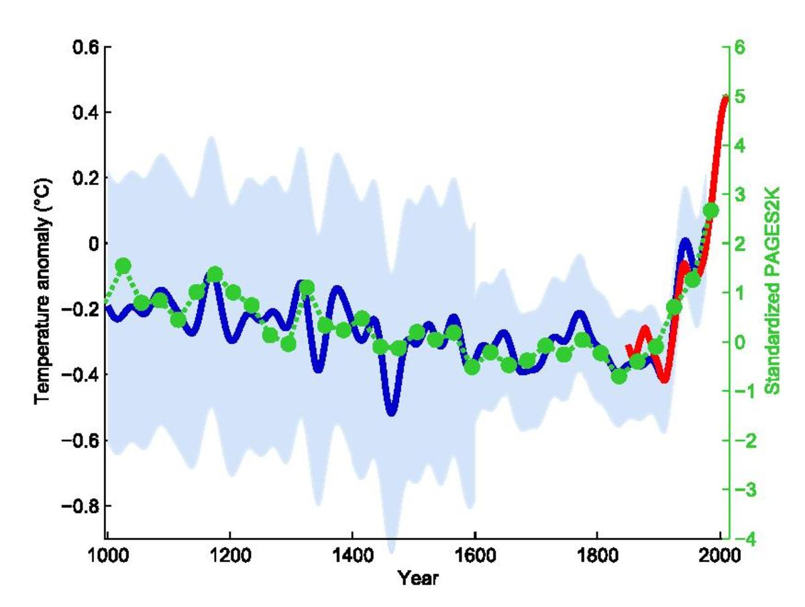
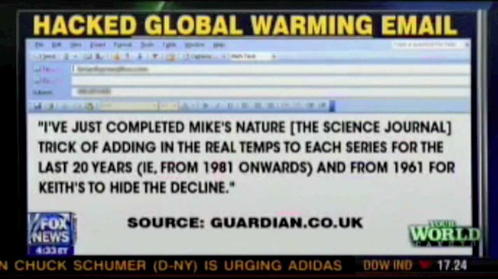
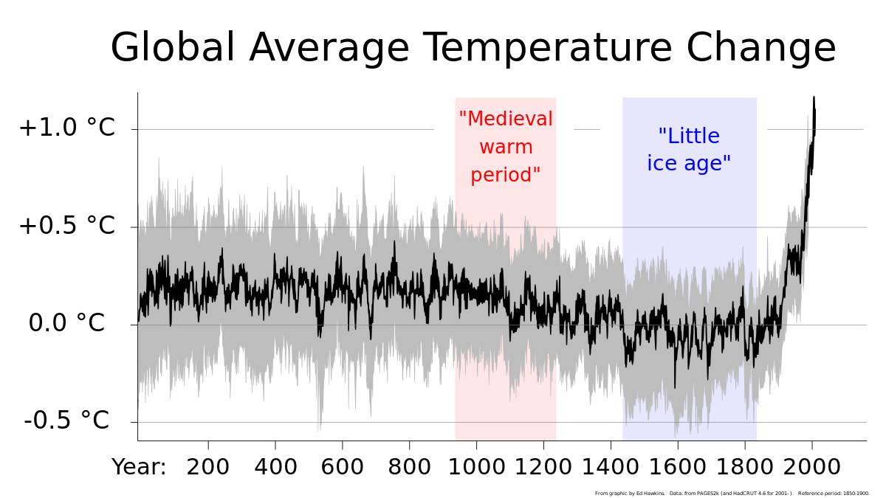

## Welcome Back: Where We Left Off

::: {style="font-size: 1.4em; line-height: 1.7;"}
- **Week 5:** buildings and cities lock in heat, energy demand and daily life for decades.
- **Week 6:** the **Tragedy of the Commons** — markets reward private benefit and spread the cost. And accurate information can still fail to land.
- **This week:** what if the facts are *made* to look uncertain — on purpose — by the people who already know the answer?
:::

::: {style="font-size: 1.4em; margin-top: 30px; font-weight: bold; color: #8e44ad;"}
Doubt can be manufactured. Today: who made it, how, and why it still works.
:::

---

## {background-color="#1a1a2e"}

::: {style="font-size: 1.9em; color: white; text-align: center; line-height: 1.5;"}
*"Doubt is our product since it is the best means of competing with the 'body of fact' that exists in the mind of the general public. It is also the means of establishing a controversy."*
:::

::: {style="font-size: 1.2em; color: #95a5a6; margin-top: 30px; text-align: center;"}
— Brown & Williamson Tobacco, internal memo "Smoking and Health Proposal", 1969
:::

::: {style="font-size: 1.4em; color: #e74c3c; margin-top: 30px; text-align: center; font-weight: bold;"}
The product was never the science. The product was the controversy — first for tobacco, then for fossil fuels.
:::

::: {.notes}
Read the whole sentence slowly. "Competing with the body of fact": the company accepted that the facts were against it. It did not need to win — it needed a controversy. Everything today is a variation on this sentence.
:::

# Act 1: Tobacco Wrote the Playbook

---

## 1953: Hire a PR Firm, Not a Lab

::: {style="font-size: 1.35em; line-height: 1.7;"}
- **December 1953:** after studies link smoking to lung cancer, tobacco company heads meet at New York's Plaza Hotel with the PR firm **Hill & Knowlton**.
- **January 1954:** "A Frank Statement to Cigarette Smokers" runs in **448 newspapers**: *"We accept an interest in people's health as a basic responsibility, paramount to every other consideration."*
- They fund a research committee whose real job is to keep the question **open** — not to answer it.
:::

::: {style="font-size: 1.35em; margin-top: 25px; font-weight: bold; color: #c0392b;"}
The goal was never to prove cigarettes safe. It was to make "we don't know yet" sound reasonable for as long as possible.
:::

::: {style="font-size: 0.7em; color: #7f8c8d; margin-top: 20px;"}
Brandt, *The Cigarette Century* (2007) · [A Frank Statement to Cigarette Smokers](https://en.wikipedia.org/wiki/A_Frank_Statement_to_Cigarette_Smokers)
:::

---

## The Playbook: Tobacco → Oil

::: {style="font-size: 1.4em; line-height: 2.0;"}
**Step 1:** Fund scientists to produce "alternative" research

**Step 2:** Amplify the 3% of dissenters, ignore the 97% consensus

**Step 3:** Reframe the debate — *"the science isn't settled"*

**Step 4:** Attack individual scientists, not their findings

**Step 5:** Shift blame to consumers — *"it's your personal choice"*
:::

::: {style="font-size: 1.5em; margin-top: 20px; background: #e74c3c; color: white; padding: 20px; border-radius: 10px; text-align: center;"}
**Same PR firms. Same strategy. Same result: decades of delay.**
:::

::: {style="font-size: 0.7em; color: #7f8c8d; margin-top: 15px;"}
Oreskes & Conway, *Merchants of Doubt* (2010)
:::

---

## 1994: Seven CEOs, One Sentence

::: {style="font-size: 1em; color: #7f8c8d; letter-spacing: 0.08em; font-weight: bold;"}
US HOUSE SUBCOMMITTEE ON HEALTH AND THE ENVIRONMENT · 14 APRIL 1994
:::

::: {style="font-size: 1.8em; line-height: 1.5; margin-top: 30px;"}
Seven tobacco chief executives, under oath, one after another:

**"I believe nicotine is not addictive."**
:::

::: {style="font-size: 1.4em; margin-top: 30px; color: #c0392b; font-weight: bold;"}
Their own internal documents had said otherwise for decades. Remember this scene — it comes back in 2021.
:::

::: {.notes}
If time allows, show 30 seconds of the C-SPAN footage of the executives standing to be sworn in together.
:::

---

## Then the Doubt Collapsed

::: {style="font-size: 1.35em; line-height: 1.7;"}
- **Documents:** leaked and subpoenaed papers showed the companies knew. Millions are now public.
- **Litigation:** the 1998 **Master Settlement Agreement** with 46 US states — about **US\$206 billion** over 25 years.
- **Judgment:** in 2006 a US federal court ruled the companies had deceived the public for decades (*US v. Philip Morris*).
- **Behaviour:** US adult smoking fell from **42%** (1965) to about **11%** today.
:::

::: {style="font-size: 1.35em; margin-top: 25px; font-weight: bold; color: #c0392b;"}
Almost no one now argues smoking is safe. Tobacco doubt is badly weakened — so the machine moved on to a bigger product.
:::

::: {style="font-size: 0.7em; color: #7f8c8d; margin-top: 15px;"}
[Master Settlement Agreement](https://en.wikipedia.org/wiki/Tobacco_Master_Settlement_Agreement) · [UCSF Truth Tobacco Industry Documents](https://www.industrydocuments.ucsf.edu/tobacco/) · CDC adult smoking data
:::

::: {.notes}
The hopeful half of the story: manufactured doubt can be defeated — through disclosure, courts and public pressure. Keep it in mind for the debate motion on legal liability.
:::

# Act 2: Shell Knew

---

## 1988: Shell's Confidential Report

::: {style="font-size: 1em; color: #7f8c8d; letter-spacing: 0.08em; font-weight: bold;"}
"THE GREENHOUSE EFFECT" · SHELL GREENHOUSE EFFECT WORKING GROUP · MARKED CONFIDENTIAL
:::

::: {style="font-size: 1.3em; line-height: 1.65; margin-top: 15px;"}
- Based on a **1986** internal study; 87 pages.
- Calculated that Shell's own oil, gas and coal products produced about **4% of global carbon emissions** (1984).
- Warned the changes could be **greater than any in recorded history** — sea-level rise, shifting rainfall, social disruption.
- *"By the time the global warming becomes detectable it could be too late to take effective countermeasures."*
:::

::: {style="font-size: 1.3em; margin-top: 20px; font-weight: bold; color: #c0392b;"}
Not a sceptic's guess. The company's own scientists, about the company's own products.
:::

::: {style="font-size: 0.7em; color: #7f8c8d; margin-top: 15px;"}
Uncovered by Jelmer Mommers, *De Correspondent* (2017) · [Climate Files: 1988 Shell confidential report](https://www.climatefiles.com/?p=1141)
:::

---

## 1991: Shell Even Told the Public

::: {style="font-size: 1em; color: #7f8c8d; letter-spacing: 0.08em; font-weight: bold;"}
"CLIMATE OF CONCERN" · 28-MINUTE SHELL FILM · MADE FOR SCHOOLS AND UNIVERSITIES
:::

::: {style="font-size: 1.45em; line-height: 1.7; margin-top: 15px;"}
- Warned of more extreme weather, floods, famine and **climate refugees**.
- Called this *"a warning endorsed by a uniquely broad consensus of scientists."*
- Said action was needed **now** — before the effects were fully certain.
:::

::: {style="font-size: 1.5em; margin-top: 30px; font-weight: bold; color: #8e44ad;"}
So in 1991, Shell knew — and said so. What did it do next?
:::

::: {style="font-size: 0.7em; color: #7f8c8d; margin-top: 15px;"}
[The Guardian (2017): Shell knew — oil giant's 1991 film warned of climate change danger](https://www.theguardian.com/environment/2017/feb/28/shell-knew-oil-giants-1991-film-warned-climate-change-danger)
:::

---

## {background-color="#000000"}

::: {style="text-align: center;"}
{width="50%"}
:::

::: {style="font-size: 1.3em; text-align: center; color: #ccc; margin-top: 20px;"}
*And Exxon knew too. Their own graphs prove it.*
:::

---

## What They Did Instead

::: {style="font-size: 1.3em; line-height: 1.65;"}
- **Global Climate Coalition (1989–2002):** an industry lobby — Exxon, Shell's US arm, BP, the American Petroleum Institute and others — that campaigned against the Kyoto Protocol.
- **1995:** the coalition's own technical advisers wrote that the greenhouse effect *"is well established and cannot be denied."* That passage was cut before the document circulated.
- **1998, API's communications plan:** *"Victory will be achieved when average citizens 'understand' (recognize) uncertainties in climate science."*
:::

::: {style="font-size: 1.3em; margin-top: 20px; background: #2c3e50; color: white; padding: 20px; border-radius: 10px;"}
Upton Sinclair: *"It is difficult to get a man to understand something, when his salary depends upon his not understanding it."* Shell understood. Its salary depended on **you** not understanding it.
:::

::: {style="font-size: 0.7em; color: #7f8c8d; margin-top: 15px;"}
[New York Times (2009): Industry ignored its scientists on climate](https://www.nytimes.com/2009/04/24/science/earth/24deny.html) · [Climate Files: API 1998 action plan](https://www.climatefiles.com/)
:::

::: {.notes}
Read the API line twice: "victory" is defined as public uncertainty — the 1969 tobacco memo, rewritten for carbon. Shell and BP left the coalition in the late 1990s but stayed in trade associations that kept lobbying against climate policy.
:::

---

## One Timeline. One Cover-Up.

::: {style="font-size: 1.3em; line-height: 1.75; background: #1a1a2e; color: white; padding: 40px; border-radius: 15px;"}
[**1977–82**]{style="color: #3498db;"} — Exxon's own scientists model the coming warming — accurately.

[**1988**]{style="color: #3498db;"} — Shell's confidential report. NASA's James Hansen tells the US Senate that warming has begun.

[**1991**]{style="color: #3498db;"} — Shell's public film warns of floods, famine and climate refugees.

[**1989–2002**]{style="color: #f39c12;"} — Exxon, Shell, BP and API back the Global Climate Coalition against binding cuts.

[**1998**]{style="color: #f39c12;"} — API: "victory" is when citizens "recognize uncertainties."

[**2023**]{style="color: #e74c3c;"} — *Science* confirms Exxon's projections were **remarkably accurate.**

They knew. They chose doubt. [**You inherited the bill.**]{style="color: #e74c3c;"}
:::

::: {style="font-size: 1.2em; margin-top: 20px; font-weight: bold; color: #c0392b; text-align: center;"}
More than half of all fossil-fuel CO₂ ever emitted has been released since 1990 — after they knew.
:::

---

## See It: Who Is Really Responsible?



::: {style="font-size: 1.1em; margin-top: 10px; color: #7f8c8d; text-align: center;"}
*Kurzgesagt (~10 min). The answer to "who is responsible?" changes completely depending on your metric — per-capita, annual, or cumulative. The narrative shapes the blame.*
:::

# Act 3: Doubt in the Hearing Room

---

## Case Study 1: The Hockey Stick Graph



---

## What Does This Graph Actually Show?

::: {style="font-size: 1.5em; line-height: 1.8;"}
In 1998, climate scientist **Michael Mann** published a graph of global temperatures over the last **1,000 years.**

The shape tells the story:

- **The handle** (900–1900 AD): temperatures roughly flat — small ups and downs, no clear trend
- **The blade** (1900–present): a sharp, sudden spike upward

**The message:** for a thousand years, nothing much happened. Then we started burning fossil fuels — and the graph broke upward like a hockey stick.
:::

---

## Why It Mattered

::: {style="font-size: 1.5em; line-height: 1.8;"}
The Hockey Stick became the **icon of the IPCC's 2001 report** — the single most recognisable image in climate science.

It said, in one picture:

*"This is not natural variability. This is us."*

That made it **the most dangerous graph in the world** — for anyone whose profits depended on doubt.
:::

---

## The Attack

::: {style="font-size: 1.4em; line-height: 1.7;"}
**Who:** Steve McIntyre (retired mining executive) and Ross McKitrick (economist) — neither was a climate scientist.

**What they did:** Challenged Mann's statistical methods. Claimed the hockey-stick shape was an artefact of bad maths.

**The hearing room:** In 2005, Rep. **Joe Barton**, chair of the House Energy and Commerce Committee, demanded Mann's funding records, data and computer code. Congressional hearings followed. Death threats to Mann. *"The science isn't settled."*

**What they did NOT do:** Produce an alternative temperature reconstruction that showed a different story.
:::

---

## The Verdict

::: {style="font-size: 1.5em; line-height: 1.8;"}
Since 1998, **dozens of independent teams** using different data and different methods have reconstructed the temperature record.

**Every single one** confirms the basic shape: flat handle, sharp upward blade.

The National Academy of Sciences (2006) concluded with *"a high level of confidence"* that recent decades were warmer than any comparable period in **at least 400 years** — and that the 1,000-year picture was *"plausible."*
:::

::: {style="font-size: 1.4em; margin-top: 20px; font-weight: bold; color: #c0392b;"}
The attack didn't disprove the science. It delayed the response by a decade.
:::

---

## {background-color="#2c3e50"}

::: {style="font-size: 1.8em; text-align: center; padding: 50px; color: white; line-height: 1.6;"}
You don't need to **win** the scientific debate.

You just need to make people **think there is one.**

That's how the Doubt Machine works.
:::

---

## The Snowball on the Senate Floor

::: {style="font-size: 1.4em; line-height: 1.7;"}
- **2003:** Senator **James Inhofe** calls global warming *"the greatest hoax ever perpetrated on the American people."*
- **26 February 2015:** he carries a snowball onto the Senate floor — *"Do you know what this is? It's a snowball"* — to dispute that 2014 was the warmest year on record. **It was.**
- At the time, he **chaired** the Senate committee responsible for environmental policy.
:::

::: {style="font-size: 1.4em; margin-top: 25px; font-weight: bold; color: #c0392b;"}
Weather is not climate. But a snowball is easier to remember than a temperature record — and that is the point.
:::

::: {style="font-size: 0.7em; color: #7f8c8d; margin-top: 15px;"}
Inhofe, *The Greatest Hoax* (2012) · NASA / NOAA global temperature records, 2015
:::

::: {.notes}
Let students react: it looks absurd, yet it was effective theatre. Connect to the Spectacle Formula: the Doubt Machine uses spectacle too — which is why their own presentations need evidence as well as impact.
:::

---

## 2021: Big Oil's Tobacco Moment

:::: {.columns}
::: {.column width="48%"}
::: {style="background: #ecf0f1; padding: 30px; border-radius: 15px; font-size: 1.25em; line-height: 1.6;"}
**1994 · Tobacco**

Seven CEOs sworn in together.

*"I believe nicotine is not addictive."*
:::
:::

::: {.column width="4%"}
:::

::: {.column width="48%"}
::: {style="background: #fdebd0; padding: 30px; border-radius: 15px; font-size: 1.25em; line-height: 1.6;"}
**28 October 2021 · Oil**

The heads of ExxonMobil, Chevron, BP America and **Shell** testify to the House Oversight Committee.

All deny misleading the public. None commits to stop funding groups that fight climate policy.
:::
:::
::::

::: {style="font-size: 1.35em; margin-top: 25px; font-weight: bold; color: #c0392b;"}
Committee chair Carolyn Maloney: *"They are obviously lying like the tobacco executives were."*
:::

::: {style="font-size: 1.15em; margin-top: 15px;"}
Several committee members spent their time defending the industry and questioning the hearing itself. Even in the hearing room, the doubt still had a voice.
:::

::: {style="font-size: 0.7em; color: #7f8c8d; margin-top: 15px;"}
[PBS NewsHour: Oil executives testify over climate misinformation (2021)](https://www.pbs.org/newshour/economy/watch-live-oil-executives-testify-over-climate-misinformation-in-house-hearing)
:::

::: {.notes}
ExxonMobil's Darren Woods told the committee the company's public climate statements "are and have always been truthful, fact-based". The comparison with 1994 was made by the committee itself. Ask: what is different in 2021? The executives no longer deny that warming is happening; they deny that they misled anyone. The doubt has moved from the science to the responsibility.
:::

---

## This Is Not History: 2025–26

::: {style="font-size: 1.4em; line-height: 1.7;"}
- **July 2025:** the US Department of Energy publishes a climate report written by **five long-standing contrarians** — including Ross McKitrick, who attacked the hockey stick.
- The EPA cites it in proposing to scrap the **2009 endangerment finding** — the legal basis for regulating greenhouse gases from vehicles.
- **February 2026:** the repeal is finalised; it takes effect in April. Lawsuits are under way.
:::

::: {style="font-size: 1.4em; margin-top: 25px; font-weight: bold; color: #c0392b;"}
The Doubt Machine no longer needs to lobby the government. In some places, it now writes the reports.
:::

::: {style="font-size: 0.7em; color: #7f8c8d; margin-top: 15px;"}
[Ballotpedia News (2026): EPA revokes endangerment finding](https://news.ballotpedia.org/2026/03/04/epa-revokes-obama-era-endangerment-finding-on-greenhouse-gas-emissions/)
:::

::: {.notes}
Keep this factual: documents and dates. The final rule leans on legal arguments rather than the contested report, but the proposal relied on it. Check the status of the court challenges before class.
:::

# Case Study 2: Climategate

---

## Climategate



---

## What Happened

::: {style="font-size: 1.4em; line-height: 1.8;"}
**November 2009** — weeks before the Copenhagen climate summit — hackers leaked **thousands of private emails** from the University of East Anglia's Climate Research Unit.

**The accusation:** Scientists were manipulating data and suppressing dissent.

**The most-quoted line:** Phil Jones wrote about using a "trick" to "hide the decline."

**What he actually meant:** A well-known statistical technique to handle a known data divergence in tree-ring records after 1960. "Trick" = clever method. Not deception.
:::

---

## The Verdict

::: {style="font-size: 1.5em; line-height: 1.8;"}
**Eight independent investigations** — UK Parliament, Penn State, the US EPA, and more.

**Result:** Scientists cleared of misconduct. Every. Single. Time.

**But the damage was done:**

- Public trust in climate science dropped **15 percentage points** in the year after
- The Copenhagen summit collapsed without a binding agreement
:::

::: {style="font-size: 1.4em; margin-top: 20px; font-weight: bold; color: #c0392b;"}
The emails were stolen. The quotes were cherry-picked. The scientists were cleared. And the world lost a decade.
:::

# Case Study 3: The Medieval Warm Period

---

## Medieval Warm Period



---

## The Argument

::: {style="font-size: 1.5em; line-height: 1.8;"}
**The claim:** From about **950–1250 AD**, parts of the North Atlantic were unusually warm. Vikings farmed in Greenland. Grapes grew in England.

**The sceptic's argument:** *"See? The climate has always changed. What's happening now is natural."*

**What they leave out:**

- The MWP was **regional** (mainly North Atlantic), not global
- Current warming is **global** and **faster** than anything in the record
- The *cause* matters — medieval warmth had natural drivers; current warming has an industrial one
:::

---

## {background-color="#1a1a2e"}

::: {style="font-size: 2.5em; color: white; text-align: center; line-height: 1.6;"}
The question isn't: *"Has the climate changed before?"*

Of course it has.

The question is: [**"Has it ever changed this fast — and did we cause it?"**]{style="color: #e74c3c;"}

The answer to both is **yes.**
:::

# Case Study 4: Fake News as a Weapon

---

## Trump's Climate Claims

::: {style="font-size: 1.4em; line-height: 1.8;"}
These aren't just "wrong." They're **the Doubt Machine operating at the highest level of political power.**

> *"The concept of global warming was created by and for the Chinese in order to make U.S. manufacturing non-competitive."*
> — Trump, Twitter, 2012

**Fact:** Climate science dates to the 1890s (Svante Arrhenius). It predates modern China by half a century.
:::

---

## More Claims, Same Playbook

::: {style="font-size: 1.4em; line-height: 1.8;"}
> *"It used to not be climate change, it used to be global warming… That wasn't working too well because it was getting too cold all over the place."*
> — Trump, Interview with Piers Morgan, 2018

**Fact:** Weather ≠ climate. The terminology shifted because "climate change" captures broader impacts — droughts, floods, storms. Not because warming stopped.

Global temperatures have risen consistently for decades.
:::

---

## The Sea Level Lie

::: {style="font-size: 1.4em; line-height: 1.8;"}
> *"The ocean is going to rise by 1/100th of an inch over 400 years. That's not our problem."*
> — Trump, Rally, December 2015

**Fact:** The IPCC projects about **0.3–1.0 metres** of sea-level rise by 2100. That's enough to displace **hundreds of millions** of coastal residents.
:::

::: {style="font-size: 1.5em; margin-top: 20px; font-weight: bold; color: #c0392b;"}
Notice the pattern: minimise, confuse, redirect. The Doubt Machine doesn't need to be right. It just needs to sound plausible for long enough.
:::

# Spotting Manufactured Doubt

---

## Five Fingerprints: FLICC

::: {style="font-size: 1.3em;"}
| Technique | What it sounds like |
|-----------|---------------------|
| **F**ake experts | "Thousands of scientists signed a petition…" — few of them climate scientists |
| **L**ogical fallacies | "The climate changed before humans, so humans can't be changing it." |
| **I**mpossible expectations | "Until the models are perfect, we shouldn't act." |
| **C**herry picking | A snowball. One cold winter. One leaked phrase. |
| **C**onspiracy theories | "It's a hoax — to destroy industry, or to get grant money." |
:::

::: {style="font-size: 0.7em; color: #7f8c8d; margin-top: 15px;"}
John Cook · [Skeptical Science: FLICC, five techniques of science denial](https://skepticalscience.com/history-FLICC-5-techniques-science-denial.html)
:::

---

## Real Uncertainty or Manufactured Doubt?

:::: {.columns}
::: {.column width="48%"}
::: {style="background: #d5f5e3; padding: 30px; border-radius: 15px; font-size: 1.3em; line-height: 1.6;"}
**Genuine uncertainty**

Comes with ranges and error bars.

Published, reviewed — and narrows as data arrive.

Offers an explanation of its own.
:::
:::

::: {.column width="4%"}
:::

::: {.column width="48%"}
::: {style="background: #fadbd8; padding: 30px; border-radius: 15px; font-size: 1.3em; line-height: 1.6;"}
**Manufactured doubt**

Aimed at the public, not at journals.

Funded by those who gain from delay.

Never resolves — and never proposes an alternative.
:::
:::
::::

::: {style="font-size: 1.4em; margin-top: 30px; font-weight: bold; color: #8e44ad; text-align: center;"}
When someone says "the science isn't settled," ask: *who profits from your uncertainty?*
:::

::: {.notes}
Scepticism is part of science, and students should keep it. The difference is direction: genuine scepticism wants the question answered; manufactured doubt wants it to stay open.
:::

---

## Will Oil Go the Way of Tobacco?

::: {style="font-size: 1.35em; line-height: 1.7;"}
- **Documents:** the internal papers are now public — Shell's 1988 report, Exxon's projections, the API plan.
- **Courts:** in 2021 a Dutch court ordered Shell to cut emissions 45% by 2030. The appeal court overturned the target in 2024 — but agreed Shell has a duty to reduce emissions. US cities and states are suing oil companies for deception.
- **Hearings:** the 2021 hearing borrowed tobacco's script on purpose.
:::

::: {style="font-size: 1.4em; margin-top: 25px; font-weight: bold; color: #c0392b;"}
Tobacco doubt took about 40 years to break. How long can climate doubt last — and who pays while it does?
:::

::: {style="font-size: 0.7em; color: #7f8c8d; margin-top: 15px;"}
*Milieudefensie v. Royal Dutch Shell*, The Hague District Court (2021) and Court of Appeal (2024)
:::

# This Week's Conceptual Takeaway

---

## The Doubt Machine

::: {style="font-size: 1.5em; line-height: 1.7; background: #2c3e50; color: white; padding: 40px; border-radius: 15px;"}
Before this week, you might have thought climate denial was just ignorance — people who don't understand science.

Now you know: **doubt is a manufactured product.** It has a budget, a playbook, and a seventy-year track record.

- Tobacco → "smoking doesn't cause cancer"
- Fossil fuels → "the science isn't settled" — while Shell's and Exxon's own scientists said it was
- Same firms, same strategy, same result: **delay**
:::

::: {style="font-size: 1.4em; margin-top: 30px; font-weight: bold; color: #8e44ad; text-align: center;"}
**Your portable takeaway:** Epistemic humility — when someone says "the science isn't settled," ask: *who profits from your uncertainty?*
:::

# This Week's Battlefield

---

## Two Sides. Two Views on Truth.

::: {style="display: flex; justify-content: space-around; margin-top: 50px;"}
::: {style="text-align: center; width: 45%; background: #27ae60; color: white; padding: 50px; border-radius: 15px;"}
::: {style="font-size: 2.5em; font-weight: bold;"}
PRO-CLIMATE
:::
::: {style="font-size: 1.3em; margin-top: 20px;"}
= Scientific Consensus Matters

= "Denialism is dangerous"
:::
:::

::: {style="text-align: center; width: 45%; background: #3498db; color: white; padding: 50px; border-radius: 15px;"}
::: {style="font-size: 2.5em; font-weight: bold;"}
PRO-DEVELOPMENT
:::
::: {style="font-size: 1.3em; margin-top: 20px;"}
= Question Everything

= "Skepticism is healthy"
:::
:::
:::

---

## The Core Tension

::: {style="font-size: 1.6em; line-height: 1.8;"}
| PRO-CLIMATE | PRO-DEVELOPMENT |
|-------------|-----------------|
| Trust the science | Question the models |
| Expert consensus | Healthy skepticism |
| Urgency requires action | Uncertainty requires caution |
| Denialism is funded | Alarmism is funded too |
| Facts over feelings | Predictions often fail |

**This tension defines debates about truth, expertise, and action.**
:::

# Building Your Doubt Spectacle

---

## The Formula (Reminder)

::: {style="font-size: 1.8em; line-height: 1.8;"}
**Fact** + **Human Story** + **Stakes** = **Spectacle**
:::

::: {style="display: flex; justify-content: space-around; margin-top: 50px;"}
::: {style="text-align: center; width: 30%; background: #ecf0f1; padding: 30px; border-radius: 10px;"}
::: {style="font-size: 1.2em; font-weight: bold;"}
Weak
:::
"Misinformation is a problem"
:::

::: {style="text-align: center; width: 30%; background: #f39c12; color: white; padding: 30px; border-radius: 10px;"}
::: {style="font-size: 1.2em; font-weight: bold;"}
Better
:::
"Oil companies funded climate denial for 40 years"
:::

::: {style="text-align: center; width: 30%; background: #e74c3c; color: white; padding: 30px; border-radius: 10px;"}
::: {style="font-size: 1.2em; font-weight: bold;"}
Spectacle
:::
"In 1988, Shell's own scientists warned it could soon be too late. In 1991, Shell made a film about climate refugees. Then it funded the coalition that fought Kyoto. They knew. They sold doubt. You paid."
:::
:::

---

## PRO-CLIMATE: Make It Personal

::: {style="background: #27ae60; color: white; padding: 40px; border-radius: 15px; font-size: 1.5em; line-height: 1.8;"}
**Don't say:** "Climate denial is funded by fossil fuel companies."

**Say:** "The same playbook. The same PR firms. Tobacco companies denied cancer for decades. Oil companies denied warming for decades. You were the mark both times."

**Don't say:** "Trust the scientific consensus."

**Say:** "97% of climate scientists agree. That's the same consensus level as 'smoking causes cancer.' You wouldn't bet your life on the 3%. Why bet your grandchildren's?"
:::

---

## PRO-DEVELOPMENT: Argue Hard — Without Becoming the Machine

::: {style="background: #3498db; color: white; padding: 40px; border-radius: 15px; font-size: 1.35em; line-height: 1.7;"}
**Don't say:** "The science isn't settled." — that is the Doubt Machine's own line, and the documents now show it wasn't true.

**Say:** "Hong Kong's buses, ships and power stations still run on fossil fuels. If liability pushes up fuel prices, who pays first — the oil company, or the minibus driver?"

**Don't say:** "Scientists predicted an ice age in the 1970s" or "they called Galileo a denier too." — cherry picking and a false analogy. Now you can spot them.

**Say:** "Governments approved these fuels and all of us bought them. Lawsuits about the past won't build a single wind farm. Spend that money on the transition."
:::

::: {.notes}
This replaces the old "Paint the Picture" lines, which themselves used cherry picking and a false analogy. The development side can still argue hard against liability — on cost, fairness and shared responsibility rather than on the science.
:::

---

## This Week's Debate Motion

::: {style="font-size: 1.8em; text-align: center; background: #2c3e50; color: white; padding: 50px; border-radius: 15px;"}
**"This house believes that fossil fuel companies that knowingly funded climate denial should be held legally liable for climate damages."**
:::

::: {style="font-size: 1.3em; margin-top: 30px; text-align: center;"}
PRO-CLIMATE: They knew. They lied. They should pay — just like Big Tobacco.

PRO-DEVELOPMENT: Legal liability will cripple the energy industry and raise costs for everyone. Punish the future for the past?
:::

# Activity: The Doubt Machine Debate

#

```{=html}
<style>
  #w7groupAssignment_container { text-align: center; margin-top: 20px; font-family: Arial, sans-serif; }
  #w7groupAssignment_startButton { font-size: 24px; padding: 15px 30px; cursor: pointer; background-color: #3498db; color: white; border: none; border-radius: 5px; transition: background-color 0.3s; }
  #w7groupAssignment_startButton:hover { background-color: #2980b9; }
  #w7groupAssignment_overlay { position: fixed; top: 0; left: 0; width: 100%; height: 100%; background-color: rgba(255,255,255,0.9); display: none; justify-content: center; align-items: center; z-index: 1000; }
  #w7groupAssignment_display { font-size: 36px; text-align: center; padding: 20px; max-width: 90%; max-height: 90%; overflow-y: auto; }
  #w7groupAssignment_display h2 { color: #2c3e50; font-size: 48px; margin-bottom: 30px; }
  #w7groupAssignment_display ul { list-style-type: none; padding: 0; }
  #w7groupAssignment_display li { margin: 20px 0; font-size: 36px; background-color: #ecf0f1; padding: 15px; border-radius: 10px; box-shadow: 0 2px 5px rgba(0,0,0,0.1); }
  #w7groupAssignment_closeButton { position: absolute; top: 20px; right: 20px; font-size: 24px; cursor: pointer; background-color: #e74c3c; color: white; border: none; border-radius: 5px; padding: 10px 20px; }
</style>
<div id="w7groupAssignment_container">
  <h1 style="font-size: 48px; color: #34495e;">Group Assignment Time!</h1>
  <button id="w7groupAssignment_startButton">Start the assignment</button>
</div>
<div id="w7groupAssignment_overlay">
  <div id="w7groupAssignment_display"></div>
  <button id="w7groupAssignment_closeButton">Close</button>
</div>
<script>
const W7GroupAssignment = {
  groups: ['Group One','Group Two','Group Three','Group Four','Group Five','Group Six'],
  vocations: ['Journalist/Media','Fossil Fuel Industry Rep','Climate Scientist','Policy Maker/Politician','Social Media Influencer','General Public/Student'],
  shuffleArray: function(a){for(let i=a.length-1;i>0;i--){const j=Math.floor(Math.random()*(i+1));[a[i],a[j]]=[a[j],a[i]];}return a;},
  createAssignment: function(){const s=this.shuffleArray([...this.vocations]);return this.groups.map((g,i)=>({group:g,vocation:s[i]}));},
  displayAssignment: function(){const a=this.createAssignment();let h='<h2>Random Group Assignments</h2><ul>';a.forEach(x=>{h+=`<li><strong>${x.group}:</strong> ${x.vocation}</li>`;});h+='</ul>';document.getElementById('w7groupAssignment_display').innerHTML=h;document.getElementById('w7groupAssignment_overlay').style.display='flex';},
  init: function(){document.getElementById('w7groupAssignment_startButton').addEventListener('click',()=>this.displayAssignment());document.getElementById('w7groupAssignment_closeButton').addEventListener('click',()=>{document.getElementById('w7groupAssignment_overlay').style.display='none';});}
};
W7GroupAssignment.init();
</script>
```

## Presentation Countdown

```{=html}
<style>
  #w7timer {
    font-size: 348px;
    font-weight: 700;
    font-variant-numeric: tabular-nums;
    line-height: 1.1;
    margin-bottom: 20px;
    transition: color 0.6s ease;
  }
  #w7timer.w7timer-flash { animation: w7timer-pop 0.6s ease; }
  @keyframes w7timer-pop {
    0%   { transform: scale(1); }
    40%  { transform: scale(1.06); }
    100% { transform: scale(1); }
  }
  #w7timer-label { font-size: 40px; color: #7f8c8d; margin-bottom: 30px; min-height: 1.4em; }
  .w7timer-btn { font-size: 24px; padding: 15px 30px; color: white; border: none; border-radius: 8px; cursor: pointer; margin: 0 5px; }
  .w7timer-btn:disabled { opacity: 0.6; cursor: default; }
  #w7start-button { background-color: #27ae60; }
  #w7pause-button { background-color: #f39c12; }
  #w7reset-button { background-color: #e74c3c; }
  #w7timer-legend { display: flex; justify-content: center; gap: 28px; margin-top: 36px; font-size: 26px; color: #2c3e50; }
  #w7timer-legend span { display: inline-flex; align-items: center; gap: 8px; }
  #w7timer-legend i { display: inline-block; width: 22px; height: 22px; border-radius: 50%; }
</style>

<div id="w7timer-container" style="text-align: center;">
  <div id="w7timer">05:00</div>
  <div id="w7timer-label"></div>
  <button id="w7start-button" class="w7timer-btn">Start 5:00</button>
  <button id="w7pause-button" class="w7timer-btn" disabled>Pause</button>
  <button id="w7reset-button" class="w7timer-btn">Reset</button>
  <div id="w7timer-legend"></div>
</div>

<script>
(function () {
  const TOTAL = 300; // 5 minutes
  // One colour per minute, as on countdown_colors.qmd:
  // 5:00–4:01 slate, 4:00–3:01 blue, 3:00–2:01 green, 2:00–1:01 orange, final minute red.
  const BAND_COLORS = ['#2c3e50', '#2980b9', '#27ae60', '#f39c12', '#e74c3c'];
  const DONE_COLOR = '#8e44ad'; // Time's up

  const timerEl = document.getElementById('w7timer');
  const labelEl = document.getElementById('w7timer-label');
  const startBtn = document.getElementById('w7start-button');
  const pauseBtn = document.getElementById('w7pause-button');
  const resetBtn = document.getElementById('w7reset-button');
  const legendEl = document.getElementById('w7timer-legend');

  let timeLeft = TOTAL;
  let deadline = 0;
  let interval = null;
  let currentBand = -1;

  BAND_COLORS.forEach((c, i) => {
    const s = document.createElement('span');
    s.innerHTML = '<i style="background:' + c + '"></i>' + (BAND_COLORS.length - i) + ' min';
    legendEl.appendChild(s);
  });

  // 300..241 -> 0, 240..181 -> 1, ..., 60..1 -> 4, 0 -> done
  function bandFor(sec) {
    return sec <= 0 ? BAND_COLORS.length : BAND_COLORS.length - Math.ceil(sec / 60);
  }

  function render(animate) {
    const m = Math.floor(timeLeft / 60);
    const s = timeLeft % 60;
    timerEl.textContent = String(m).padStart(2, '0') + ':' + String(s).padStart(2, '0');

    const band = bandFor(timeLeft);
    if (band === currentBand) return;
    currentBand = band;
    if (band >= BAND_COLORS.length) {
      timerEl.style.color = DONE_COLOR;
      labelEl.textContent = "Time's up!";
    } else {
      const minsLeft = BAND_COLORS.length - band;
      timerEl.style.color = BAND_COLORS[band];
      labelEl.textContent = minsLeft === 1 ? 'Final minute' : minsLeft + ' minutes left';
    }
    if (animate) {
      timerEl.classList.remove('w7timer-flash');
      void timerEl.offsetWidth; // restart the pop animation
      timerEl.classList.add('w7timer-flash');
    }
  }

  function stop() {
    clearInterval(interval);
    interval = null;
    pauseBtn.disabled = true;
  }

  function tick() {
    // Count down from a deadline so a slow or throttled tab cannot stretch the five minutes.
    timeLeft = Math.max(0, Math.ceil((deadline - Date.now()) / 1000));
    render(true);
    if (timeLeft <= 0) {
      stop();
      startBtn.disabled = true;
      startBtn.textContent = 'Done';
    }
  }

  startBtn.addEventListener('click', () => {
    if (interval || timeLeft <= 0) return;
    deadline = Date.now() + timeLeft * 1000;
    interval = setInterval(tick, 250);
    startBtn.disabled = true;
    startBtn.textContent = 'Running…';
    pauseBtn.disabled = false;
  });

  pauseBtn.addEventListener('click', () => {
    stop();
    startBtn.disabled = false;
    startBtn.textContent = 'Resume';
  });

  resetBtn.addEventListener('click', () => {
    stop();
    timeLeft = TOTAL;
    currentBand = -1;
    startBtn.disabled = false;
    startBtn.textContent = 'Start 5:00';
    render(false);
  });

  render(false);
})();
</script>
```

---

## Group Discussion: Climate Truth Debate (10 min)

1. **Introductions**
   - Briefly introduce your persona
   - One sentence: how does manufactured doubt affect your persona?

2. **Round-table: Share Key Insights**
   - Identify one climate claim your persona encounters most often
   - Is it manufactured doubt, genuine uncertainty, or somewhere in between?

3. **Converse More**
   - Challenge another persona: is their "fact" a product of the Doubt Machine?
   - Find common ground — what can both sides agree is genuinely uncertain vs. deliberately manufactured?
   - Choose your champion!

# The Persuasion Playbook | Strategy #6

---

## The Pre-Mortem

::: {style="font-size: 1.6em; background: #2c3e50; color: white; padding: 40px; border-radius: 10px;"}
Psychologist **Gary Klein** developed a technique:

Before launching a project, assume it **failed catastrophically**.

Then ask: *"What went wrong?"*

**Imagining the failure as already happened helps people find about 30% more reasons for it.**
:::

---

## The Science

::: {style="font-size: 1.4em; line-height: 1.8;"}
This is **Prospective Hindsight** (Mitchell, Russo & Pennington, 1989).

Imagining failure as *already happened* unlocks different cognitive pathways than "what could go wrong?"

The brain is better at **explaining the past** than predicting the future.

So you trick it: treat the future as past.
:::

---

## You Just Saw It

::: {style="font-size: 1.6em; line-height: 1.8;"}
The teams that did well today **anticipated the counterattack**.

They didn't ask "what might they say?"

They assumed: *"We lost. Why?"*

Then they fixed it before it happened.

The Doubt Machine runs its own pre-mortems. **So should you.**
:::

---

## Next Week's Challenge

::: {style="font-size: 2em; background: #e74c3c; color: white; padding: 40px; border-radius: 10px; text-align: center;"}
**Before you present, assume it bombed.**

Write three reasons why. Fix them.
:::

---

## Further Reading

::: {style="font-size: 1.1em; line-height: 1.6;"}
Oreskes, N. & Conway, E. M. (2010). *Merchants of Doubt.* Bloomsbury.

Supran, G., Rahmstorf, S. & Oreskes, N. (2023). Assessing ExxonMobil's global warming projections. *Science* 379, eabk0063.

Shell Greenhouse Effect Working Group (1988). *The Greenhouse Effect* (confidential). [Climate Files](https://www.climatefiles.com/?p=1141).

Brandt, A. M. (2007). *The Cigarette Century.* Basic Books.

Cook, J. et al. (2018). Deconstructing climate misinformation to identify reasoning errors. *Environmental Research Letters* 13, 024018.
:::
