## Last Week, in One Slide

::: {style="font-size: 1.3em; line-height: 1.6;"}
- **Doubt is a product.** Tobacco wrote the playbook: *"Doubt is our product"* (1969).
- **Shell knew.** Its own 1988 report warned it could soon be *"too late"* — then the industry backed a coalition that fought the Kyoto Protocol.
- **The hearing room kept doubt alive:** the attack on the hockey stick (2005), a snowball on the Senate floor (2015), oil CEOs before Congress (2021).
- **Your test:** real uncertainty has error bars and narrows as data arrive. Manufactured doubt never resolves.
:::

::: {style="font-size: 1.3em; margin-top: 30px; font-weight: bold; color: #8e44ad;"}
Today you'll need that test. Every claim carries a label: [Settled]{.w8-tag .settled} [Emerging]{.w8-tag .emerging} [Debated]{.w8-tag .debated}
:::

::: {style="font-size: 0.95em; color: #7f8c8d; margin-top: 24px;"}
Last week's challenge: run a pre-mortem on your presentation. Who tried it?
:::

::: {.notes}
One minute only. The labels matter: this week the evidence ranges from settled physics to genuinely open questions, and students should practise telling them apart.
:::

---

## {background-color="#000000"}

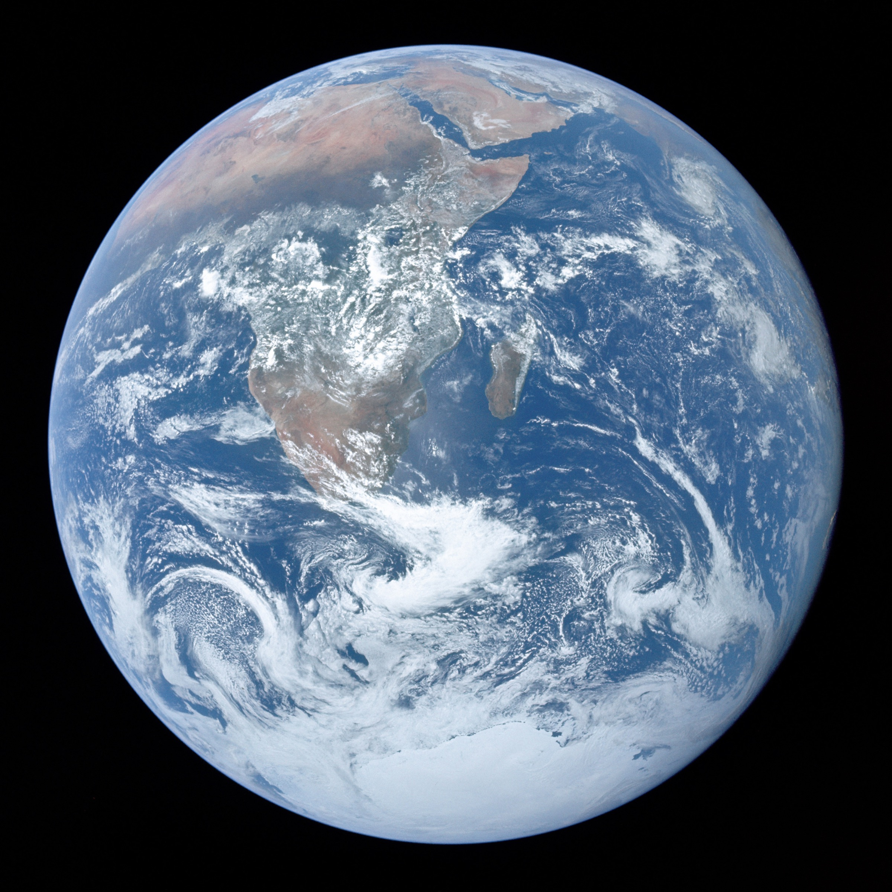{.r-stretch}

::: {.w8-hero-cap}
You live on an ocean planet. You just forgot.
:::

::: {.w8-hero-credit}
The Blue Marble — Apollo 17, 1972 (NASA)
:::

---

## Quick Exercise: What Comes to Mind?

::: {style="font-size: 2em; text-align: center; padding: 50px; background: #0a3d62; color: white; border-radius: 15px;"}
When I say **"ocean and climate change"** —

what keywords come to mind?
:::

::: {style="font-size: 1.3em; margin-top: 30px; text-align: center;"}
*Shout them out. Let's collect them.*
:::

---

## What You Probably Said vs. What You Didn't

::: {style="display: flex; justify-content: space-around; margin-top: 30px;"}
::: {style="text-align: left; width: 45%; background: #ecf0f1; padding: 30px; border-radius: 10px;"}
::: {style="font-size: 1.4em; font-weight: bold;"}
Common Answers
:::
::: {.nonincremental style="font-size: 1.2em; line-height: 1.6; margin-top: 15px;"}
- Plastic pollution
- Sea level rise
- Polar bears / ice caps
- Coral bleaching
- Overfishing
- Oil spills
:::
:::

::: {.fragment style="text-align: left; width: 45%; background: #e74c3c; color: white; padding: 30px; border-radius: 10px;"}
::: {style="font-size: 1.4em; font-weight: bold;"}
Rarely Mentioned
:::
::: {.nonincremental style="font-size: 1.2em; line-height: 1.6; margin-top: 15px;"}
- The ocean absorbs ~29% of our CO₂
- The global conveyor belt
- Phytoplankton — half of Earth's photosynthesis
- Ocean acidification
- Bottom trawling and seabed carbon
- The ocean's carbon sink weakening
:::
:::
:::

::: {.fragment style="font-size: 1.4em; text-align: center; margin-top: 30px; font-weight: bold; color: #c0392b;"}
The right-hand column is today's lecture.
:::

---

## So What Does "Ocean, Decolonized" Mean?

::: {style="font-size: 1.4em; line-height: 1.8;"}
The ocean has been **colonized by three wrong narratives.** Today we strip them away.
:::

::: {style="display: flex; justify-content: space-around; margin-top: 30px;"}
::: {style="text-align: left; width: 30%; background: #0a3d62; color: white; padding: 25px; border-radius: 10px;"}
::: {style="font-size: 1.2em; font-weight: bold;"}
1\. The Resource Narrative
:::
::: {style="font-size: 1.1em; line-height: 1.5; margin-top: 10px;"}
We think of the ocean as **fish, shipping lanes, oil.**

Today: the ocean is a **climate machine** — and we are slowing it down.
:::
:::

::: {style="text-align: left; width: 30%; background: #c0392b; color: white; padding: 25px; border-radius: 10px;"}
::: {style="font-size: 1.2em; font-weight: bold;"}
2\. The Consumer Guilt Narrative
:::
::: {style="font-size: 1.1em; line-height: 1.5; margin-top: 10px;"}
We think the problem is **our plastic straw.**

Today: the bigger damage is **industrial** — fossil CO₂, plastic production, fishing fleets.
:::
:::

::: {style="text-align: left; width: 30%; background: #8e44ad; color: white; padding: 25px; border-radius: 10px;"}
::: {style="font-size: 1.2em; font-weight: bold;"}
3\. The Knowledge Narrative
:::
::: {style="font-size: 1.1em; line-height: 1.5; margin-top: 10px;"}
We think Western science is the **only valid lens.**

Today: whose knowledge — and whose seas — **get counted?**
:::
:::
:::

---

## {background-color="#0a3d62"}

::: {style="font-size: 2.2em; color: white; text-align: center; line-height: 1.35;"}
The ocean is the largest carbon-capture machine on Earth.

**We are slowing it down.**
:::

::: {.fragment style="font-size: 1.45em; color: #ffb3a7; text-align: center; line-height: 1.45; margin-top: 30px;"}
And every tonne it fails to capture stays in the air — heating the water that does the capturing.
:::

::: {style="font-size: 0.8em; color: #a9cce3; text-align: center; margin-top: 50px;"}
1 The machine · 2 The acceleration effect · 3 Acid · 4 Phytoplankton · 5 Plastic · 6 Trawling · 7 Hong Kong · 8 Debate
:::

# Part 1 · The Machine {background-color="#0a3d62"}

[Three engines pull carbon out of the air. Two circulation systems move it around.]{.w8-sub}

## The Numbers

```{=html}
<div class="w8-tiles">
  <div class="w8-tile"><b>71%</b><span>of Earth's surface is ocean</span></div>
  <div class="w8-tile"><b>~29%</b><span>of our CO₂ emissions absorbed by the ocean, 2015–2024</span></div>
  <div class="w8-tile"><b>~90%</b><span>of the extra heat trapped by greenhouse gases ends up in the ocean</span></div>
  <div class="w8-tile"><b>~½</b><span>of all photosynthesis on Earth happens in the ocean</span></div>
</div>
```

::: {.fragment style="font-size: 1.4em; text-align: center; margin-top: 44px; font-weight: bold;"}
And the Paris Agreement mentions the ocean **once** — in its preamble.
:::

::: {.w8-src}
Global Carbon Budget 2025 (Friedlingstein et al., 2026) · IPCC AR6 WG1 (2021): 91% of the heat gained 1971–2018 · Field et al., *Science* (1998) · Paris Agreement (2015)
:::

## The World's Biggest Carbon-Capture Machine

```{=html}
<div class="w8-hbar"><div class="lab">The ocean<small>natural uptake, 2024</small></div><div class="track"><div class="fill" style="width:100%; background:#1f618d;">≈ 12.5 billion tonnes of CO₂ a year</div></div></div>
<div class="w8-hbar"><div class="lab">All human carbon removal<small>almost all of it forests</small></div><div class="track"><div class="fill" style="width:16%; background:#239b56;"></div><div class="after">≈ 2 billion tonnes</div></div></div>
<div class="w8-hbar"><div class="lab">New removal technology<small>direct air capture, biochar, BECCS…</small></div><div class="track"><div class="fill" style="width:5px; padding:0; background:#7d3c98;"></div><div class="after">≈ 0.0013 billion tonnes — too small to see</div></div></div>
```

::: {.fragment .w8-punch style="text-align: center;"}
About 6× all our carbon removal — and nearly 10,000× the new technology. For free, every year.
:::

::: {.w8-src}
Ocean sink 3.4 ± 0.4 billion tonnes of carbon in 2024: Global Carbon Budget 2025 · Removal: *The State of Carbon Dioxide Removal* (2024)
:::

::: {.notes}
Conventional removal is mostly forests and managed land. "Novel" removal — direct air capture, BECCS, biochar, enhanced weathering — was about 1.3 million tonnes of CO₂ a year (State of CDR 2024). 3.4 GtC × 3.664 ≈ 12.5 GtCO₂.
:::

## Three Engines

```{=html}
<div class="w8-cards" style="grid-template-columns: repeat(3, 1fr);">
  <div class="w8-card" style="background:#1f618d; color:#fff;"><div class="k">Engine 1</div><div class="h">Dissolve</div>CO₂ dissolves into the surface ocean. Cold water holds more. Seawater's natural "antacid" — carbonate — locks much of it away.</div>
  <div class="w8-card" style="background:#154360; color:#fff;"><div class="k">Engine 2</div><div class="h">Carry down</div>Near the poles, cold, dense water sinks — taking dissolved carbon and heat into the deep ocean, away from the air for centuries.</div>
  <div class="w8-card" style="background:#117a65; color:#fff;"><div class="k">Engine 3</div><div class="h">Grow &amp; sink</div>Phytoplankton turn CO₂ into living matter. Some of it sinks to the deep and the seabed — the "biological pump".</div>
</div>
```

::: {style="font-size: 1.3em; margin-top: 34px; text-align: center;"}
Plus the **gyres** — surface currents that decide where floating things end up.
:::

::: {.fragment .w8-punch style="text-align: center;"}
Remember the three engines. In Part 2, we watch each one slow down.
:::

## Engine 2: The Global Conveyor Belt

:::: {.columns}
::: {.column width="56%"}
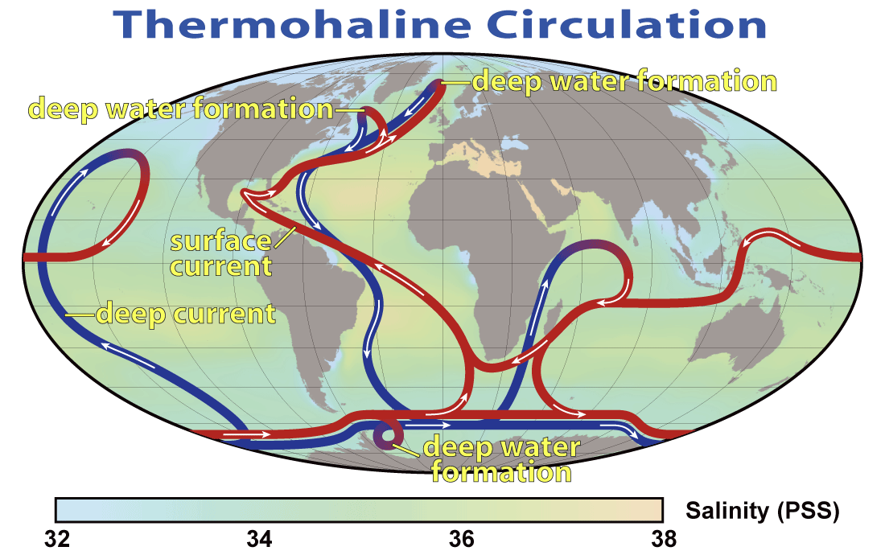
:::

::: {.column width="44%"}
::: {style="font-size: 1.05em; line-height: 1.5;"}
- Warm surface water flows **toward the poles**
- Near Greenland and Antarctica it cools, gets saltier, and **sinks**
- Deep water creeps back along the bottom — one loop takes about **1,000 years**
- On the way down it carries **heat and dissolved CO₂** out of reach of the air
:::
:::
::::

::: {.w8-punch}
Slow the conveyor, and less carbon gets carried down.
:::

::: {.w8-src}
Thermohaline circulation: red = warm surface currents, blue = cold deep currents
:::

## Engine 3: The Biological Carbon Pump

:::: {.columns}
::: {.column width="50%"}
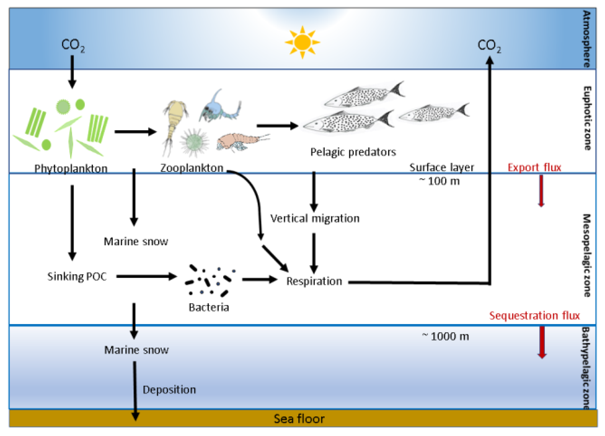
:::

::: {.column width="50%"}
::: {style="font-size: 1em; line-height: 1.5;"}
- **Phytoplankton** — microscopic algae — photosynthesise in the sunlit surface
- **Zooplankton and fish** eat them; their waste and dead cells sink as "marine snow"
- **Whales** feed deep and release iron-rich faeces at the surface — fertiliser for more phytoplankton
- A small share reaches the **seabed**, where it can stay buried for thousands of years
:::
:::
::::

::: {.w8-punch}
Without this pump, CO₂ in the air would be roughly **200 ppm higher** — even before industry.
:::

::: {.w8-src}
Volk & Hoffert (1985): about 200 ppm higher than preindustrial levels without the biological pump
:::

## The Surface Structure: Five Gyres

:::: {.columns}
::: {.column width="56%"}
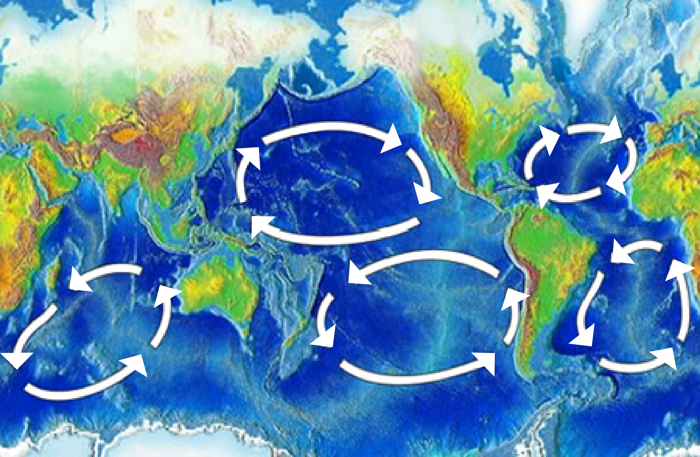
:::

::: {.column width="44%"}
::: {style="font-size: 1.05em; line-height: 1.5;"}
- Wind and Earth's rotation spin the surface ocean into **five giant gyres** — slow whirlpools thousands of kilometres across
- North and South Pacific, North and South Atlantic, Indian Ocean
- Their currents **converge** toward the centre — anything that floats gets trapped
:::
:::
::::

::: {.w8-punch}
Hold that thought. In Part 5, we see what collects in the middle.
:::

# Part 2 · The Acceleration Effect {background-color="#78281f"}

[What happens when the machine slows down?]{.w8-sub style="color: #f5d5d0;"}

## What the Ocean Did for Us in 2024

::: {style="font-size: 1.4em; text-align: center;"}
In 2024, the CO₂ in our air rose by **3.7 ppm.**
:::

```{=html}
<div class="w8-hbar" style="grid-template-columns: 430px 1fr;"><div class="lab">What actually happened</div><div class="track"><div class="fill" style="width:70%; background:#c0392b;">+3.7 ppm</div></div></div>
<div class="w8-hbar fragment" style="grid-template-columns: 430px 1fr;"><div class="lab">Without the ocean<small>its 3.4 billion tonnes of carbon left in the air</small></div><div class="track"><div class="fill" style="width:70%; background:#c0392b;">+3.7</div><div class="fill" style="width:30%; background:#1f618d;">+1.6 ppm</div></div></div>
```

::: {.fragment .w8-punch style="text-align: center;"}
About 40% faster. Every tonne the ocean stops absorbing is a tonne that stays in the air.
:::

::: {.w8-src}
Global Carbon Budget 2025: atmospheric growth 7.9 billion tonnes of carbon (3.73 ppm) in 2024; ocean sink 3.4 ± 0.4 billion tonnes ≈ 1.6 ppm (1 ppm = 2.124 billion tonnes of carbon). A thought experiment, not a forecast.
:::

::: {.notes}
Simple arithmetic to make the sink visible. It ignores how land and atmosphere would respond without an ocean sink, so present it as "what the ocean took out", not a model run.
:::

## Every Engine Is Slowing

```{=html}
<div class="w8-rows">
  <div class="eng">1 · Dissolve<small>the chemical engine</small></div>
  <div>Warmer water holds <b>less CO₂</b>. Acidification uses up the ocean's buffer, so <b>each extra tonne is harder to absorb</b>.</div>
  <div><span class="w8-tag settled">Settled</span></div>
  <div class="eng">2 · Carry down<small>the conveyor</small></div>
  <div>A warm surface "lid" mixes less with the deep (<b>stratification</b>). The Atlantic conveyor will <b>very likely weaken</b> this century.</div>
  <div><span class="w8-tag settled">Settled</span><br><span style="font-size: 0.7em; color: #7f8c8d;">how much: uncertain</span></div>
  <div class="eng">3 · Grow &amp; sink<small>the living engine</small></div>
  <div>Fewer nutrients reach the sunlit layer. Microplastics. Fewer whales.</div>
  <div><span class="w8-tag emerging">Emerging</span></div>
</div>
```

::: {.w8-src}
IPCC AR6 WG1 (2021) · Hauck & Völker (2015) · Bopp et al. (2013)
:::

::: {.notes}
IPCC AR6: the Atlantic Meridional Overturning Circulation is very likely to weaken over the 21st century; there is medium confidence it will not collapse abruptly before 2100. Some recent studies argue a collapse could come sooner. That part is debated.
:::

## The Acceleration Effect

```{=html}
<div class="w8-loop">
  <div class="node"><b>More CO₂ in the air</b>from our emissions</div>
  <div class="arr fragment" data-fragment-index="1">→</div>
  <div class="node fragment" data-fragment-index="1"><b>More heat trapped</b>the planet warms</div>
  <div class="arr fragment" data-fragment-index="4">↑</div>
  <div class="hub fragment" data-fragment-index="4">Each turn of the loop<br>makes the next one worse</div>
  <div class="arr fragment" data-fragment-index="2">↓</div>
  <div class="node hot fragment" data-fragment-index="3"><b>Less CO₂ absorbed</b>so more of it stays up</div>
  <div class="arr fragment" data-fragment-index="3">←</div>
  <div class="node hot fragment" data-fragment-index="2"><b>The ocean warms &amp; acidifies</b>all three engines slow</div>
</div>
```

::: {.fragment fragment-index="5" style="font-size: 1.15em; text-align: center; margin-top: 26px;"}
Scientists call this a **positive feedback** — not "positive" as in good, but as in **self-reinforcing.**
:::

::: {.notes}
Callback: Week 5's urban heat island had the same shape (a hotter city runs more air-conditioning, which makes it hotter). Week 10 is built on loops like this one: ice–albedo, permafrost, tipping points. Name the shape now so students recognise it then.
:::

## The More We Emit, the Less the Planet Absorbs

```{=html}
<div class="w8-sc-row"><div class="w8-sc-name">Very low emissions<small>SSP1-1.9 · 2,900 Gt CO₂</small></div><div class="w8-sc-bar"><div style="width:70.4%; background:linear-gradient(90deg,#1f618d 0 50.1%,#239b56 50.1% 100%);">70% absorbed</div><div class="air" style="width:29.6%;">30% stays up</div></div></div>
<div class="w8-sc-row"><div class="w8-sc-name">Low<small>SSP1-2.6 · 3,600 Gt CO₂</small></div><div class="w8-sc-bar"><div style="width:65.0%; background:linear-gradient(90deg,#1f618d 0 49.0%,#239b56 49.0% 100%);">65% absorbed</div><div class="air" style="width:35.0%;">35% stays up</div></div></div>
<div class="w8-sc-row"><div class="w8-sc-name">Intermediate<small>SSP2-4.5 · 5,400 Gt CO₂</small></div><div class="w8-sc-bar"><div style="width:54.0%; background:linear-gradient(90deg,#1f618d 0 50.7%,#239b56 50.7% 100%);">54% absorbed</div><div class="air" style="width:46.0%;">46% stays up</div></div></div>
<div class="w8-sc-row"><div class="w8-sc-name">High<small>SSP3-7.0 · 8,100 Gt CO₂</small></div><div class="w8-sc-bar"><div style="width:44.2%; background:linear-gradient(90deg,#1f618d 0 48.7%,#239b56 48.7% 100%);">44% absorbed</div><div class="air" style="width:55.8%;">56% stays up</div></div></div>
<div class="w8-sc-row"><div class="w8-sc-name">Very high emissions<small>SSP5-8.5 · 10,600 Gt CO₂</small></div><div class="w8-sc-bar"><div style="width:37.6%; background:linear-gradient(90deg,#1f618d 0 49.7%,#239b56 49.7% 100%);">38% absorbed</div><div class="air" style="width:62.4%;">62% stays up</div></div></div>
<div class="w8-legend"><span><i style="background:#1f618d"></i>Taken up by the ocean</span><span><i style="background:#239b56"></i>Taken up by land</span><span><i style="background:#c0392b"></i>Left in the air</span></div>
```

::: {.fragment .w8-punch style="text-align: center;"}
The share left in the air **doubles**: 30% → 62%.
:::

::: {.w8-src}
IPCC AR6 WG1, Summary for Policymakers, Fig. SPM.7 (CMIP6 models; cumulative emissions 1850–2100). The IPCC's words: sinks become "less effective at slowing the accumulation of CO₂ in the atmosphere" (high confidence).
:::

::: {.notes}
In absolute terms the sinks take up more under high emissions — about 2,000 billion tonnes of CO₂ by 2100 under SSP1-1.9 versus about 4,000 under SSP5-8.5 — but they cannot keep pace, and warming weakens them. Part of the falling share is simple arithmetic: sinks lag behind fast-rising emissions. The rest is the climate feedback. The figure includes both.
:::

## It's Already Showing: 2023 [New evidence]{.w8-tag .newev}

::: {style="font-size: 1.3em; line-height: 1.6;"}
- 2023 brought the **hottest sea surface on record.**
- Models expected the ocean to absorb *more* CO₂ that year. Instead, the non-polar ocean absorbed **about 10% less than expected.**
- Why? **Warm water holds less CO₂** — extra gas escaped from warm subtropical and subpolar waters.
- Other processes softened the blow this time. The authors warn that cushion may not hold as warming continues.
:::

::: {.w8-punch}
The physics of the acceleration effect is no longer just a projection. It showed up in the data.
:::

::: {.w8-src}
Müller, Gruber et al. (2025), "Unexpected decline in the ocean carbon sink under record-high sea surface temperatures in 2023", *Nature Climate Change*
:::

## {background-color="#78281f"}

::: {style="font-size: 2.6em; color: white; text-align: center; line-height: 1.35;"}
We are not just adding CO₂.

We are slowing down the machine that removes it.
:::

::: {style="font-size: 1.3em; color: #f5d5d0; text-align: center; margin-top: 40px;"}
Every tonne the ocean doesn't capture stays up — and warms the water a little more.
:::

# Part 3 · Acidification: The Evil Twin {background-color="#0a3d62"}

[Everyone talks about the ocean warming. Almost no one talks about it turning acidic.]{.w8-sub}

## The Chemistry, Simply [Settled]{.w8-tag .settled}

::: {style="font-size: 1.35em; line-height: 1.6;"}
When CO₂ dissolves in seawater, it forms **carbonic acid.**

The ocean's pH has dropped by **0.1 units** since the Industrial Revolution. That sounds tiny. It's not.

- pH is a logarithmic scale — 0.1 = a [**26% increase**]{style="color: #e74c3c;"} in acidity
- The acid uses up **carbonate** — the building block of shells and coral skeletons
- Shellfish, corals and some plankton struggle to build — and in the most acidic waters, shells start to dissolve
:::

::: {.fragment style="font-size: 1.3em; margin-top: 20px; font-weight: bold; color: #c0392b;"}
And carbonate is also the ocean's antacid. Use it up, and the ocean absorbs less of the next tonne.
:::

## Why Each Extra Tonne Is Harder to Absorb [Settled]{.w8-tag .settled}

```{=html}
<div class="w8-chain">
  <div class="step"><b>1 · A natural antacid</b>Seawater is full of carbonate. It reacts with incoming CO₂ — that's why the ocean can soak up so much.</div>
  <div class="to fragment" data-fragment-index="1">→</div>
  <div class="step fragment" data-fragment-index="1"><b>2 · We are using it up</b>Every tonne of CO₂ we add consumes some carbonate. The water turns more acidic.</div>
  <div class="to fragment" data-fragment-index="2">→</div>
  <div class="step fragment" data-fragment-index="2"><b>3 · A stiffer sponge</b>With less antacid, the ocean takes up a smaller share of the next tonne — and the next.</div>
</div>
```

::: {.fragment fragment-index="3" style="font-size: 1.15em; line-height: 1.55; margin-top: 30px;"}
Chemists track this with the **Revelle factor.** It is rising — so the ocean's **buffer capacity is falling.** More CO₂ in, less efficient uptake: a feedback written in chemistry.
:::

::: {.fragment .w8-punch fragment-index="4"}
Acidification isn't only damage to sea life. It's one of the brakes on the machine.
:::

::: {.w8-src}
Hauck & Völker (2015), *Geophysical Research Letters* · Jiang et al. (2019), *Scientific Reports*
:::

::: {.notes}
The Revelle factor compares how fast seawater CO₂ pressure rises with how fast dissolved carbon rises. A higher value means a weaker buffer: the surface ocean "fills up" faster and takes up less of each new tonne.
:::

## The Evidence: CO₂ Up, pH Down

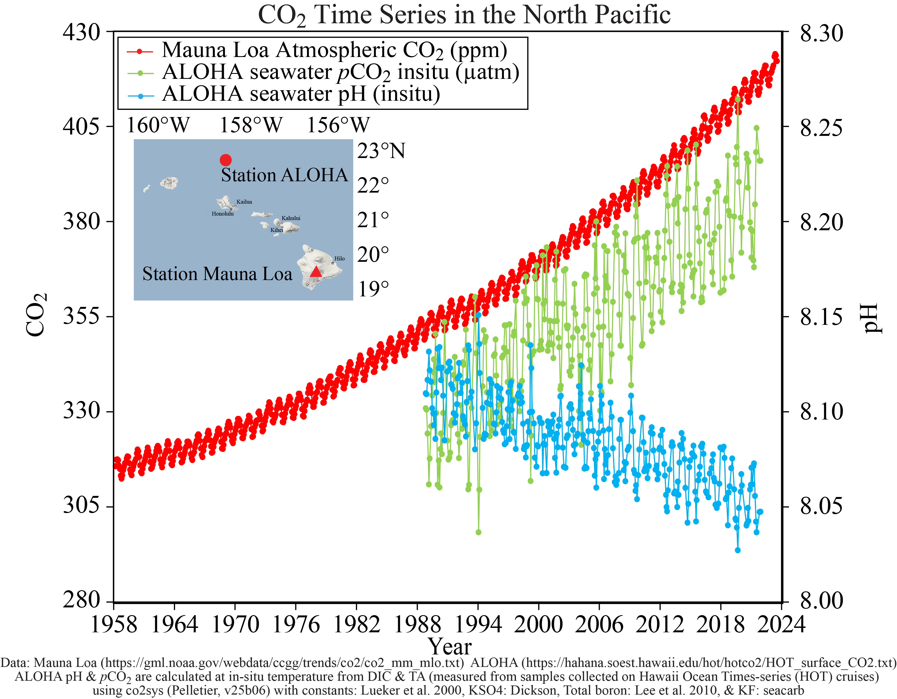{.r-stretch}

::: {style="font-size: 1.2em; text-align: center; margin-top: 10px;"}
As the CO₂ in the air rises (Mauna Loa), the ocean absorbs more (Station ALOHA) — and its pH falls in lockstep.
:::

## See It: The Evil Twin of Climate Change



::: {style="font-size: 1.1em; margin-top: 10px; color: #7f8c8d; text-align: center;"}
*Triona McGrath, TEDx (~9 min). An oceanographer explains how CO₂ is changing the ocean's chemistry — and why it matters for everything that lives in it.*
:::

## {background-color="#000000"}

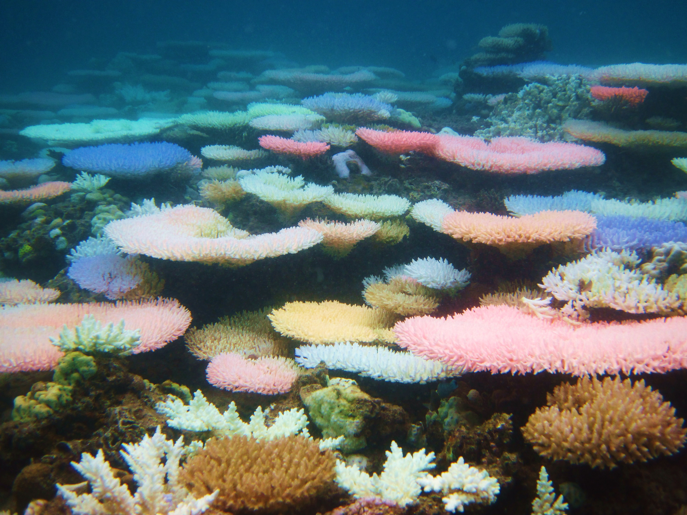{.r-stretch}

::: {.w8-hero-cap}
This is not beauty. This is a death signal.
:::

::: {.w8-hero-credit}
Coral under heat stress can glow fluorescent before it bleaches
:::

## Coral: The Double Strike

:::: {.columns}
::: {.column width="48%"}
::: {style="background: #fdebd0; padding: 30px; border-radius: 15px; font-size: 1.2em; line-height: 1.55;"}
**Warming → bleaching**

Heat makes coral expel the algae that feed it and give it colour. If the heat lasts for weeks, the coral starves.
:::
:::

::: {.column width="4%"}
:::

::: {.column width="48%"}
::: {style="background: #d6eaf8; padding: 30px; border-radius: 15px; font-size: 1.2em; line-height: 1.55;"}
**Acidification → weaker skeletons**

Less carbonate to build with. Reefs grow more slowly and erode faster.
:::
:::
::::

::: {style="font-size: 1.25em; margin-top: 30px; line-height: 1.6;"}
Reefs cover **less than 1%** of the seafloor but shelter about **a quarter** of all marine species — and over **half a billion people** depend on them.
:::

::: {.w8-punch}
Warming bleaches them. Acidification weakens them. Together, they leave reefs little time to recover.
:::

## {background-color="#0a3d62"}

```{=html}
<div class="w8-tiles" style="grid-template-columns: repeat(3, 1fr);">
  <div class="w8-tile" style="background:#0e4b77;"><b>½</b><span>of the world's living coral cover lost since the 1950s</span></div>
  <div class="w8-tile" style="background:#0e4b77;"><b>84%</b><span>of the world's reef area hit by bleaching-level heat, 2023–2025</span></div>
  <div class="w8-tile" style="background:#0e4b77;"><b>70–90%</b><span>more of today's reefs lost at 1.5°C of warming — over 99% at 2°C</span></div>
</div>
```

::: {style="font-size: 1.3em; color: white; text-align: center; margin-top: 44px;"}
The 2023–25 event was the largest bleaching on record. The previous record was 68% of reef area (2014–17).
:::

::: {.w8-src}
Eddy et al. (2021), *One Earth* · NOAA Coral Reef Watch (2026) · IPCC *Global Warming of 1.5°C* (2018)
:::

## See It: How Dead Is the Great Barrier Reef?



::: {style="font-size: 1.1em; margin-top: 10px; color: #7f8c8d; text-align: center;"}
*Vox (~6 min). "Have we really killed the Great Barrier Reef? No. But we sure are trying." Coral bleaching explained with the discomfort intact.*
:::

# Part 4 · Phytoplankton Under Pressure {background-color="#0a3d62"}

[Engine 3 runs on tiny algae. Here's what we know — and what we don't yet.]{.w8-sub}

## Small Cells, Planet-Sized Job

:::: {.columns}
::: {.column width="50%"}
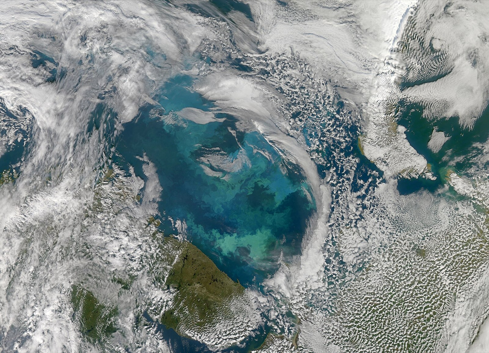

::: {.w8-src style="margin-top: 0;"}
A phytoplankton bloom in the Barents Sea, seen from space — NASA Earth Observatory, 2010
:::
:::

::: {.column width="50%"}
::: {style="font-size: 1.1em; line-height: 1.5;"}
- **Phytoplankton** are microscopic algae drifting in the sunlit surface
- They do about **half of all photosynthesis on Earth** — nearly as much as every forest, field and grassland combined
- They feed almost all ocean life — and drive **Engine 3**
- They are also the part of the machine we understand **least**
:::
:::
::::

::: {.w8-src}
Field et al. (1998), *Science*: the ocean fixes about 48.5 of the 104.9 billion tonnes of carbon fixed by photosynthesis each year
:::

## Four Pressures on Phytoplankton

```{=html}
<div class="w8-cards" style="grid-template-columns: 1fr 1fr;">
  <div class="w8-card" style="background:#eaf2f8;"><div class="h">Warming puts a lid on the ocean <span class="w8-tag emerging">Emerging</span></div>A warm surface layer mixes less with the cold, nutrient-rich water below. Models: global production <b>−8.6% ± 7.9%</b> by the 2090s under very high emissions. The error bar is almost as big as the number.</div>
  <div class="w8-card" style="background:#eaf2f8;"><div class="h">Acidification <span class="w8-tag emerging">Emerging</span></div>Plankton that build chalky shells — coccolithophores, sea butterflies — find it harder. The chemistry is settled; the effect on whole ecosystems is still being measured.</div>
  <div class="w8-card" style="background:#fdebd0;"><div class="h">Microplastics <span class="w8-tag emerging">Emerging</span></div>Studies find less photosynthesis, and plankton waste that sinks more slowly. More on the next slide.</div>
  <div class="w8-card" style="background:#eaf2f8;"><div class="h">Fewer whales <span class="w8-tag emerging">Emerging</span></div>Whaling cut great whale numbers by <b>66–90%</b>. Fewer whales means less fertiliser at the surface. The carbon cost is still being estimated.</div>
</div>
```

::: {.w8-src}
Bopp et al. (2013), *Biogeosciences* · Laufkötter et al. (2015): of nine models, five project a decline, three no clear trend, one an increase · Roman et al. (2014), *Frontiers in Ecology and the Environment*
:::

## The New Research: Microplastics in the Pump [Emerging]{.w8-tag .emerging}

::: {style="font-size: 1.25em; line-height: 1.55;"}
- **Less photosynthesis.** A 2025 global analysis found microplastics cut photosynthesis by **7–12%** across plants and algae. Estimated loss for the ocean's production: **0.3–7%**.
- **Slower sinking.** Zooplankton that eat microplastics make faecal pellets that sink **2.25× more slowly** — so less carbon reaches the deep.
- **Small — so far.** A 2023 model put the lost uptake at about **0.24%** of our emissions by 2100.
:::

::: {.w8-punch}
A real mechanism with an uncertain size. Watch it — don't exaggerate it.
:::

::: {.w8-src}
Zhu et al. (2025), *PNAS* · Cole et al. (2016), *Environmental Science & Technology* · modelling study, *Frontiers in Marine Science* (2023)
:::

## How Sure Are We?

:::: {.columns}
::: {.column width="48%"}
::: {style="background: #1e8449; color: white; padding: 30px; border-radius: 15px; font-size: 1.1em; line-height: 1.5;"}
**Settled physics** — IPCC-grade

::: {.nonincremental}
- Warmer water holds less CO₂
- Acidification uses up the ocean's buffer
- A warmer surface mixes less with the deep
- The more we emit, the smaller the share absorbed
:::
:::
:::

::: {.column width="4%"}
:::

::: {.column width="48%"}
::: {.fragment}
::: {style="background: #ca6f1e; color: white; padding: 30px; border-radius: 15px; font-size: 1.1em; line-height: 1.5;"}
**Emerging science** — real, still being sized

::: {.nonincremental}
- How much phytoplankton will decline
- Microplastics and the pump
- Whales as fertiliser
- Trawling's carbon release (Part 6)
:::
:::
:::
:::
::::

::: {.fragment style="font-size: 1.3em; margin-top: 28px; font-weight: bold; color: #8e44ad; text-align: center;"}
The physics is certain. The biology is alarming. Overstating it would be the Doubt Machine's trick in reverse.
:::

# Part 5 · Plastic and the Gyres {background-color="#0a3d62"}

[A fossil-fuel product, gathered by the ocean's own currents.]{.w8-sub}

## {background-color="#000000"}

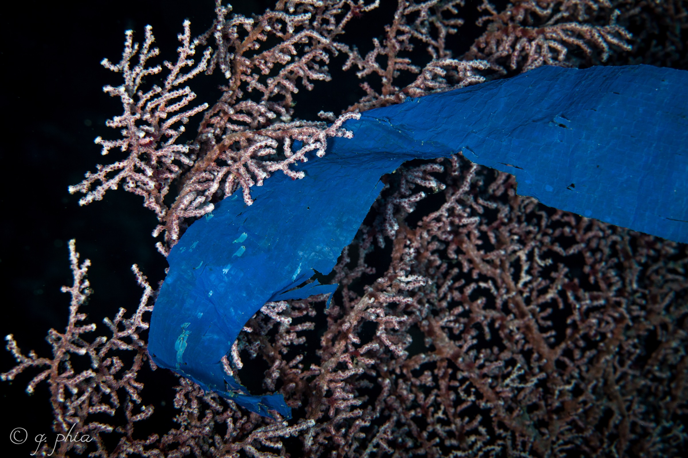{.r-stretch}

::: {.w8-hero-cap}
The coral took decades to grow. The bag took seconds to drop.
:::

::: {.w8-hero-credit}
A plastic bag draped over a fan coral — Wakatobi, Indonesia
:::

## The Great Pacific Garbage Patch

:::: {.columns}
::: {.column width="52%"}
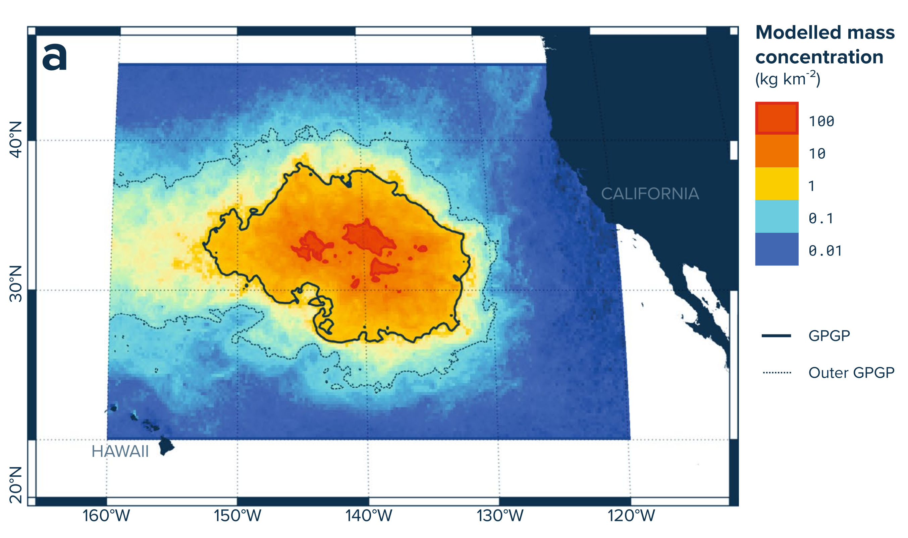
:::

::: {.column width="48%"}
::: {style="font-size: 1.1em; line-height: 1.5;"}
- **1.6 million km²** — about three times the size of France
- At least **79,000 tonnes** of plastic in **1.8 trillion pieces**
- Microplastics are **94% of the pieces** — but only **8% of the mass**
- Fishing nets: **at least 46% of the mass**
:::
:::
::::

::: {style="font-size: 1.2em; margin-top: 20px; background: #f9e79f; padding: 20px; border-radius: 10px;"}
Not a floating island — a **plastic soup** in the middle of the North Pacific gyre. You could sail through it and barely notice.
:::

::: {.w8-src}
Lebreton et al. (2018), *Scientific Reports* 8, 4666 · map: modelled plastic concentration
:::

## Plastic Is a Fossil-Fuel Product [Settled]{.w8-tag .settled}

::: {style="font-size: 1.3em; line-height: 1.6;"}
- Made from **oil and gas** — over **400 million tonnes** a year
- Its life cycle produces **3.4%** of the world's greenhouse-gas emissions
- On current trends, plastic could take **20% of all oil** by 2050
- As it breaks down in sunlight, it releases **methane and ethylene**
- Microplastics have been found in **human blood** and **placentas**
:::

::: {.w8-punch}
In the sea, microplastics enter the plankton food web — the base of Engine 3.
:::

::: {.w8-src}
OECD *Global Plastics Outlook* (2022) · Ellen MacArthur Foundation (2016) · Royer et al. (2018), *PLOS ONE* · Leslie et al. (2022); Ragusa et al. (2021)
:::

## {background-color="#1a1a2e"}

::: {style="font-size: 1.9em; color: white; text-align: center; line-height: 1.6;"}
The fossil-fuel industry makes the plastic.

The plastic gathers in the gyres — and may weaken the carbon pump.

The CO₂ from the same fuels warms and acidifies that ocean.

[**The industry that caused climate change is also degrading the system that regulates it.**]{style="color: #e74c3c;"}
:::

# Part 6 · Trawling: Scraping the Vault {background-color="#0a3d62"}

[Engine 3 sends carbon to the seabed. Then we drag nets across it.]{.w8-sub}

## {background-color="#000000"}

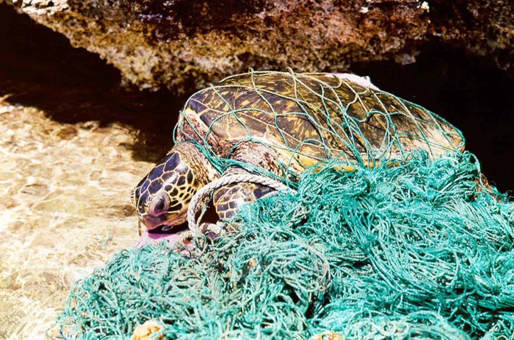{.r-stretch}

::: {.w8-hero-cap}
At least 46% of the plastic in the Pacific garbage patch is fishing gear. Meet the industry that left it there.
:::

## What Is Bottom Trawling?

:::: {.columns}
::: {.column width="44%"}
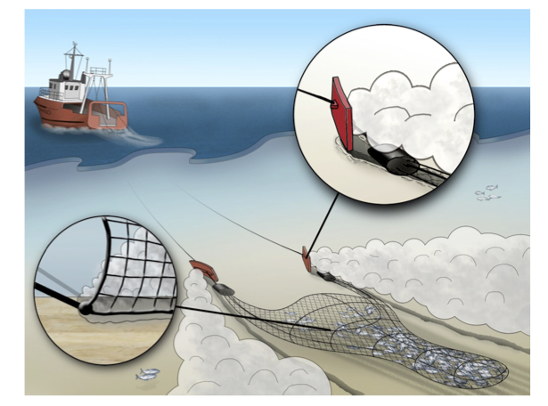{width="100%"}

::: {.w8-src style="margin-top: 0;"}
Drawing: Ferdinand Oberle / USGS (public domain)
:::
:::

::: {.column width="56%"}
::: {style="font-size: 1.1em; line-height: 1.5;"}
- A cone-shaped net held open by heavy steel **"doors"** and **dragged along the seabed**
- Lands about **19 million tonnes** of fish and shellfish a year — roughly **a quarter** of all wild-caught marine fish
- In the regions studied, **14%** of the continental shelf and slope is trawled — over **50%** in some European seas
- Every pass lifts a **cloud of sediment** behind the net
:::
:::
::::

::: {.w8-src}
Amoroso et al. (2018), *PNAS*: bottom-trawl footprints across 24 regions of continental shelf and slope, 0–1,000 m deep
:::

## What It Leaves Behind {background-color="#000000"}

:::: {.columns}
::: {.column width="38%"}
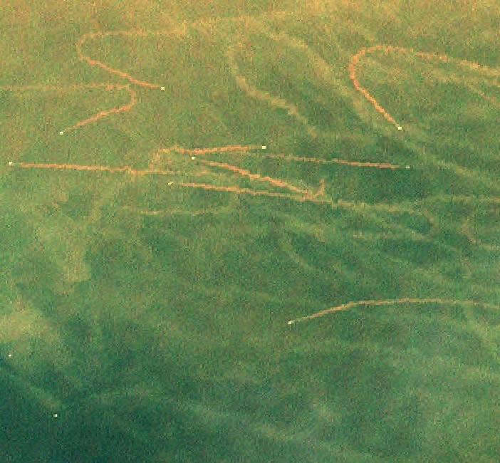{width="100%"}

::: {style="font-size: 0.7em; color: #dddddd; line-height: 1.4;"}
**From space:** mud plumes trailing behind trawlers off the coast of Louisiana (Landsat, public domain)
:::
:::

::: {.column width="62%"}
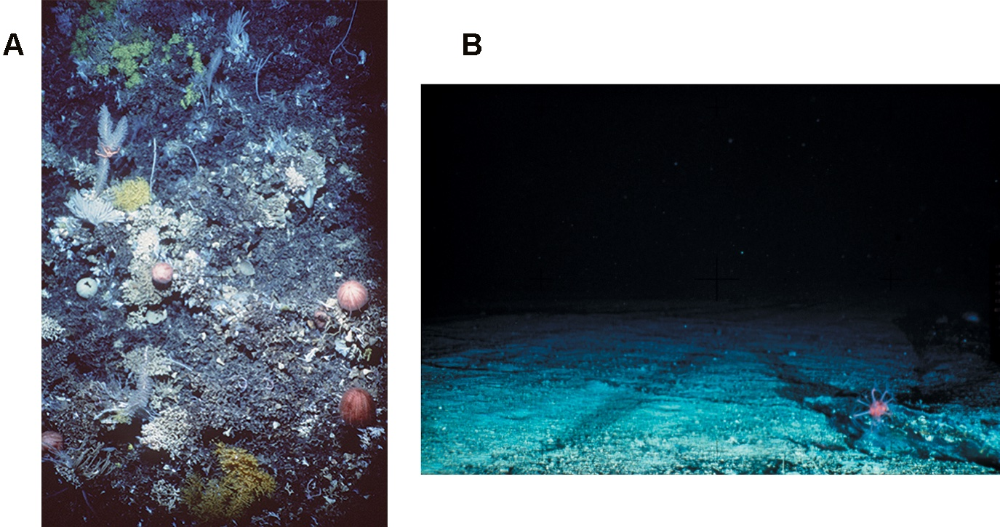{width="100%"}

::: {style="font-size: 0.7em; color: #dddddd; line-height: 1.4;"}
**On the seabed:** (A) an untrawled seamount; (B) a trawled one, both 1,000–2,000 m deep (CSIRO Marine Research, via Gewin 2004, *PLOS Biology*, CC BY 2.5)
:::
:::
::::

## The Vault: Why the Seabed Matters

::: {style="font-size: 1.35em; text-align: center; line-height: 1.5;"}
The top metre of the seafloor holds about **3,100 billion tonnes of carbon** —

roughly **3.5 times** all the carbon in the atmosphere.
:::

```{=html}
<div class="w8-chain">
  <div class="step"><b>1 · Stir</b>A trawl churns up sediment that took centuries to settle.</div>
  <div class="to fragment" data-fragment-index="1">→</div>
  <div class="step fragment" data-fragment-index="1"><b>2 · Release</b>Microbes turn the exposed carbon into CO₂ in the seawater — locally acidifying it.</div>
  <div class="to fragment" data-fragment-index="2">→</div>
  <div class="step fragment" data-fragment-index="2"><b>3 · Escape</b>Over the following years, part of that CO₂ reaches the air.</div>
</div>
```

::: {.fragment fragment-index="3" style="font-size: 1.2em; margin-top: 26px; text-align: center;"}
Only about **2%** of this seabed carbon lies in highly or fully protected areas.
:::

::: {.w8-src}
Atwood et al. (2020; corrected 2021), *Frontiers in Marine Science*: about 3,117 billion tonnes of carbon in the top metre of marine sediments
:::

## How Much CO₂? The Number Changed

:::: {.columns}
::: {.column width="48%"}
::: {style="background: #f4ecf7; padding: 30px; border-radius: 15px; font-size: 1.1em; line-height: 1.5;"}
**2021 · Sala et al., *Nature*** [Debated]{.w8-tag .debated}

**0.6–1.5 billion tonnes of CO₂ a year** released **into seawater** — rounded everywhere to "1 billion, as much as aviation". Critics say it is far too high.
:::
:::

::: {.column width="4%"}
:::

::: {.column width="48%"}
::: {.fragment}
::: {style="background: #fdebd0; padding: 30px; border-radius: 15px; font-size: 1.1em; line-height: 1.5;"}
**2024 · Atwood et al., *Frontiers*** [Emerging]{.w8-tag .emerging}

Only part of it reaches **the air**: 55–60% over 7–9 years — about **0.34–0.37 billion tonnes a year.**
:::
:::
:::
::::

::: {.fragment style="font-size: 1.25em; margin-top: 24px; text-align: center;"}
That is still **over a third** of global aviation's CO₂ (about 0.94 billion tonnes in 2024).
:::

::: {.fragment style="font-size: 1.2em; margin-top: 20px; background: #2c3e50; color: white; padding: 22px; border-radius: 10px; text-align: center;"}
This is **genuine uncertainty**, not manufactured doubt: published estimates with ranges, revised in the open. It passes Week 7's test.
:::

::: {.w8-src}
Sala et al. (2021), *Nature* 592, 397 · critique: Hiddink et al. (2023), *Nature* · Atwood et al. (2024), *Frontiers in Marine Science* · IATA: 942 million tonnes of gross aviation CO₂ in 2024
:::

::: {.notes}
Sala et al. estimated CO₂ produced in seawater when trawled sediment is remineralised. Atwood et al. (the same group, with NASA climate modellers) asked how much of it reaches the atmosphere. Hiddink et al. (2023, Nature) argue the 2021 method overstates the release by several orders of magnitude, because it applies the decay rate of fresh surface carbon to all sediment; fisheries scientist Ray Hilborn makes a similar point about the 2024 paper. Students should be able to state the range, not one number.
:::

## Paid to Do It

::: {style="font-size: 1.5em; text-align: center;"}
[**US\$35.4 billion**]{style="color: #c0392b; font-size: 1.6em;"}

in global fisheries subsidies (2018)
:::

::: {style="font-size: 1.2em; line-height: 1.6; margin-top: 20px;"}
- **US\$22.2 billion** of it is "capacity-enhancing" — cheap fuel, new boats, new gear: the kind that drives overfishing
- **22%** of all fisheries subsidies are for fuel
- Five governments — China, the EU, the US, South Korea and Japan — pay **58%**
:::

::: {.w8-punch}
Week 6's Tragedy of the Commons — with a receipt.
:::

::: {.w8-src}
Sumaila et al. (2019), "Updated estimates and analysis of global fisheries subsidies", *Marine Policy* 109
:::

# Part 7 · Back to Hong Kong {background-color="#0a3d62"}

[One of the few places that has actually banned trawling.]{.w8-sub}

## {background-color="#000000"}

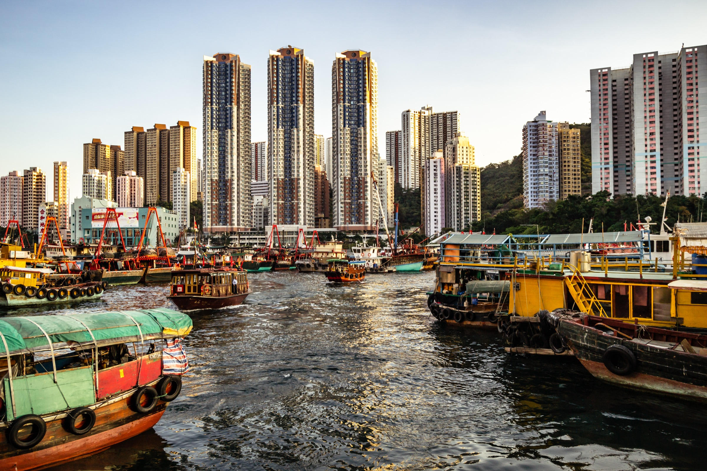{.r-stretch}

::: {.w8-hero-cap}
This is Hong Kong's relationship with the sea. It's older than the skyline.
:::

::: {.w8-hero-credit}
Fishing boats in Aberdeen Harbour, Hong Kong
:::

## The Ban — and the Deal

::: {style="font-size: 1.25em; line-height: 1.6;"}
- **May 2011:** the Legislative Council passes the ban. **31 December 2012:** trawling ends in Hong Kong waters.
- **HK\$1,726.8 million** one-off package: allowances for trawler owners, a voluntary buy-back of boats, grants for local deckhands, and training and loans to switch to other fishing.
- **2014:** a HK\$500 million Sustainable Fisheries Development Fund.
- **The friction:** **858 appeals** from trawler owners over the size of their payouts (to October 2015).
:::

::: {.w8-src}
LegCo Finance Committee approval, 10 June 2011 · Government reply to LegCo, 30 November 2016 (HK\$953 million paid out by then)
:::

## Did It Work?

::: {style="font-size: 1.25em; line-height: 1.6;"}
- **East and west waters: recovery.** Fish abundance, biomass and average trophic level rose. Predatory crabs in eastern waters: **86 → 516 per km²** (2004 vs 2015–16).
- **Southern waters: no clear gain** — in places, declines.
- **Why the difference?** Land reclamation, illegal trawling, and more fishing with other gear.
:::

::: {.w8-punch}
A ban, a funded transition — and a partial recovery. Real policy is messy. (Week 6.)
:::

::: {.w8-src}
Survey of demersal fish three years after the ban, *Reviews in Fish Biology and Fisheries* (2021) · City University of Hong Kong & HKBU study (2021)
:::

## Who Gets to Study the Ocean?

::: {style="font-size: 1.2em; line-height: 1.6;"}
- **Who holds the tools:** research ships, funding and data are concentrated in a handful of wealthy countries.
- **Who holds the memory:** Hong Kong's fishing families know grounds, seasons and spawning runs that were never written down — knowledge that fades as the fleet shrinks.
- **Elsewhere:** Inuit hunters have documented thinning, later-forming sea ice from decades of travelling on it — observations now used alongside satellite records.
- **Community-managed marine areas** can work where communities hold rights — but evidence on their outcomes is still thin.
:::

::: {style="font-size: 1.25em; margin-top: 20px; font-weight: bold; color: #8e44ad;"}
Decolonizing isn't rejecting science. It's asking whose knowledge — and whose seas — get counted.
:::

::: {.w8-src}
UNESCO *Global Ocean Science Report* (2020) · Krupnik & Jolly (eds.), *The Earth Is Faster Now* (2002) · Jupiter et al. (2014), *Pacific Conservation Biology*
:::

# Part 8 · The Debate {background-color="#0a3d62"}

[Is the ocean a carbon sink to protect — or a food system to manage?]{.w8-sub}

## Two Sides. Two Ways to See the Ocean.

::: {style="display: flex; justify-content: space-around; margin-top: 50px;"}
::: {style="text-align: center; width: 45%; background: #27ae60; color: white; padding: 50px; border-radius: 15px;"}
::: {style="font-size: 2.1em; font-weight: bold; white-space: nowrap;"}
PRO-CLIMATE
:::
::: {style="font-size: 1.3em; margin-top: 20px;"}
= The ocean is a climate machine

= "Protect the sink first"
:::
::: {style="font-size: 0.95em; margin-top: 22px; opacity: 0.92;"}
It takes ~29% of our CO₂ — a share that shrinks as we emit more
:::
:::

::: {style="text-align: center; width: 45%; background: #3498db; color: white; padding: 50px; border-radius: 15px;"}
::: {style="font-size: 2.1em; font-weight: bold; white-space: nowrap;"}
PRO-DEVELOPMENT
:::
::: {style="font-size: 1.3em; margin-top: 20px;"}
= The ocean is a food system

= "Feed people first"
:::
::: {style="font-size: 0.95em; margin-top: 22px; opacity: 0.92;"}
It supplies a fifth of the animal protein for 3.2 billion people
:::
:::
:::

::: {.w8-src style="text-align: center;"}
Global Carbon Budget 2025 (ocean share of CO₂ emissions, 2015–2024) · FAO, *The State of World Fisheries and Aquaculture* (2024): aquatic foods supply at least 20% of animal protein for 3.2 billion people
:::

## The Core Tension

::: {style="font-size: 1.35em; line-height: 1.5;"}
| [PRO-CLIMATE]{style="color: #27ae60; font-weight: bold;"} | [PRO-DEVELOPMENT]{style="color: #3498db; font-weight: bold;"} |
|-------------|-----------------|
| [Restrict]{style="color: #27ae60;"} industrial fishing to protect the carbon sink | [Scale]{style="color: #3498db;"} sustainable fishing to feed the world |
| [Ban]{style="color: #27ae60;"} bottom trawling — it stirs up the seabed's carbon | [Manage]{style="color: #3498db;"} trawling — zoning and gear rules save jobs |
| [Act]{style="color: #27ae60;"} on the settled physics — the sink is slowing | [Start]{style="color: #3498db;"} with what's proven — the trawling numbers are still debated |
| The ocean is a [climate system]{style="color: #27ae60;"} | The ocean is a [food system]{style="color: #3498db;"} |
:::

::: {style="font-size: 1.3em; text-align: center; margin-top: 30px; font-weight: bold;"}
Both are true. The debate is about **which comes first when they collide.**
:::

## Why This Motion?

::: {style="font-size: 1.3em; line-height: 1.8;"}
This debate connects three scales — and everything we covered today:
:::

::: {style="display: flex; justify-content: space-around; margin-top: 20px;"}
::: {style="text-align: left; width: 30%; background: #0a3d62; color: white; padding: 25px; border-radius: 10px;"}
::: {style="font-size: 1.2em; font-weight: bold;"}
Local (Hong Kong)
:::
::: {style="font-size: 1.05em; line-height: 1.5; margin-top: 10px;"}
Hong Kong banned trawling in 2012 and paid HK\$1.7 billion to ease the transition. East and west waters recovered; the south didn't. **Can the model scale — and who pays?**
:::
:::

::: {style="text-align: left; width: 30%; background: #2c3e50; color: white; padding: 25px; border-radius: 10px;"}
::: {style="font-size: 1.2em; font-weight: bold;"}
Global (Food and Money)
:::
::: {style="font-size: 1.05em; line-height: 1.5; margin-top: 10px;"}
Bottom trawling lands about a quarter of wild-caught fish. Fishing also gets US\$35 billion a year in subsidies. **Yet the Paris Agreement mentions the ocean only once.**
:::
:::

::: {style="text-align: left; width: 30%; background: #78281f; color: white; padding: 25px; border-radius: 10px;"}
::: {style="font-size: 1.2em; font-weight: bold;"}
Physics (The Machine)
:::
::: {style="font-size: 1.05em; line-height: 1.5; margin-top: 10px;"}
The ocean absorbs ~29% of our CO₂ and gets less effective as we emit more: **that much is settled.** How much trawling adds is **still debated.**
:::
:::
:::

## This Week's Debate Motion

::: {style="font-size: 1.8em; text-align: center; background: #2c3e50; color: white; padding: 50px; border-radius: 15px;"}
**"This house believes that industrial fishing should be regulated as a climate problem under the Paris Agreement — even at a cost to fishing jobs and food supply."**
:::

::: {style="display: flex; justify-content: space-between; gap: 50px; margin-top: 36px; text-align: left;"}
::: {style="flex: 1; border-left: 10px solid #27ae60; padding: 4px 0 4px 26px; font-size: 1.1em; line-height: 1.5;"}
[PRO-CLIMATE]{style="color: #27ae60; font-weight: 800;"}\
The ocean's carbon sink is weakening, and trawling may add over a third of aviation's CO₂ — backed by US\$35 billion a year in subsidies. Hong Kong showed a funded ban can work.
:::
::: {style="flex: 1; border-left: 10px solid #3498db; padding: 4px 0 4px 26px; font-size: 1.1em; line-height: 1.5;"}
[PRO-DEVELOPMENT]{style="color: #3498db; font-weight: 800;"}\
Aquatic foods supply a fifth of the animal protein for 3.2 billion people. The trawling number is still disputed, and the poorest fishers would pay first. Fix fishing with fishing rules.
:::
:::

::: {style="font-size: 1.05em; text-align: center; margin-top: 30px; color: #7f8c8d;"}
Both sides have real evidence. Label yours: [Settled]{.w8-tag .settled} [Emerging]{.w8-tag .emerging} [Debated]{.w8-tag .debated}
:::

# Role-Play: Who Speaks for the Ocean?

#

```{=html}
<style>
  #w8groupAssignment_container { text-align: center; margin-top: 20px; font-family: Arial, sans-serif; }
  #w8groupAssignment_startButton { font-size: 24px; padding: 15px 30px; cursor: pointer; background-color: #3498db; color: white; border: none; border-radius: 5px; transition: background-color 0.3s; }
  #w8groupAssignment_startButton:hover { background-color: #2980b9; }
  #w8groupAssignment_overlay { position: fixed; top: 0; left: 0; width: 100%; height: 100%; background-color: rgba(255,255,255,0.9); display: none; justify-content: center; align-items: center; z-index: 1000; }
  #w8groupAssignment_display { font-size: 36px; text-align: center; padding: 20px; max-width: 90%; max-height: 90%; overflow-y: auto; }
  #w8groupAssignment_display h2 { color: #2c3e50; font-size: 48px; margin-bottom: 30px; }
  #w8groupAssignment_display ul { list-style-type: none; padding: 0; }
  #w8groupAssignment_display li { margin: 20px 0; font-size: 36px; background-color: #ecf0f1; padding: 15px; border-radius: 10px; box-shadow: 0 2px 5px rgba(0,0,0,0.1); }
  #w8groupAssignment_closeButton { position: absolute; top: 20px; right: 20px; font-size: 24px; cursor: pointer; background-color: #e74c3c; color: white; border: none; border-radius: 5px; padding: 10px 20px; }
</style>
<div id="w8groupAssignment_container">
  <h1 style="font-size: 48px; color: #34495e;">Group Assignment Time!</h1>
  <button id="w8groupAssignment_startButton">Start the assignment</button>
</div>
<div id="w8groupAssignment_overlay">
  <div id="w8groupAssignment_display"></div>
  <button id="w8groupAssignment_closeButton">Close</button>
</div>
<script>
const W8GroupAssignment = {
  groups: ['Group One','Group Two','Group Three','Group Four','Group Five','Group Six'],
  vocations: ['Local Fisherman','Marine Scientist','Policy Maker/Government','Fishing Industry Rep','Conservation NGO','Consumer/General Public'],
  shuffleArray: function(a){for(let i=a.length-1;i>0;i--){const j=Math.floor(Math.random()*(i+1));[a[i],a[j]]=[a[j],a[i]];}return a;},
  createAssignment: function(){const s=this.shuffleArray([...this.vocations]);return this.groups.map((g,i)=>({group:g,vocation:s[i]}));},
  displayAssignment: function(){const a=this.createAssignment();let h='<h2>Random Group Assignments</h2><ul>';a.forEach(x=>{h+=`<li><strong>${x.group}:</strong> ${x.vocation}</li>`;});h+='</ul>';document.getElementById('w8groupAssignment_display').innerHTML=h;document.getElementById('w8groupAssignment_overlay').style.display='flex';},
  init: function(){document.getElementById('w8groupAssignment_startButton').addEventListener('click',()=>this.displayAssignment());document.getElementById('w8groupAssignment_closeButton').addEventListener('click',()=>{document.getElementById('w8groupAssignment_overlay').style.display='none';});}
};
W8GroupAssignment.init();
</script>
```

## Presentation Countdown

```{=html}
<style>
  #w8timer {
    font-size: 348px;
    font-weight: 700;
    font-variant-numeric: tabular-nums;
    line-height: 1.1;
    margin-bottom: 20px;
    transition: color 0.6s ease;
  }
  #w8timer.w8timer-flash { animation: w8timer-pop 0.6s ease; }
  @keyframes w8timer-pop {
    0%   { transform: scale(1); }
    40%  { transform: scale(1.06); }
    100% { transform: scale(1); }
  }
  #w8timer-label { font-size: 40px; color: #7f8c8d; margin-bottom: 30px; min-height: 1.4em; }
  .w8timer-btn { font-size: 24px; padding: 15px 30px; color: white; border: none; border-radius: 8px; cursor: pointer; margin: 0 5px; }
  .w8timer-btn:disabled { opacity: 0.6; cursor: default; }
  #w8start-button { background-color: #27ae60; }
  #w8pause-button { background-color: #f39c12; }
  #w8reset-button { background-color: #e74c3c; }
  #w8timer-legend { display: flex; justify-content: center; gap: 28px; margin-top: 36px; font-size: 26px; color: #2c3e50; }
  #w8timer-legend span { display: inline-flex; align-items: center; gap: 8px; }
  #w8timer-legend i { display: inline-block; width: 22px; height: 22px; border-radius: 50%; }
</style>

<div id="w8timer-container" style="text-align: center;">
  <div id="w8timer">05:00</div>
  <div id="w8timer-label"></div>
  <button id="w8start-button" class="w8timer-btn">Start 5:00</button>
  <button id="w8pause-button" class="w8timer-btn" disabled>Pause</button>
  <button id="w8reset-button" class="w8timer-btn">Reset</button>
  <div id="w8timer-legend"></div>
</div>

<script>
(function () {
  const TOTAL = 300; // 5 minutes
  // One colour per minute, as on countdown_colors.qmd:
  // 5:00–4:01 slate, 4:00–3:01 blue, 3:00–2:01 green, 2:00–1:01 orange, final minute red.
  const BAND_COLORS = ['#2c3e50', '#2980b9', '#27ae60', '#f39c12', '#e74c3c'];
  const DONE_COLOR = '#8e44ad'; // Time's up

  const timerEl = document.getElementById('w8timer');
  const labelEl = document.getElementById('w8timer-label');
  const startBtn = document.getElementById('w8start-button');
  const pauseBtn = document.getElementById('w8pause-button');
  const resetBtn = document.getElementById('w8reset-button');
  const legendEl = document.getElementById('w8timer-legend');

  let timeLeft = TOTAL;
  let deadline = 0;
  let interval = null;
  let currentBand = -1;

  BAND_COLORS.forEach((c, i) => {
    const s = document.createElement('span');
    s.innerHTML = '<i style="background:' + c + '"></i>' + (BAND_COLORS.length - i) + ' min';
    legendEl.appendChild(s);
  });

  // 300..241 -> 0, 240..181 -> 1, ..., 60..1 -> 4, 0 -> done
  function bandFor(sec) {
    return sec <= 0 ? BAND_COLORS.length : BAND_COLORS.length - Math.ceil(sec / 60);
  }

  function render(animate) {
    const m = Math.floor(timeLeft / 60);
    const s = timeLeft % 60;
    timerEl.textContent = String(m).padStart(2, '0') + ':' + String(s).padStart(2, '0');

    const band = bandFor(timeLeft);
    if (band === currentBand) return;
    currentBand = band;
    if (band >= BAND_COLORS.length) {
      timerEl.style.color = DONE_COLOR;
      labelEl.textContent = "Time's up!";
    } else {
      const minsLeft = BAND_COLORS.length - band;
      timerEl.style.color = BAND_COLORS[band];
      labelEl.textContent = minsLeft === 1 ? 'Final minute' : minsLeft + ' minutes left';
    }
    if (animate) {
      timerEl.classList.remove('w8timer-flash');
      void timerEl.offsetWidth; // restart the pop animation
      timerEl.classList.add('w8timer-flash');
    }
  }

  function stop() {
    clearInterval(interval);
    interval = null;
    pauseBtn.disabled = true;
  }

  function tick() {
    // Count down from a deadline so a slow or throttled tab cannot stretch the five minutes.
    timeLeft = Math.max(0, Math.ceil((deadline - Date.now()) / 1000));
    render(true);
    if (timeLeft <= 0) {
      stop();
      startBtn.disabled = true;
      startBtn.textContent = 'Done';
    }
  }

  startBtn.addEventListener('click', () => {
    if (interval || timeLeft <= 0) return;
    deadline = Date.now() + timeLeft * 1000;
    interval = setInterval(tick, 250);
    startBtn.disabled = true;
    startBtn.textContent = 'Running…';
    pauseBtn.disabled = false;
  });

  pauseBtn.addEventListener('click', () => {
    stop();
    startBtn.disabled = false;
    startBtn.textContent = 'Resume';
  });

  resetBtn.addEventListener('click', () => {
    stop();
    timeLeft = TOTAL;
    currentBand = -1;
    startBtn.disabled = false;
    startBtn.textContent = 'Start 5:00';
    render(false);
  });

  render(false);
})();
</script>
```

## The Debate

::: {style="font-size: 1.35em; line-height: 1.7;"}
You will take **stakeholder positions**: Local Fisherman, Marine Scientist, Policy Maker, Fishing Industry Rep, Conservation NGO, Consumer — or whatever you see fit.

**Remember the three scales:**

- **Local** — what does this mean for Hong Kong's fishing communities?
- **Global** — what does this mean for the US\$35 billion subsidy system?
- **Physics** — what does this mean for the ocean's three engines?

Build arguments that connect all three — and label your evidence: settled, emerging or debated.
:::

## Ground Rules

::: {style="font-size: 1.5em; line-height: 1.8;"}
- This is a [**safe space**]{style="color: #27ae60;"} for exploration and discussion. There are [**no wrong answers**]{style="color: #e74c3c;"}, only opportunities to learn.

- **Respect** and **open-mindedness** are our guiding principles. Every opinion shared contributes to collective learning.

- **Feedback** and **reflection** are encouraged. This is a chance to voice thoughts, ask questions, and grow from the experience.
:::

## Pro-Climate Talking Points

::: {style="font-size: 1.2em; line-height: 1.6;"}
**Treat the ocean as climate infrastructure:**

- **The sink is slowing** — the ocean takes ~29% of our CO₂, and the more we emit, the smaller the share it absorbs [Settled]{.w8-tag .settled}
- **Trawling adds to it** — about 0.34–0.37 billion tonnes of CO₂ a year may reach the air: over a third of aviation [Emerging]{.w8-tag .emerging}
- **We pay for it** — fisheries get US\$35 billion a year in subsidies, US\$22 billion of it to grow fleets
- **It can be done** — Hong Kong banned trawling in 2012 with a HK\$1.7 billion support package, and its eastern and western waters recovered
:::

## Pro-Development Talking Points

::: {style="font-size: 1.2em; line-height: 1.6;"}
**Feed people first — and fix fishing with fishing rules:**

- **Fish feed people** — aquatic foods supply a fifth of the animal protein for 3.2 billion people, and trawling lands about a quarter of the wild catch
- **The number is still moving** — the trawling estimate has been revised since 2021, and critics say the model behind it still overstates the release [Debated]{.w8-tag .debated}
- **Hong Kong's model is costly and partial** — HK\$1.7 billion, 858 appeals, and southern waters didn't recover. Few countries can afford even that
- **Right problem, wrong tool** — zoning, gear limits and quotas target fishing directly, and since September 2025 a WTO deal bans subsidies for illegal fishing and overfished stocks
:::

# This Week's Conceptual Takeaway

## What You Can't See Still Matters Most

::: {style="font-size: 1.2em; line-height: 1.55; background: #0a3d62; color: white; padding: 36px 40px; border-radius: 15px;"}
Before this week, "climate change" might have felt like a *land* problem — cities, cars, factories.

Now you know: the ocean is the planet's **carbon-capture machine** — and we are slowing it down.

- **Settled:** warming and acidification make the ocean less effective — the more we emit, the smaller the share it absorbs
- **Emerging:** phytoplankton decline, microplastics, fewer whales and trawling may be adding to the damage
- **Honest position:** the settled physics alone is already a crisis — we don't need to exaggerate the rest
:::

::: {style="font-size: 1.3em; margin-top: 26px; font-weight: bold; color: #8e44ad; text-align: center;"}
**Your portable takeaway:** We are not just adding CO₂. We are breaking the machine that removes it.
:::

## Did We Decolonize?

::: {style="font-size: 1.3em; line-height: 1.7;"}
At the start, we named three narratives that colonized the ocean:

**1. The resource narrative** — "the ocean is fish and shipping lanes"\
→ It's a **climate machine** with three engines — and we are slowing all three.

**2. The consumer guilt narrative** — "stop using plastic straws"\
→ The big damage is **industrial**: fossil CO₂, plastic as a fossil product, nets as nearly half the garbage patch, subsidised trawling.

**3. The knowledge narrative** — "only peer-reviewed Western science counts"\
→ **Whose knowledge counts** — Hong Kong's fishers, Inuit observers — and who owns the research ships shapes what we see.
:::

::: {style="font-size: 1.2em; margin-top: 20px; font-style: italic; text-align: center; color: #7f8c8d;"}
Decolonizing doesn't mean rejecting science. It means asking: whose story shaped what you saw — and what you missed?
:::

## The Hero Image Lesson

::: {style="font-size: 1.35em; line-height: 1.65;"}
Notice what happened today. Most parts opened with **one image and one line**: an ocean planet, a glowing coral, a bag on a reef, a turtle in a net, a harbour.

**Why it works:**

- We remember pictures far better than words — the **picture superiority effect**
- Emotion lands before the argument — then the audience goes looking for the explanation
- But a hero image is only as honest as its caption. **Check the numbers behind yours.**
:::

::: {style="font-size: 1.3em; margin-top: 20px; font-weight: bold; color: #8e44ad;"}
Your challenge: find ONE image for your portfolio that does this. The rest of the deck is commentary.
:::

## The Semester So Far

```{=html}
<div class="w8-map">
  <div class="wk"><small>WEEK 1</small>Spectacle Formula</div><div class="les">Fact + human story + stakes. Data alone doesn't persuade.</div>
  <div class="wk"><small>WEEK 2</small>Complexity</div><div class="les">Rarely one right answer — that's not a bug, it's the point.</div>
  <div class="wk"><small>WEEK 3</small>System Boundaries</div><div class="les">Where you draw the boundary changes the answer.</div>
  <div class="wk"><small>WEEK 4</small>Timing</div><div class="les">When energy flows matters as much as how much.</div>
  <div class="wk"><small>WEEK 5</small>Built Environment</div><div class="les">Buildings are climate decisions. Hot cities heat themselves.</div>
  <div class="wk"><small>WEEK 6</small>Structural Incentives</div><div class="les">Every player acts rationally — the outcome is catastrophic.</div>
  <div class="wk last"><small>WEEK 7</small>The Doubt Machine</div><div class="les last">Accurate, nuanced facts can still be arranged to mislead.</div>
  <div class="wk now fragment" data-fragment-index="1"><small>WEEK 8</small>Invisible Infrastructure</div><div class="les now fragment" data-fragment-index="1">The ocean sink is slowing — the climate can speed itself up.</div>
</div>
<div class="w8-next">Still to come: Week 9 Responsibility Asymmetry · Week 10 Cascade Effects · Week 11 Perspective</div>
```

::: {.notes}
Two minutes. Ask: which of these lenses did you use in today's debate? Week 7's lesson is the subtle one: the Doubt Machine rarely lies outright. It arranges true, carefully qualified facts so that the picture they add up to is wrong.
:::

## Two Threads That Run to Week 11

```{=html}
<div class="w8-thread p">
  <div class="t">1 · Accurate facts can still mislead</div>
  <div class="w8-chain">
    <div class="step"><b>Week 3</b>Where you draw the boundary changes the answer</div>
    <div class="to">→</div>
    <div class="step"><b>Week 7</b>Correct, nuanced details arranged to manufacture doubt</div>
    <div class="to">→</div>
    <div class="step today"><b>Today</b>Label every claim: settled, emerging or debated</div>
    <div class="to">→</div>
    <div class="step"><b>Week 11</b>No framing is neutral — not even yours</div>
  </div>
</div>
<div class="w8-thread r fragment" data-fragment-index="1">
  <div class="t">2 · The climate can speed itself up</div>
  <div class="w8-chain">
    <div class="step"><b>Week 5</b>A hotter city runs more air-con, which makes it hotter</div>
    <div class="to">→</div>
    <div class="step today"><b>Today</b>A warmer ocean absorbs less CO₂, which warms it more</div>
    <div class="to">→</div>
    <div class="step"><b>Week 10</b>Ice, permafrost, tipping points: loops that feed themselves</div>
    <div class="to">→</div>
    <div class="step"><b>Week 11</b>A cascade in orbit: space debris</div>
  </div>
</div>
```

::: {.fragment .w8-punch fragment-index="2" style="text-align: center;"}
Week 8 is where they cross: a loop that speeds itself up, told with labels that keep us honest.
:::

::: {.notes}
Week 10 builds directly on today's loop (ice–albedo, permafrost, tipping points). Week 11 returns to both threads: the Kessler cascade of space debris, and Strategy #10, the reminder that your own framing is never neutral.
:::

# The Persuasion Playbook | Strategy #7

## The Fork

::: {style="font-size: 1.6em; background: #2c3e50; color: white; padding: 40px; border-radius: 10px;"}
*"Are you going to let your family suffer, or are you going to act now?"*

The trick isn't the answer.

**The trick is that both options accept your frame.**
:::

## The Science

::: {style="font-size: 1.4em; line-height: 1.8;"}
This is the **False Dilemma** — or in sales, **The Fork**.

Present two choices that both serve your goal.

*"Do you want the red one or the blue one?"*
(Not: "Do you want to buy a car?")

The brain loves binary choices. Multiple options = paralysis.

**Two options = decision.**
:::

## You Just Saw It

::: {style="font-size: 1.5em; line-height: 1.7;"}
Listen back to today's debate. Someone probably said:

*"Either we ban bottom trawling now, or we keep scraping the seabed's carbon into the air."*

Notice what's missing?

**Zoning, gear changes, quotas, a funded phase-out — the middle options.** They weren't on the table, because the speaker didn't put them there.
:::

## Next Week's Challenge

::: {style="font-size: 2em; background: #e74c3c; color: white; padding: 40px; border-radius: 10px; text-align: center;"}
**End with two options — both of which support your case.**

Remove the third option before they think of it.
:::

## Next Week: Climate Displacement

::: {style="font-size: 1.45em; line-height: 1.7; background: #2c3e50; color: white; padding: 40px; border-radius: 15px;"}
Next week, we meet the people who are **already losing their homes to the sea** — in Tuvalu, in Bangladesh, and on Hong Kong's own coast.

**Responsibility asymmetry:** the people who suffer most are not the ones who caused it.
:::

## Further Reading and Sources

::: {style="font-size: 0.6em; line-height: 1.45; column-count: 2; column-gap: 70px; text-align: left;"}
Friedlingstein, P. et al. (2026). Global Carbon Budget 2025. *Earth System Science Data* 18, 3211. [Link](https://essd.copernicus.org/articles/18/3211/2026/)

IPCC (2021). *Climate Change 2021: The Physical Science Basis*, Summary for Policymakers, Fig. SPM.7. [Data](https://catalogue.ceda.ac.uk/uuid/b1ad4c02319b438884a72fea34cb5a18/)

Müller, J. D., Gruber, N. et al. (2025). Unexpected decline in the ocean carbon sink under record-high sea surface temperatures in 2023. *Nature Climate Change*.

Hauck, J. & Völker, C. (2015). *Geophysical Research Letters* — the Revelle factor and Southern Ocean CO₂ uptake. Jiang, L.-Q. et al. (2019). Surface ocean pH and buffer capacity. *Scientific Reports*.

Volk, T. & Hoffert, M. I. (1985). Ocean carbon pumps. AGU *Geophysical Monograph* 32. Field, C. B. et al. (1998). Primary production of the biosphere. *Science*.

Bopp, L. et al. (2013). *Biogeosciences* 10, 6225. Laufkötter, C. et al. (2015). *Biogeosciences*. Roman, J. et al. (2014). Whales as marine ecosystem engineers. *Frontiers in Ecology and the Environment*.

Zhu, R. et al. (2025). A global estimate of multiecosystem photosynthesis losses under microplastic pollution. *PNAS*. Cole, M. et al. (2016). Microplastics alter the properties and sinking rates of zooplankton faecal pellets. *Environmental Science & Technology*.

Smith, S. M. et al. (2024). *The State of Carbon Dioxide Removal*, 2nd edition.

Lebreton, L. et al. (2018). Evidence that the Great Pacific Garbage Patch is rapidly accumulating plastic. *Scientific Reports* 8, 4666. OECD (2022). *Global Plastics Outlook*.

Eddy, T. D. et al. (2021). Global decline in capacity of coral reefs to provide ecosystem services. *One Earth*. NOAA Coral Reef Watch (2026). IPCC (2018). *Global Warming of 1.5°C*.

Sala, E. et al. (2021). Protecting the global ocean for biodiversity, food and climate. *Nature* 592, 397. Atwood, T. B. et al. (2024). Atmospheric CO₂ emissions and ocean acidification from bottom-trawling. *Frontiers in Marine Science*. Atwood, T. B. et al. (2020). Global patterns in marine sediment carbon stocks. *Frontiers in Marine Science*.

Amoroso, R. O. et al. (2018). Bottom trawl fishing footprints on the world's continental shelves. *PNAS*. Sumaila, U. R. et al. (2019). Updated estimates and analysis of global fisheries subsidies. *Marine Policy* 109. WTO (2025). Agreement on Fisheries Subsidies enters into force, 15 September.

FAO (2024). *The State of World Fisheries and Aquaculture*. Legislative Council of Hong Kong, trawl-ban papers (2011); Government reply to LegCo (30 November 2016).

Images: NASA (Blue Marble; Earth Observatory bloom image by Norman Kuring) · USGS (trawl drawing, F. Oberle) · Landsat (Louisiana trawl plumes) · CSIRO Marine Research via Gewin (2004), *PLOS Biology*, CC BY 2.5.
:::
